# Cómo usar este dosier {.nobreak}

Este dosier recoge todo lo que entra en la UT1. Empieza por los ficheros, pasa a las bases de datos y sus modelos, y termina con los sistemas gestores (SGBD), su arquitectura y las bases de datos distribuidas. Está pensado para que puedas estudiar por tu cuenta, sin depender de haber copiado bien los apuntes en clase.

Encontrarás cuatro tipos de caja repartidos por el texto:

!!! definicion "Definición"
    Un término que tienes que saber explicar con tus palabras y reconocer cuando te lo preguntan con la definición formal.

!!! ejemplo "Ejemplo"
    Un caso concreto. Si entiendes el ejemplo, entiendes el concepto.

!!! ojo "Ojo"
    Un error típico o una confusión frecuente entre dos conceptos parecidos. Suelen caer en el examen.

!!! comprueba "Comprueba"
    Preguntas cortas al final de algunos apartados. Si no sabes responderlas sin mirar, vuelve atrás.

Los bloques se numeran del 1 al 6. Al final tienes un glosario, un mapa resumen y una autoevaluación para repasar.

## Qué vas a aprender

Al terminar esta UT deberías ser capaz de:

- **Explicar** qué es un fichero y de qué partes se compone (registro, campo, bloque).
- **Distinguir** los tipos de fichero según su función y según su organización, y elegir la más adecuada en cada caso.
- **Explicar** qué es una base de datos, qué problemas resuelve y qué son los metadatos.
- **Identificar** entidades y atributos a partir de un enunciado, y saber dónde se almacenan físicamente las bases de datos (SATA, SCSI, RAID, NAS, SAN).
- **Comparar** los modelos de bases de datos y saber cuál se usa hoy y por qué.
- **Describir** qué es un SGBD, sus funciones (DDL, DML y DCL) y sus componentes.
- **Explicar** los tres niveles de abstracción y la independencia lógica y física de los datos.
- **Clasificar** bases de datos y SGBD según distintos criterios.
- **Comparar** las bases de datos centralizadas y las distribuidas, y aplicar la fragmentación horizontal, vertical e híbrida.

## Índice

[**Bloque 1. Los ficheros**](#bloque-1-los-ficheros)\
1.1 Por qué empezamos por los ficheros, 1.2 Qué es un fichero, 1.3 Estructura interna, 1.4 Tipos según su función, 1.5 Soportes y tipos de acceso, 1.6 Organizaciones de ficheros, 1.7 Parámetros de utilización, 1.8 Los límites del enfoque de ficheros

[**Bloque 2. Las bases de datos**](#bloque-2-las-bases-de-datos)\
2.1 Qué es una base de datos, 2.2 Elementos, 2.3 Conceptos clave, 2.4 Quién las utiliza, 2.5 Dónde se usan, 2.6 Ubicación física de la información

[**Bloque 3. Los modelos de bases de datos**](#bloque-3-los-modelos-de-bases-de-datos)\
3.1 Qué es un modelo, 3.2 Jerárquico, 3.3 En red, 3.4 Relacional, 3.5 Orientado a objetos, 3.6 Objeto-relacional, 3.7 Otros modelos y NoSQL

[**Bloque 4. Los sistemas de gestión de bases de datos (SGBD)**](#bloque-4-los-sistemas-de-gestion-de-bases-de-datos-sgbd)\
4.1 Qué es un SGBD, 4.2 El SGBD y su entorno, 4.3 Ventajas, 4.4 Funciones, 4.5 Componentes

[**Bloque 5. Arquitectura y tipos**](#bloque-5-arquitectura-y-tipos)\
5.1 Los tres niveles de abstracción, 5.2 Independencia de datos, 5.3 Tipos de bases de datos, 5.4 Tipos de SGBD

[**Bloque 6. Bases de datos centralizadas y distribuidas**](#bloque-6-bases-de-datos-centralizadas-y-distribuidas)\
6.1 Centralizadas, 6.2 Distribuidas, 6.3 El SGBD distribuido, 6.4 Ventajas y desventajas, 6.5 La fragmentación, 6.6 Reglas de la fragmentación, 6.7 Fragmentación horizontal, vertical e híbrida

[**Material de repaso**](#material-de-repaso)\
Glosario, mapa resumen y autoevaluación

<!-- Fuente: dosieres UF1 Parte 1 y Parte 2 del curso pasado (Drive, «0484. Bases de datos/UF1/Markdown e imágenes»), unidos en un solo dosier. Las soluciones de la autoevaluación no se publican aquí. -->

# Bloque 1. Los ficheros

## 1.1 ¿Por qué empezamos por los ficheros?

Puede parecer raro empezar un módulo de bases de datos hablando de ficheros, que es lo que las bases de datos vinieron a sustituir. Hay dos motivos, y los dos son buenos:

**Primero, por historia.** En los años setenta las empresas informatizaban básicamente dos cosas: la contabilidad y la facturación. Hasta entonces esa información vivía en archivadores de papel, carpetas ordenadas por cliente o por fecha. Cuando llegó la informática, lo que se hizo fue lo más natural: copiar en digital lo que ya se hacía en papel. Las herramientas informáticas se diseñaron para que los elementos se parecieran a los que se manejaban manualmente. El elemento que permitió guardar datos de forma permanente en dispositivos de memoria masiva fue el **fichero** o **archivo**.

**Segundo, y más importante: por debajo, las bases de datos siguen siendo ficheros.** Cuando MySQL guarda una tabla, la guarda en ficheros del disco. Cuando crea un índice para acelerar una consulta, está aplicando la misma idea que los ficheros indexados que verás en el punto 1.6.3. Todo lo que aprendas en este bloque te va a reaparecer más adelante, pero disfrazado.

## 1.2 Qué es un fichero

!!! definicion "Definición: Fichero o archivo"
    Conjunto de información relacionada, tratada como un todo y organizada de forma estructurada.

Las tres partes de la definición importan y conviene desmenuzarlas:

- **«Información relacionada»**: Dentro de un fichero van datos que tienen algo que ver entre sí: los alumnos de un centro, los productos de un almacén, las facturas de un año. No se mezclan alumnos con facturas.
- **«Tratada como un todo»**: El fichero se abre, se copia, se mueve y se borra entero, como una unidad. Tiene un nombre y una identidad propia.
- **«Organizada de forma estructurada»**: No es un montón de datos sueltos. Hay una estructura repetitiva y previsible que permite que un programa sepa dónde empieza y dónde acaba cada dato.

La clave de todo es que esa estructura permite que los datos se puedan **añadir, suprimir, actualizar o consultar individualmente en cualquier momento**. Un fichero no es una foto congelada: es un almacén vivo.

## 1.3 Estructura interna de los ficheros

Un fichero se organiza en tres niveles, de mayor a menor. Esta jerarquía la tienes que tener clarísima porque es la base de todo lo demás.

### 1.3.1 Registro lógico

!!! definicion "Definición: Registro lógico"
    Conjunto de datos relativos a un mismo elemento u objeto.

Un registro es «una ficha». Si el fichero guarda los usuarios de una plataforma educativa, cada usuario es un registro.

### 1.3.2 Campo

!!! definicion "Definición: Campo"
    Cada una de las informaciones elementales que forman un registro.

Dentro de la ficha de un usuario, el nombre es un campo, el correo electrónico es otro, la fecha de alta es otro. Son las piezas mínimas con sentido propio.

### 1.3.3 Registro físico o bloque

Aquí es donde mucha gente se pierde, así que vamos despacio.

!!! definicion "Definición: Registro físico o bloque"
    Cantidad de información transferida entre el soporte de almacenamiento y la memoria principal en una sola operación de lectura/grabación.

Los ficheros suelen ser **muy voluminosos**: no caben enteros en la memoria principal. Por eso el ordenador no lee «el fichero», lee trocitos. Y no lee registro a registro, porque cada viaje al disco es lento: aprovecha cada viaje para traerse varios registros de golpe. Ese paquete es el bloque.

!!! definicion "Definición: Factor de blocaje"
    Número de registros lógicos que entran en un bloque. A la operación de agrupar varios registros en un bloque se le llama **bloqueo de registros**.

!!! ejemplo "Ejemplo: Factor de blocaje"
    Un fichero de alumnos tiene registros de 256 bytes. El sistema transfiere bloques de 4.096 bytes.

    Factor de blocaje = 4.096 ÷ 256 = **16 registros por bloque**.

    Si el fichero tiene 800 alumnos, hacen falta 800 ÷ 16 = **50 operaciones de lectura** para recorrerlo entero, no 800.

!!! ojo "Ojo: Lógico ≠ físico"
    El **registro lógico** es lo que ve el programador: una ficha. El **registro físico (bloque)** es lo que mueve el hardware: un paquete de fichas. Un bloque suele contener varios registros lógicos, y por eso se llaman «lógico» y «físico»: uno vive en tu cabeza y en tu código, el otro en el disco.

| Nivel | Qué es | Ejemplo en un fichero de alumnos |
|---|---|---|
| Fichero | El conjunto completo | `alumnos.dat` |
| Registro lógico | Los datos de un elemento | Los datos de Marta Ruiz |
| Campo | Un dato elemental | `nombre`, `email`, `fecha_alta` |
| Bloque (registro físico) | Lo que viaja disco ↔ memoria | 16 fichas de alumno a la vez |

!!! comprueba "Comprueba"
    1. ¿Qué diferencia hay entre un registro lógico y un registro físico?
    2. Si los registros ocupan 512 bytes y el bloque es de 4 KB, ¿cuál es el factor de blocaje?
    3. ¿Por qué el sistema no lee los registros de uno en uno?

## 1.4 Tipos de ficheros según su función

Esta clasificación responde a la pregunta: **¿cuánto tiempo va a vivir este fichero?**

### 1.4.1 Ficheros permanentes

Contienen información relevante para la aplicación y tienen un **periodo de permanencia amplio**. Son los que forman el patrimonio de datos de la empresa. Se dividen en tres:


**Ficheros maestros.** Contienen el **estado actual** de los datos que pueden modificarse desde la aplicación. Son la parte central, el núcleo de la aplicación.
*Ejemplo: el fichero con los datos de los usuarios activos de una plataforma educativa.*

**Ficheros constantes.** Incluyen **datos fijos** para la aplicación. No suelen modificarse y se accede a ellos para realizar consultas.
*Ejemplo: un fichero con los códigos postales de España.*

**Ficheros históricos.** Contienen datos que **fueron considerados actuales** en un periodo o situación anterior. Se utilizan para la reconstrucción de situaciones.
*Ejemplo: un fichero con los usuarios dados de baja de la plataforma.*

!!! ojo "Ojo: Maestro vs. histórico"
    Un alumno matriculado este curso está en el **maestro**. Cuando se da de baja, pasa al **histórico**. El maestro responde a «¿cómo están las cosas ahora?»; el histórico, a «¿cómo estaban entonces?».

### 1.4.2 Ficheros temporales

Almacenan información útil **solo para una parte** de la aplicación. Se generan a partir de datos de ficheros permanentes y tienen un **corto periodo de existencia**. También son tres:


**Ficheros intermedios.** Almacenan resultados de una aplicación que serán utilizados por otra. Sirven como **puente** entre procesos o aplicaciones.

**Ficheros de maniobras.** Almacenan datos que no pueden mantenerse en memoria principal por falta de espacio. Funcionan como **extensión de la RAM**.
*Es exactamente la misma idea que la memoria de intercambio (swap) de tu sistema operativo.*

**Ficheros de resultados.** Almacenan datos que van a ser transferidos a un **dispositivo de salida**. Contienen información ya procesada, lista para presentarse al usuario o para imprimirse.

| | Permanentes | Temporales |
|---|---|---|
| **Duración** | Larga | Corta |
| **Origen** | La propia aplicación / el usuario | Se crean a partir de los permanentes |
| **Si se pierden** | Es un desastre | Se regeneran |
| **Subtipos** | Maestros, constantes, históricos | Intermedios, de maniobras, de resultados |

!!! comprueba "Comprueba"
    1. Clasifica: un fichero con los tipos de IVA vigentes. ¿Maestro, constante o histórico?
    2. ¿Qué tipo de fichero temporal es el swap del sistema operativo?
    3. Un informe PDF listo para imprimir, ¿qué tipo de fichero es?

## 1.5 Soportes de información y tipos de acceso

### 1.5.1 Un poco de historia del soporte


**Tambores y cintas magnéticas.** Los primeros sistemas de almacenamiento físico. Funcionaban de manera similar a los antiguos casetes, pero con mayores dimensiones, para almacenar gran cantidad de datos en formato digital **secuencial**.

**Disquetes.** Dispositivos de **acceso aleatorio** (o acceso directo): permitían acceder directamente a la información sin necesidad de recorrer todos los datos desde el inicio.

**Discos duros.** Dispositivos de acceso aleatorio con **mayor capacidad**, que supusieron un avance decisivo en el almacenamiento de información.

### 1.5.2 Los dos grandes tipos de soporte

**Soportes de acceso directo.** Son los más empleados. El acceso a los datos puede hacerse de forma directa: podemos colocarnos en la posición que nos interesa y leer a partir de ella. *Ejemplos: discos magnéticos, ópticos o magneto-ópticos.*

- Permiten acceso aleatorio a la información
- Mayor velocidad de acceso a datos específicos
- Ideales para aplicaciones interactivas

**Soportes de acceso secuencial.** Se usan sobre todo en copias de seguridad. Si queremos leer un dato que está en la mitad de la cinta, tenemos que leer todo lo que hay hasta llegar a esa posición. *Ejemplo: cintas magnéticas.*

- Requieren lectura secuencial desde el inicio
- Mayor tiempo de acceso a datos específicos
- Ideales para copias de seguridad y archivado

!!! ejemplo "Ejemplo: La analogía que no falla"
    Acceso secuencial = una **cinta de casete**: para oír la canción 7 tienes que pasar las seis anteriores.

    Acceso directo = un **CD**: pulsas «7» y suena la 7.

!!! ojo "Ojo: Las cintas no están muertas"
    Puede parecer tecnología de museo, pero las cintas LTO siguen usándose hoy en centros de datos para copias de seguridad a largo plazo: son baratísimas por terabyte y muy duraderas. Para hacer una copia completa no necesitas acceso directo, así que su punto débil no importa.

### 1.5.3 Objetivos de los métodos de acceso

Da igual qué organización elijamos: todas persiguen las mismas tres cosas.

1. **Acceso rápido**, Proporcionar un acceso rápido a los registros para mejorar el rendimiento de las aplicaciones.
2. **Actualización eficiente**, Facilitar la actualización de los registros de manera eficiente y segura.
3. **Estructura lógica**, Permitir que la estructura refleje la organización real de la información.

## 1.6 Organizaciones de ficheros

Esta es la parte central del bloque 1 y la que más se pregunta. Hay **cinco organizaciones**. Para cada una vas a ver siempre lo mismo: cómo funciona, qué gana, qué pierde y cuándo usarla.

### 1.6.1 Ficheros secuenciales

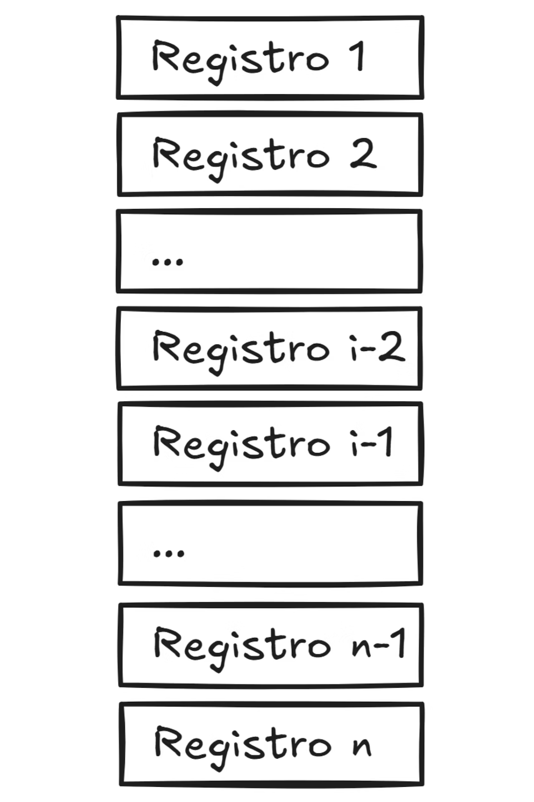

**Cómo funciona.** Los registros se almacenan **de forma contigua**, uno detrás de otro, con una marca **EOF** (*End Of File*) al final que indica dónde termina el fichero. Los registros se identifican mediante un **campo clave** o llave; si el fichero está ordenado por esa clave, las operaciones son más rápidas. La lectura **siempre se realiza hacia adelante**.

Pueden utilizar dispositivos de acceso secuencial, como las cintas magnéticas.

**Características:**

- **Monousuario.** No permiten el acceso simultáneo de varios usuarios, lo que limita su uso en entornos multiusuario.
- **Estructura rígida.** Todos los registros deben aparecer en orden, con la misma posición de campos en cada registro.
- **Eficiencia de almacenamiento.** Aprovechan al máximo el soporte, porque no dejan huecos vacíos entre registros.
- **Limitaciones de inserción.** No se pueden insertar registros entre los que ya están grabados.

!!! ojo "Ojo"
    «No se puede insertar en medio» no significa que no se pueda añadir. Se puede añadir **al final**, o reescribir el fichero entero. Lo que no existe es meter un registro entre dos que ya están grabados sin rehacer el fichero.

**Cuándo usarlo:** procesamiento por lotes (nóminas, facturación mensual), copias de seguridad, ficheros de log.

### 1.6.2 Ficheros de acceso directo

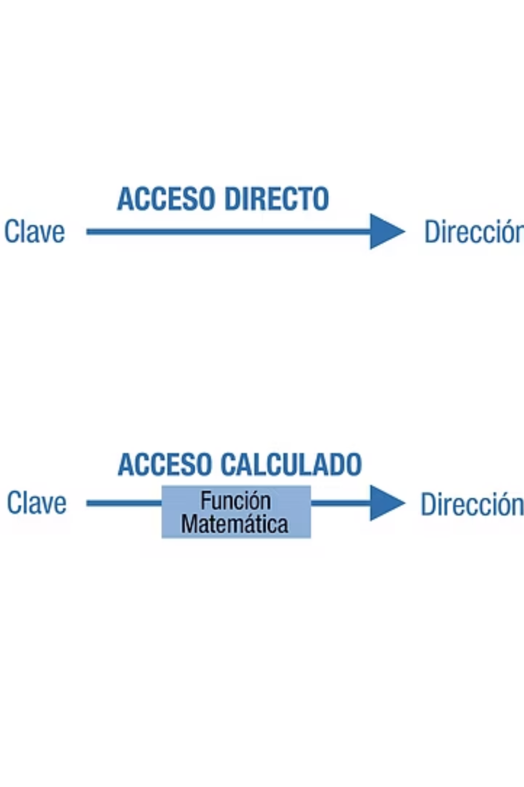

**Cómo funciona.** Cada registro tiene un **campo clave** que forma parte del registro. Cada registro se guarda en una **posición física** que depende del espacio disponible, y mediante una **transformación aplicada a la clave** se obtiene la dirección física donde está ese registro. Es decir: de la clave se calcula directamente *dónde* está el dato.

**Características:**

- **Posicionamiento inmediato.** Permite acceder a cualquier registro sin leer los anteriores, lo que aumenta mucho la velocidad de acceso.
- **Registros de longitud fija.** Todos los registros tienen el mismo tamaño. Esto facilita el cálculo de posiciones, pero puede desperdiciar espacio si los datos son variables.
- **Multiusuario.** Permiten que varios usuarios accedan simultáneamente al fichero, lo que los hace ideales para entornos compartidos.
- **Actualización en tiempo real.** Permiten actualizar en el mismo fichero y en tiempo real, sin crear copias temporales.

!!! ojo "Ojo: ¿Por qué longitud fija?"
    Porque si todos los registros miden lo mismo, la posición del registro *n* se calcula con una multiplicación. Si midieran distinto, habría que ir contando desde el principio… y eso es acceso secuencial otra vez.

**Cuándo usarlo:** aplicaciones interactivas y consultas frecuentes sobre registros concretos.

### 1.6.3 Ficheros indexados

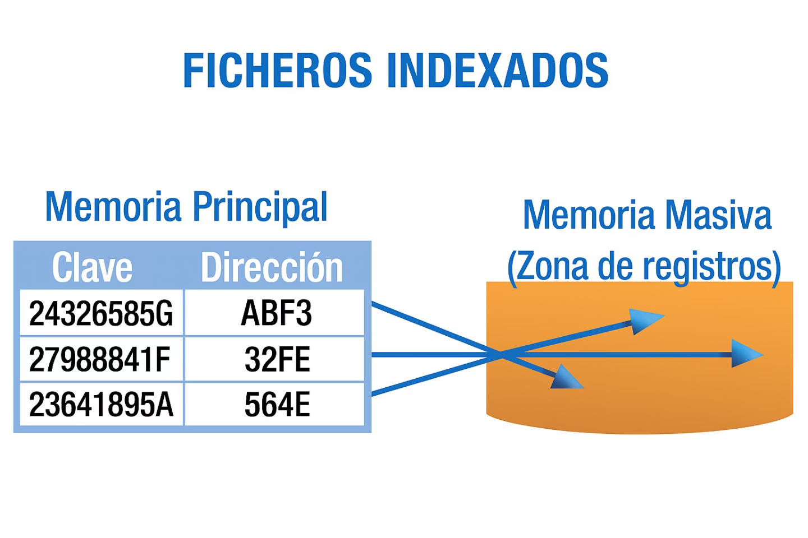

**La idea.** Los ficheros indexados se basan en la utilización de **índices** que permiten el acceso directo a un registro sin tener que leer los anteriores. Son como el índice de un libro: no lees 200 páginas para llegar al capítulo 7, miras el índice y vas directo.

**Estructura.** Hay dos zonas:

- Una **zona de registros**, con los datos del archivo.
- Una **zona de índices**, con una tabla que contiene las claves y las posiciones de los registros. La tabla está **ordenada por el campo clave**.

**Funcionamiento.** La tabla de índices se carga en memoria principal. Allí se busca la fila correspondiente a la clave del registro deseado y se obtiene la dirección donde se encuentra. Una vez localizada, se accede directamente a esa posición en la zona de registros.

**Características:**

- **Claves múltiples.** Puede tener más de un campo clave, con al menos una **clave primaria** que no admite duplicados.
- **Doble modo de acceso.** Permiten leer la información tanto en modo **secuencial** como en modo **directo**.
- **Soporte direccionable.** Solo pueden grabarse en soportes direccionables, como los discos magnéticos.

En el **acceso directo**, se usa el contenido del campo clave para que el sistema consulte el índice y conozca la posición del registro. En el **acceso secuencial**, los registros se leen ordenados por el campo clave, independientemente del orden de grabación, porque el acceso se hace a través del índice, que sí está ordenado.

!!! ojo "Ojo: Esto es lo que hace tu base de datos"
    Cuando en MySQL escribes `CREATE INDEX idx_email ON usuarios(email);` estás construyendo exactamente esto. Por eso una consulta por un campo indexado es instantánea y por un campo sin índice obliga a recorrer toda la tabla.

**Cuándo usarlo:** cuando necesitas buscar por varios criterios distintos y además recorrer los datos ordenados. Es la base de las bases de datos.

### 1.6.4 Ficheros secuenciales indexados

**Cómo funciona.** También llamados **parcialmente indexados**. Tienen una zona de índices y una zona de registros de datos **dividida en segmentos** (bloques de registros) ordenados.

En la tabla de índices, **cada fila hace referencia a un segmento**, no a un registro individual: el índice apunta al **registro inicial** del segmento. Una vez que se accede al primer registro del segmento mediante el índice, dentro de él se localiza **de forma secuencial** el registro buscado.

!!! ojo "Ojo: La ventaja escondida"
    Un índice con una entrada por registro es enorme. Un índice con una entrada por segmento es pequeñísimo y cabe en memoria. Se paga con una pequeña búsqueda secuencial dentro del segmento. Es un compromiso: índice más ligero a cambio de un poco más de trabajo al final.

### 1.6.5 Ficheros de acceso calculado o *hash*

**Cómo funciona.** En lugar de consultar una tabla de índices, se utiliza una **función matemática** (**función de hashing**) que, a partir de la clave, genera **directamente** la dirección de cada registro del archivo. No hay índice que consultar: se calcula y se va.

**El problema: las colisiones.**

!!! definicion "Definición: Colisión y sinónimos"
    Una **colisión** se produce cuando dos claves diferentes generan la misma dirección al aplicar la función matemática. Las claves que generan la misma dirección se conocen como **sinónimos**.

**Soluciones a las colisiones.** Se aplican distintos métodos, como disponer de una **zona de sinónimos** dentro del propio fichero, o crear un **archivo específico** para gestionar los sinónimos.

**Métodos de transformación hash.** Los más comunes son tres:

1. **Módulo.** La dirección es igual al **resto de la división entera** entre la clave y el número de registros. Es simple, pero puede generar muchas colisiones si la distribución de claves no es uniforme.
2. **Extracción.** La dirección se obtiene **extrayendo una parte de las cifras** que componen la clave. Es rápido, pero su eficacia depende de la distribución de valores en las posiciones extraídas.
3. **Funciones biunívocas.** Una buena función hash será la que produzca el **menor número de colisiones**, idealmente estableciendo una relación biunívoca (uno a uno) entre claves y direcciones.

!!! ejemplo "Ejemplo: Método del módulo"
    Fichero con espacio para 100 registros (direcciones 0 a 99). Función: `dirección = clave mod 100`.

   ; Clave 45231 → 45231 mod 100 = **31**

   ; Clave 87654 → 87654 mod 100 = **54**

   ; Clave 12331 → 12331 mod 100 = **31** ← ¡colisión con la primera!

    Las claves 45231 y 12331 son **sinónimos**. La 45231 llegó primero y ocupa la dirección 31; solo la 12331, que llega después y encuentra la dirección ocupada, va a la zona de sinónimos.

**Cuándo usarlo:** diccionarios, cachés, tablas de símbolos. Todo lo que sea «dame exactamente este elemento, ya».

!!! ojo "Ojo: Hash vs. indexado"
    El hash es más rápido porque no consulta ninguna tabla, solo calcula. Pero **no mantiene ningún orden**: con hash no puedes pedir «los registros del 100 al 200 ordenados por clave», porque las claves consecutivas acaban en direcciones dispersas. El indexado es un poco más lento pero sí te da el orden.

### 1.6.6 Tabla comparativa de las cinco organizaciones

| Organización | Cómo localiza el registro | Ventaja principal | Inconveniente | Casos de uso |
|---|---|---|---|---|
| **Secuencial** | Leyendo desde el principio | Máximo aprovechamiento del soporte, simplicidad | Lento para un registro concreto; monousuario; no permite inserción intermedia | Procesamiento por lotes, copias de seguridad |
| **Acceso directo** | Transformando la clave en dirección | Acceso rápido, actualización en tiempo real, multiusuario | Registros de longitud fija; puede desperdiciar espacio | Aplicaciones interactivas, consultas frecuentes |
| **Indexado** | Consultando una tabla de índices | Flexibilidad de acceso (directo y secuencial), varias claves | El índice ocupa espacio y hay que mantenerlo | Bases de datos, búsquedas por varios criterios |
| **Secuencial indexado** | Índice por segmento + búsqueda dentro | Índice mucho más pequeño | Búsqueda final secuencial dentro del segmento | Ficheros grandes con acceso mixto |
| **Hash** | Calculando con una función matemática | Acceso muy rápido, sin tablas de índices | Colisiones; no mantiene el orden | Diccionarios, cachés, tablas de símbolos |

!!! comprueba "Comprueba"
    1. ¿Qué organización elegirías para un fichero de log de un servidor web? ¿Por qué?
    2. ¿Qué es un sinónimo en un fichero hash?
    3. Un fichero indexado permite dos modos de acceso. ¿Cuáles y en qué se diferencian?
    4. ¿Por qué el índice de un fichero secuencial indexado es más pequeño que el de uno indexado?

## 1.7 Parámetros de utilización de ficheros

Para decidir qué organización conviene, antes hay que **medir** el fichero. Estos son los cuatro parámetros que se usan:

| Parámetro | Qué mide | Cómo se calcula o expresa |
|---|---|---|
| **Capacidad o volumen** | Espacio en caracteres que ocupa el fichero | Nº de registros × longitud media de cada registro |
| **Actividad** | Cantidad de consultas y modificaciones | Tasa y frecuencia de consulta o modificación |
| **Volatilidad** | Cantidad de inserciones y borrados | Tasa y frecuencia de renovación |
| **Crecimiento** | Variación de la capacidad del fichero | Tasa de crecimiento |

!!! ojo "Ojo: Actividad ≠ volatilidad"
    **Actividad** es cuánto se *usa* (se lee y se modifica). **Volatilidad** es cuánto *cambia de contenido* (se dan altas y bajas). Un fichero de códigos postales tiene actividad alta (se consulta todo el rato) y volatilidad casi nula (los códigos postales no cambian).

### Cómo se elige la organización

La elección del tipo de fichero adecuado depende de estos parámetros y de los requisitos concretos de la aplicación:

- Para aplicaciones con **alta tasa de consultas aleatorias**, los ficheros de **acceso directo o indexados** son más adecuados.
- Para el **procesamiento secuencial de todos los registros**, los ficheros **secuenciales** ofrecen mejor rendimiento.

## 1.8 Los límites del enfoque de ficheros

Si los ficheros funcionaban, ¿por qué se inventaron las bases de datos? Porque cuando cada aplicación gestiona sus propios ficheros aparecen cuatro problemas serios:

1. **Redundancia.** El mismo dato se guarda en varios sitios. La dirección de un cliente está en el fichero de facturación y también en el de reparto.
2. **Inconsistencia.** Consecuencia directa de lo anterior: el cliente cambia de dirección, se actualiza un fichero y se olvida el otro. Ahora hay dos verdades distintas.
3. **Dependencia física.** El programa sabe cómo están guardados los datos. Si cambia el formato del fichero, hay que reescribir el programa.
4. **Dificultad de compartir.** Los ficheros secuenciales son monousuario; coordinar a varios usuarios y varias aplicaciones sobre los mismos ficheros es un problema que cada programa tiene que resolver por su cuenta.

Las bases de datos nacen para resolver esto: **un único almacén, compartido, con la mínima redundancia posible y con una descripción de los datos separada de los programas**. Eso es exactamente lo que vas a ver en el bloque 2.

# Bloque 2. Las bases de datos

## 2.1 Qué es una base de datos y por qué son tan importantes

!!! definicion "Definición: Base de datos"
    Colección de datos lógicamente relacionados, con una estructura y descripción común. Almacena información de manera organizada, representando entidades y sus relaciones, con la mínima redundancia posible. Esto permite que múltiples aplicaciones y usuarios accedan a los datos de manera eficiente.

Fíjate en las cuatro ideas que van dentro de esa definición, porque son justo las respuestas a los problemas del punto 1.8:

- **Lógicamente relacionados** → no son datos sueltos, hay relaciones entre ellos.
- **Estructura y descripción común** → una sola definición para todos.
- **Mínima redundancia** → el dato se guarda una vez.
- **Múltiples aplicaciones y usuarios** → compartida, no monousuario.

### Los metadatos

Y aquí llega el concepto que diferencia de verdad una base de datos de un montón de ficheros:

!!! definicion "Definición: Metadatos"
    Además de los datos en sí, una base de datos incluye una **descripción de esos datos**, conocida como metadatos. Se almacenan en un **diccionario de datos** o **catálogo**.

¿Para qué sirven? Para conseguir la **independencia** entre cómo se organizan **lógicamente** los datos y cómo se almacenan **físicamente**. Es decir: tú trabajas con «la tabla ALUMNOS y sus columnas», y el sistema se ocupa de en qué fichero, en qué bloque y en qué byte está cada cosa. Si cambia lo de abajo, tu programa no se entera.

!!! ejemplo "Ejemplo: Metadatos"
    El dato es `"Marta Ruiz"`. El metadato es: *la columna se llama `nombre`, es de tipo `VARCHAR(50)`, pertenece a la tabla `ALUMNOS`, no admite valores nulos*.

## 2.2 Elementos de una base de datos

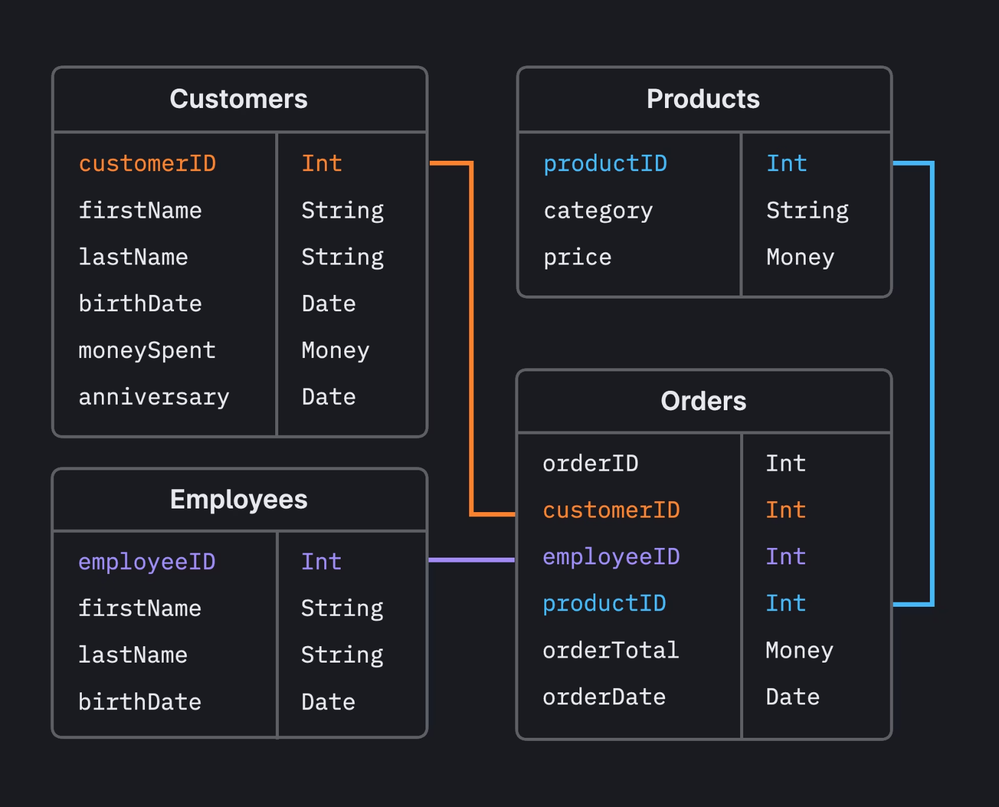

**Entidades.** Objetos reales o abstractos sobre los cuales queremos almacenar información. Cada entidad tiene características que la hacen única.

**Atributos.** Las propiedades o características de una entidad. Contienen los datos específicos que queremos almacenar.

**Registros.** Las filas de la base de datos, que contienen información específica sobre una entidad. Cada registro es una combinación de atributos con valores concretos.

!!! ojo "Ojo: El truco para identificar entidades y atributos"
    Lee el enunciado y busca los **sustantivos importantes**: suelen ser entidades (un alumno, un libro, un coche). Luego, para cada uno, busca lo que el enunciado dice **sobre** él: eso son los atributos.

    Pregunta de control: *¿sobre esto necesito guardar varios datos?* Si la respuesta es sí, es una entidad. Si es un dato suelto, es un atributo.

### Actividad guiada, Escenario 1: Centro de fitness

> Un centro de fitness está creando una base de datos para gestionar sus operaciones. El gerente necesita almacenar información sobre los miembros del centro, como contactarlos y cuánto tiempo llevan como miembros. Los instructores de fitness, que enseñan diferentes clases, necesitan tener documentadas sus cualificaciones y áreas de especialización. Además, el centro quiere registrar los detalles de cada clase de fitness, incluyendo cuándo está programada y qué tipo de ejercicio implica.

**Solución**

| Entidad | Atributos |
|---|---|
| **Miembro** | Nombre, Información de Contacto, Duración de Membresía |
| **Instructor** | Nombre, Cualificaciones, Especialidad |
| **Clase** | Nombre de la Clase, Tipo de Clase, Horario |

### Actividad guiada, Escenario 2: Cadena de librerías

> Una cadena de librerías quiere crear una base de datos para organizar su inventario e información de clientes. Para cada libro, necesitan almacenar detalles como su título, precio y cuántas copias hay en stock. Los clientes pueden inscribirse en un programa de fidelidad, y la tienda quiere registrar la información de contacto de cada cliente y cuántos puntos de fidelidad han ganado. Además, necesitan hacer un seguimiento de las nuevas llegadas de libros y asegurarse de saber qué libros se esperan pronto.

**Solución**

| Entidad | Atributos |
|---|---|
| **Libro** | Título, Precio, Stock |
| **Cliente** | Nombre, Información de Contacto, Puntos de Fidelidad |
| **Nueva Llegada** | Título, Fecha de Llegada Esperada |

### Actividad guiada, Escenario 3: Concesionario de coches de lujo

> Un concesionario de coches de lujo quiere gestionar información sobre los vehículos que vende. Necesitan almacenar detalles sobre cada coche, como su modelo, año y número de identificación del vehículo (VIN). Para cada vendedor, el concesionario quiere registrar su nombre, años de experiencia y los coches que ha vendido. Además, el concesionario está interesado en documentar las preferencias de sus clientes, incluyendo qué tipo de coches prefieren y su rango de presupuesto.

**Solución**

| Entidad | Atributos |
|---|---|
| **Coche** | Modelo, Año, VIN, Precio |
| **Vendedor** | Nombre, Años de Experiencia, Coches vendidos |
| **Cliente** | Nombre, Información de Contacto, Tipo de Coche Preferido, Rango de Presupuesto |

## 2.3 Conceptos clave en bases de datos

**Claves**

!!! definicion "Definición: Clave primaria"
    Atributo o conjunto de atributos que identifica de manera **única** cada registro de una entidad.

!!! definicion "Definición: Clave foránea"
    Atributo de una entidad utilizado para crear una **relación** con otra entidad.

**Relaciones.** Representan cómo se conectan las diferentes entidades de la base de datos. Estas conexiones se definen utilizando claves primarias y foráneas.

**Metadatos.** Datos que describen la estructura de la base de datos: tablas, atributos, tipos de datos y relaciones.

**Índices.** Estructuras creadas para **acelerar** las búsquedas y consultas. *(Sí: los mismos índices del punto 1.6.3.)*

!!! ejemplo "Ejemplo: Primaria y foránea juntas"
    Tabla `ALUMNOS`: la clave primaria es `id_alumno`.

    Tabla `MATRÍCULAS`: tiene su propia clave primaria `id_matricula`, y además una columna `id_alumno` que es **clave foránea** y apunta a la tabla `ALUMNOS`.

    La primaria dice *quién soy*; la foránea dice *con quién estoy relacionado*.

## 2.4 ¿Quién utiliza las bases de datos?

Hay cuatro perfiles, y conviene que sepas cuál será el tuyo:

**Administrador (DBA).** Responsable de la **creación y gestión física** de la base de datos. Decide sobre tipos de datos, índices y ubicaciones de almacenamiento.

**Diseñadores.** Definen la **estructura**: identifican los datos, establecen las relaciones y configuran las restricciones.

**Programadores de aplicaciones.** Crean los programas que permiten a los usuarios finales **consultar, insertar, actualizar y eliminar** datos. *(Este es tu papel en DAW/DAM.)*

**Usuarios finales.** Los clientes finales de la base de datos.

Todo el proceso de diseño, implementación y mantenimiento se realiza para **satisfacer las necesidades de los usuarios finales** y facilitar la gestión de la información. Nadie hace una base de datos por gusto: se hace para que alguien trabaje mejor.

## 2.5 ¿Dónde utilizamos bases de datos?

Prácticamente en todas partes. Estos son los sectores clásicos:

| Sector | Para qué |
|---|---|
| **Bancos** | Gestión de cuentas, transacciones y servicios financieros |
| **Compras y tarjetas de crédito** | Plataformas de comercio electrónico y sistemas de pago |
| **Aerolíneas y turismo** | Sistemas de reservas, gestión de vuelos y paquetes turísticos |
| **Universidades** | Gestión académica, expedientes de estudiantes y programación de cursos |
| **Telecomunicaciones** | Gestión de redes, servicios y facturación |
| **Medicina** | Historiales médicos, gestión hospitalaria y seguimiento de tratamientos |
| **Entretenimiento digital** | Plataformas de streaming, videojuegos y contenido multimedia |

## 2.6 Ubicación física de la información


Utilizamos bases de datos a diario, pero ¿dónde se almacena toda esa información? Las bases de datos, ya sean pequeñas (1 MB) o grandes (terabytes), se almacenan en **discos duros u otros dispositivos de almacenamiento**, y son gestionadas por **Sistemas de Gestión de Bases de Datos (SGBD)** como MySQL o SQL Server.

Las bases de datos grandes pueden **distribuirse en múltiples servidores** (como en los servicios en la nube), mientras que las más pequeñas pueden existir como **archivos en el disco duro de un solo ordenador**. El SGBD garantiza que la información esté organizada, accesible y segura.

### 2.6.1 Discos SATA

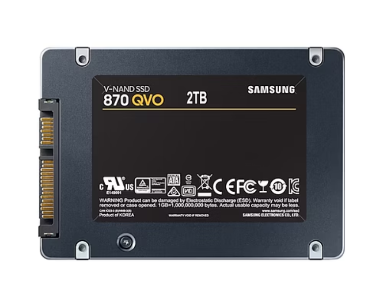

**SATA** (*Serial Advanced Technology Attachment*) son unidades de disco duro utilizadas para el almacenamiento de datos en **ordenadores personales y servidores**. SATA define cómo se transfieren los datos entre la unidad y la placa base.

Ventajas:

- Altas velocidades de transferencia, para operaciones de lectura y escritura más rápidas.
- Mejor gestión de múltiples unidades y optimización del rendimiento del sistema.
- Colocación flexible de las unidades, gracias a cables más largos.
- **Conexión en caliente** (*hot-plug*): se pueden conectar o desconectar unidades sin apagar el sistema.

### 2.6.2 Discos SCSI

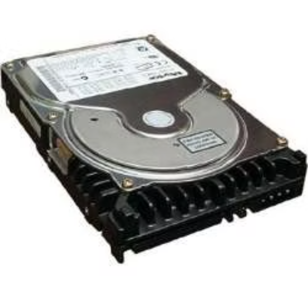

**SCSI** (*Small Computer System Interface*) son unidades diseñadas para el almacenamiento de datos principalmente en **servidores y estaciones de trabajo**. Es el estándar de los entornos empresariales de alta demanda.

Ventajas:

- **Gestión de múltiples dispositivos**: un solo controlador puede manejar hasta **15 unidades** simultáneamente, lo que lo hace perfecto para cargas de trabajo pesadas.
- **Fiabilidad y durabilidad**: diseñado para operación continua bajo cargas intensas.
- **Intercambio en caliente**, con cables aún más largos, lo que permite mantenimiento y expansión sin apagar el sistema.

!!! ojo "Ojo: SATA vs SCSI"
    SATA es el doméstico y de servidor sencillo; SCSI es el empresarial de alta demanda. La diferencia clave que te pueden preguntar: **hasta 15 unidades por controlador en SCSI** y su fiabilidad para funcionamiento continuo.

### 2.6.3 RAID

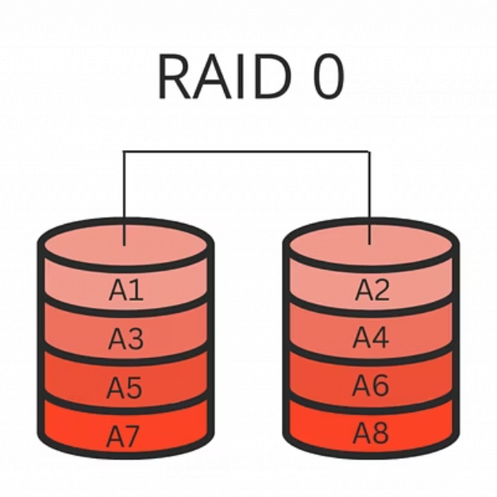

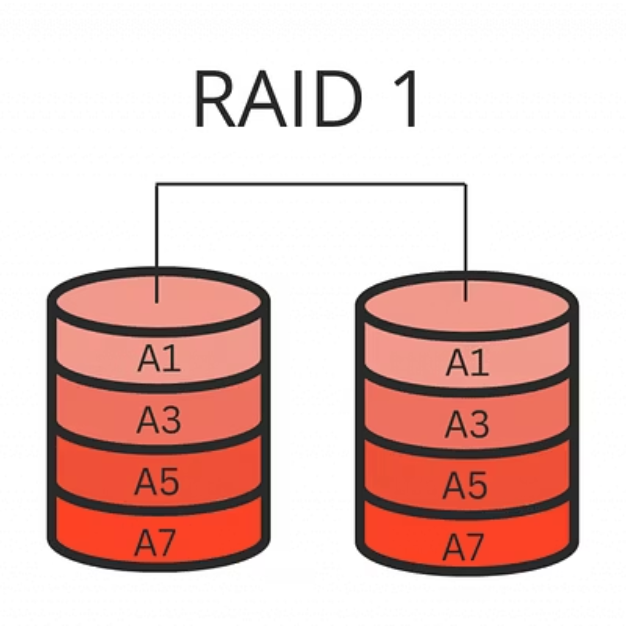

**RAID** (*Redundant Array of Independent Disks*) es una tecnología que **combina múltiples discos duros en una única unidad lógica** para mejorar el rendimiento, la capacidad de almacenamiento y la seguridad de los datos. Se usa tanto en servidores como en ordenadores personales que requieren alta fiabilidad y rendimiento.

- **Rendimiento**: mejora las velocidades de lectura/escritura distribuyendo los datos entre varios discos (según el nivel de RAID).
- **Redundancia**: si un disco falla, los datos pueden recuperarse de los otros.

Niveles principales:

| Nivel | Qué hace | Qué ganas | Qué pierdes |
|---|---|---|---|
| **RAID 0** | Divide los datos entre discos (*striping*) | Rendimiento | Toda la seguridad: si cae un disco, se pierde todo |
| **RAID 1** | Refleja los datos en dos discos (*mirroring*) | Seguridad | La mitad de la capacidad |

La elección depende del **equilibrio requerido entre rendimiento y protección de datos**.

!!! ojo "Ojo: RAID no es una copia de seguridad"
    RAID te protege de que **se rompa un disco**. No te protege de que borres una tabla por error: el borrado se replica igual de rápido en los dos discos. Copia de seguridad y RAID son cosas distintas y complementarias.

### 2.6.4 NAS

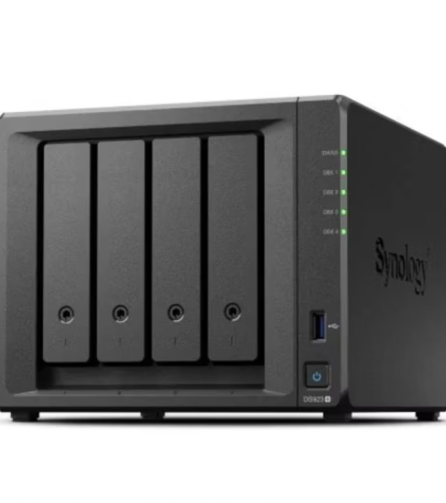

**NAS** (*Network Attached Storage*) es un dispositivo de almacenamiento **conectado a una red**, que permite a múltiples usuarios y dispositivos acceder a los datos de forma **centralizada**. Es ideal para uso doméstico y empresarial: simplifica el almacenamiento de archivos, las copias de seguridad y el compartir.

- Acceso rápido y seguro a grandes cantidades de datos **a través de la red**.
- A menudo incluye características avanzadas como **RAID** para redundancia y protección.
- **Escalable**: se puede añadir almacenamiento fácilmente.
- Muchos modelos ofrecen acceso remoto, servidores multimedia y sincronización con la nube.

### 2.6.5 SAN

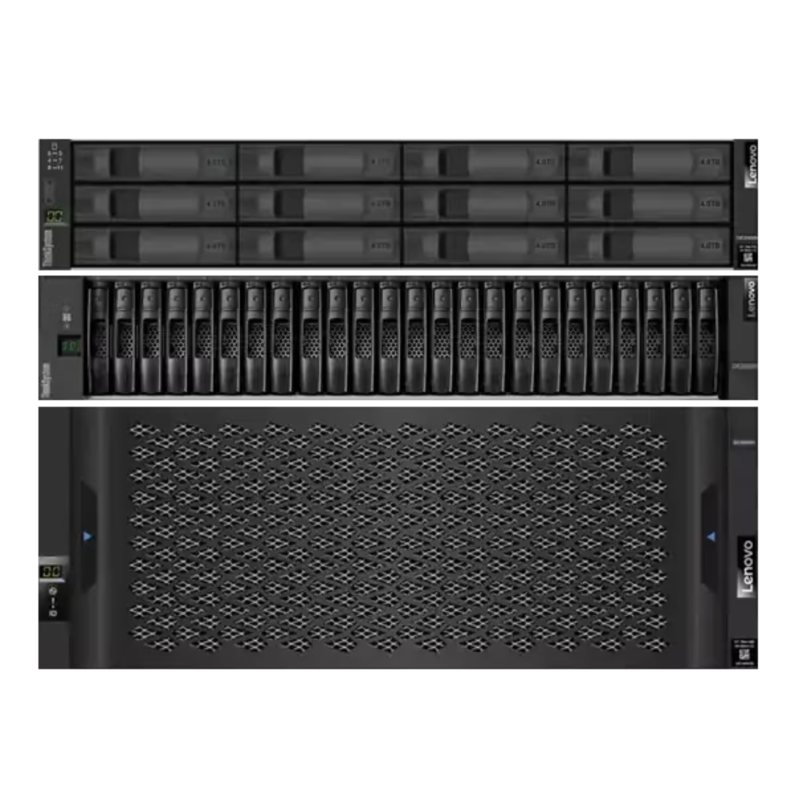

**SAN** (*Storage Area Network*) es una **red de alta velocidad** que conecta múltiples dispositivos de almacenamiento (discos duros o matrices de discos) a servidores, proporcionando acceso rápido y eficiente a grandes cantidades de datos. Es ideal para empresas que necesitan almacenamiento **centralizado, seguro y de alto rendimiento**.

- Utiliza **conexiones dedicadas**, como fibra óptica, para transferencia de alta velocidad y baja latencia.
- Permite a los servidores acceder al almacenamiento **como si fuera local**.
- Aumenta el rendimiento en la gestión de grandes bases de datos, aplicaciones críticas y virtualización.
- Es **escalable y flexible**: permite expandir el almacenamiento o hacer cambios sin interrumpir los servidores.
- Admite **RAID** y estrategias de copia de seguridad para garantizar la seguridad y disponibilidad de los datos.

!!! ojo "Ojo: NAS vs SAN"
    El **NAS** se conecta a la **red normal** y el servidor lo ve como una **carpeta compartida** (trabaja con archivos).

    La **SAN** usa una **red dedicada** (fibra) y el servidor la ve **como si fuera su propio disco** (trabaja con bloques).

    Por eso la SAN es más rápida, más cara y propia de entornos críticos.

!!! comprueba "Comprueba"
    1. ¿Qué son los metadatos y dónde se guardan?
    2. ¿En qué se diferencia una clave primaria de una foránea?
    3. ¿Cuántas unidades puede gestionar un solo controlador SCSI?
    4. ¿Por qué RAID 1 no sustituye a una copia de seguridad?
    5. Diferencia NAS de SAN en una frase.

# Bloque 3. Los modelos de bases de datos

## 3.1 Qué es un modelo de base de datos

!!! definicion "Definición: Modelo de base de datos"
    Conjunto de reglas, conceptos y estructuras que definen cómo se organizan, almacenan y gestionan los datos dentro de una base de datos. Es la forma en que se estructuran los datos y se establecen las relaciones entre ellos, determinando cómo se puede acceder, manipular y actualizar la información.

Tradicionalmente se establecen **tres modelos**: jerárquico, en red y relacional. Actualmente el más extendido con diferencia es el **relacional**. Aun así, hay que tener en cuenta dos variantes suyas que se han usado mucho en los últimos años: las bases de datos **distribuidas** y las **orientadas a objetos**.

### Clasificación de los modelos de datos

Un modelo también puede verse como un **lenguaje para describir** una base de datos. Se clasifican en tres niveles según lo cerca que estén de la máquina:

| Nivel | Para qué sirve | Cuándo se usa | Ejemplo |
|---|---|---|---|
| **Conceptual** | Describe estructuras de datos y restricciones de integridad, para representar elementos y sus relaciones | Fase de **análisis** | Modelo **Entidad-Relación** |
| **Lógico** | Se centra en las **operaciones**; se implementa en un SGBD | Fase de **diseño** | Modelo **Relacional** |
| **Físico** | Define cómo se almacenan y se accede a los datos a bajo nivel: almacenamiento de archivos, indexación y gestión de memoria | Fase de **implementación** | Organización de ficheros, índices |

El modelo físico se centra en el **rendimiento y la eficiencia**: asegura que los datos estén organizados en el hardware de manera que se optimice la velocidad y el uso del espacio. *(Todo el bloque 1 de este dosier era, en el fondo, nivel físico.)*

## 3.2 Modelo jerárquico

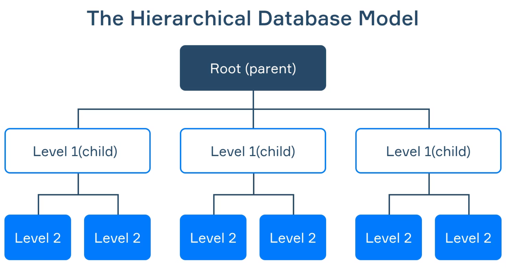

Estructura los datos en **forma de árbol**, con un nodo raíz y niveles jerárquicos. Cada elemento tiene **solo un «padre»**, lo que crea una estricta relación de **uno a muchos**.

Hoy en día este modelo está **obsoleto** debido a sus limitaciones: la principal es justo esa, que un hijo no puede tener dos padres, y el mundo real está lleno de situaciones que no encajan ahí.

!!! ejemplo "Ejemplo: Dónde se rompe"
    Un alumno pertenece a un grupo: eso es jerárquico y funciona. Pero un alumno cursa varios módulos y un módulo lo cursan varios alumnos: eso ya no cabe en un árbol.

## 3.3 Modelo en red

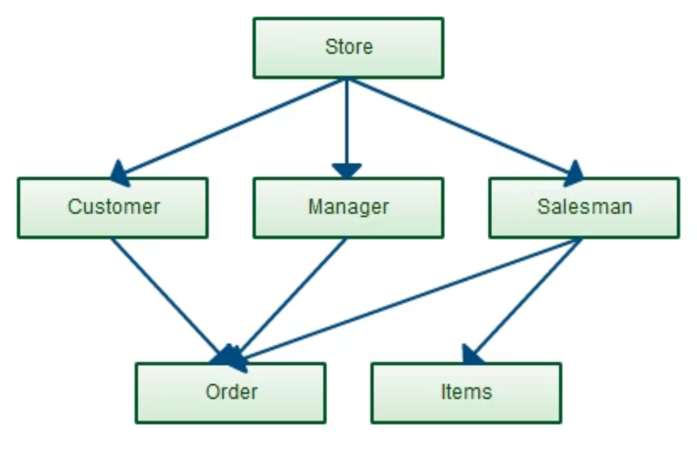

Similar al jerárquico, pero permite que un registro tenga **múltiples «padres»**, lo que crea una estructura más flexible con relaciones de **muchos a muchos**. Este modelo es capaz de representar **cualquier tipo de relación**, pero su gestión se vuelve **compleja**.

Un poco de historia: podemos considerar **IDS** (*Integrated Data Store*), de Bachman, como el primer sistema de base de datos en red. Después se intentó crear un estándar de modelo en red mediante **CODASYL**, que llegó a ser un modelo ampliamente aceptado.

## 3.4 Modelo relacional


Fue desarrollado por **Codd en 1970**. Hoy en día, las bases de datos relacionales son **las más utilizadas**.

La base de datos se percibe como un **conjunto de tablas**. Esta percepción está en el **nivel lógico**: a nivel físico, la base de datos puede almacenarse de maneras muy distintas.

> En el modelo relacional las cosas no son tan difíciles como pueden parecer. Lo único complicado es **identificar cuáles son las entidades y los atributos** de lo que queremos diseñar con el modelo conceptual.

### 3.4.1 Los dos sublenguajes

Un modelo de datos también puede verse como un lenguaje para describir una base de datos. Incluye dos sublenguajes con funciones complementarias:

| Sublenguaje | Función | Comandos típicos |
|---|---|---|
| **DDL**, Lenguaje de Definición de Datos | Describir de forma abstracta las **estructuras** de datos y las restricciones de integridad | `CREATE TABLE`, `ALTER TABLE`, `DROP TABLE` |
| **DML**, Lenguaje de Manipulación de Datos | Describir las operaciones de **manipulación** de datos | `SELECT`, `INSERT`, `UPDATE`, `DELETE` |

!!! ojo "Ojo: Cómo no confundirlos nunca"
    **DDL = el continente** (creas, cambias o destruyes la *tabla*).
    **DML = el contenido** (consultas, añades, modificas o borras *filas*).

### 3.4.2 Estructura de una tabla

En el modelo relacional los datos se organizan en **tablas bidimensionales**, también llamadas **relaciones**. Cada tabla tiene un nombre único y consta de filas y columnas:

- **Fila** (registro o **tupla**): representa una única entrada en la tabla.
- **Columna** (campo o **atributo**): representa una característica.

Conceptos clave asociados:

- **Dominio**: el conjunto de valores permitidos para un atributo.
- **Clave**: un atributo o conjunto de atributos que identifica de manera única cada fila.

!!! ejemplo "Ejemplo: Dominio"
    El dominio del atributo `nota` es el conjunto de números del 0 al 10. El dominio de `día_semana` es {lunes, martes, miércoles, jueves, viernes, sábado, domingo}. Fuera del dominio, el valor no es válido.

### 3.4.3 Requisitos que debe cumplir una tabla

1. **Estructura consistente**, Todas las filas deben seguir la misma estructura de columnas.
2. **Nombres únicos**, Los nombres de las columnas deben ser únicos, sin duplicados.
3. **Registros únicos**, Las filas deben ser únicas; no se permiten registros duplicados.
4. **Orden irrelevante**, El orden de las filas no importa: las tablas no tienen un orden específico de almacenamiento.
5. **Identificación única**, Cada fila debe identificarse mediante una clave única, que puede consistir en uno o más atributos.

!!! ojo "Ojo: «El orden no importa»"
    Que el orden no importe significa que la tabla no guarda las filas en un orden garantizado. Por eso, si quieres resultados ordenados, tienes que pedirlo explícitamente con `ORDER BY`. Confiar en que «salen en el orden en que las metí» es un error clásico.

### 3.4.4 Consultas y operaciones: SQL

**SQL** (*Structured Query Language*) es el **lenguaje estándar** para consultar bases de datos relacionales. Permite buscar, insertar, actualizar o eliminar datos.

| Operación | Para qué |
|---|---|
| `SELECT` | Recuperar datos de una o más tablas |
| `INSERT` | Añadir nuevos registros |
| `UPDATE` | Modificar registros existentes |
| `DELETE` | Eliminar registros |

### 3.4.5 Normalización

!!! definicion "Definición: Normalización"
    Proceso de diseñar una base de datos para que los datos estén organizados y relacionados de la manera más simple posible.

Sirve para:

- **Reducir el espacio** de almacenamiento.
- **Facilitar las actualizaciones** y el mantenimiento de los datos.

*Se verá con mucho más detalle más adelante en el módulo.*

## 3.5 Modelo orientado a objetos

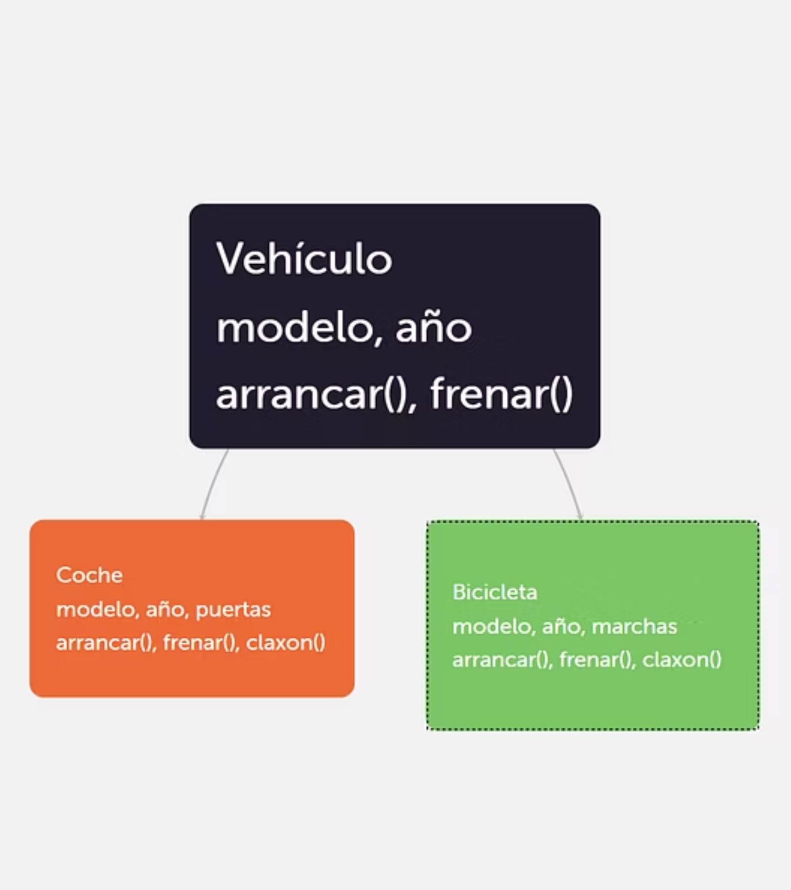

El modelo orientado a objetos organiza la base de datos en términos de **objetos**, que tienen sus propias **propiedades** (datos) y **métodos** (acciones que pueden realizar).

Los objetos que comparten la misma estructura y comportamiento se agrupan en **clases**, y las clases pueden organizarse en **jerarquías**: algunas pueden **heredar** características de otras.

Desde la aparición de la Programación Orientada a Objetos, las bases de datos se han adaptado a estos lenguajes. Este modelo se considera la base de las bases de datos de **tercera generación**:

| Generación | Modelo |
|---|---|
| Primera | Bases de datos **en red** |
| Segunda | Bases de datos **relacionales** |
| Tercera | Bases de datos **orientadas a objetos** |

Algunos sistemas relacionales han evolucionado para incorporar conceptos orientados a objetos: se denominan **sistemas objeto-relacionales**.

### 3.5.1 Objetivos del modelo orientado a objetos

- **Herencia** entre tablas, igual que las clases en programación.
- **Tipos definidos por el usuario**: permite crear tipos de datos personalizados.
- **Soporte multimedia**: almacenamiento eficiente de imágenes, vídeos, etc.
- **Encapsulación**: permite ocultar información dentro de un objeto, evitando accesos incorrectos o conflictos.
- **Polimorfismo**: una operación puede trabajar con diferentes tipos de objetos, adaptándose según sea necesario.

### 3.5.2 Conceptos con ejemplos

**Tipos definidos por el usuario**

- Tipo *número de teléfono*: cadena que contiene 12 caracteres.
- Tipo compuesto *dirección*: (calle, ciudad, código_postal).

**Soporte multimedia.** El modelo orientado a objetos (MOO) es más adecuado de forma natural para gestionar contenido multimedia, porque trata los objetos multimedia como **tipos de datos complejos con datos y comportamiento**:

- **Almacenamiento de objetos**: imágenes, vídeos, archivos de audio o documentos pueden almacenarse como parte de un objeto con atributos que describen el medio (resolución, duración, formato…).
- **Métodos**: los objetos pueden tener métodos para actuar sobre el contenido multimedia, como redimensionar imágenes, transmitir vídeo o extraer metadatos.

## 3.6 Modelo objeto-relacional

Las **bases de datos objeto-relacionales (BOR)** son un **híbrido** que combina características del modelo relacional (tablas) y del orientado a objetos (objetos con atributos y métodos). Su objetivo es fusionar la **simplicidad** de las bases de datos relacionales con las **ventajas** de la orientación a objetos.

¿Por qué existen? Porque las bases de datos orientadas a objetos puras pueden ser **costosas y complejas** al convertir datos de sistemas relacionales. Las BOR siguen utilizando tablas, pero permiten estructuras más complejas y flexibles, similares a los objetos en programación: por ejemplo, una fila de una tabla puede hacer referencia a otras tablas, lo que se conoce como **herencia directa**.

### 3.6.1 Comparación entre los tres enfoques

**Modelo relacional (RM).** La dirección en la tabla `Persona` es una **clave foránea** que se refiere a la dirección completa en la tabla `Address`.

*Persona*

| Person_id | Name | Address |
|---|---|---|
| 1 | Alice | 101 |
| 2 | Bob | 102 |

*Address*

| Address_id | City | Street |
|---|---|---|
| 101 | New York | 5th Avenue |
| 102 | Chicago | Lakeshore Drive |

**Modelo orientado a objetos (OOM).** Aquí Alice tiene una referencia a `home_address`. Es similar a cómo las bases de datos relacionales vinculan datos con claves foráneas, pero en POO estás **vinculando objetos directamente**: no hay tablas de por medio.

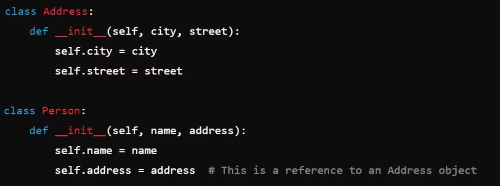


**Modelo objeto-relacional (ORM).** La diferencia clave es que las BOR permiten que una fila de una tabla haga **referencia directa a objetos completos** de otra tabla, creando relaciones más flexibles. En lugar de guardar solo un identificador para enlazar con otra tabla, la tabla `Person` puede incluir **directamente un objeto** de la tabla `Address`:

*Person (BOR)*

| Person_id | Name | Address |
|---|---|---|
| 1 | Alice | `{city: "New York", street: "5th Avenue"}` |
| 2 | Bob | `{city: "Chicago", street: "Lakeshore Drive"}` |

| | Relacional | Orientado a objetos | Objeto-relacional |
|---|---|---|---|
| **Unidad básica** | Tabla | Objeto | Tabla que puede contener objetos |
| **Cómo enlaza** | Clave foránea (un identificador) | Referencia directa entre objetos | Objeto completo dentro de la fila |
| **Ventaja** | Simplicidad, madurez, SQL | Modela bien lo complejo y lo multimedia | Lo mejor de los dos, sin migrar todo |

## 3.7 Modelos de bases de datos menos conocidos

### 3.7.1 Bases de datos deductivas

También conocidas como **bases de datos lógicas**. Combinan la tecnología de bases de datos relacionales con técnicas de **programación lógica**, y permiten realizar **inferencias y deducciones** a partir de los datos almacenados.

Características principales:

- Utilizan **reglas lógicas** para derivar nueva información.
- Pueden responder a consultas complejas que requieren **razonamiento**.
- Incorporan mecanismos de **inferencia automática**.

!!! ejemplo "Ejemplo"
    Si la base de datos sabe que *Ana es madre de Luis* y que *Luis es padre de Marta*, una base de datos deductiva puede responder a «¿quién es la abuela de Marta?» sin que nadie haya guardado nunca ese dato, aplicando la regla `abuela(X,Z) :- madre(X,Y), padre(Y,Z)`.

### 3.7.2 Bases de datos multidimensionales

Están optimizadas para aplicaciones que requieren **análisis complejos desde múltiples perspectivas**.

Características principales:

- Organizan los datos en **«cubos»** con múltiples dimensiones.
- Permiten análisis rápidos desde diferentes ángulos.
- Facilitan la visualización de tendencias y patrones.
- Son ideales para **inteligencia de negocios** y análisis de datos.

!!! ejemplo "Ejemplo"
    Un cubo de ventas con las dimensiones *producto*, *tienda* y *mes* permite preguntar en un instante «ventas del producto X en la tienda Y durante marzo», o cambiar de ángulo y ver el total por tienda del año entero.

### 3.7.3 Bases de datos transaccionales

Están diseñadas para gestionar **operaciones comerciales diarias**, garantizando la integridad de los datos durante las transacciones.

Características principales:

- Garantizan las propiedades **ACID**.
- Optimizadas para operaciones de inserción, actualización y eliminación rápidas.
- Mantienen la integridad de los datos **incluso en caso de fallos**.
- Muy utilizadas en sistemas bancarios, comercio electrónico y gestión de inventario.

| Propiedad ACID | Qué garantiza |
|---|---|
| **A**tomicidad | La transacción se ejecuta entera o no se ejecuta nada |
| **C**onsistencia | La base de datos pasa de un estado válido a otro estado válido |
| **A**islamiento (*Isolation*) | Las transacciones simultáneas no se interfieren entre sí |
| **D**urabilidad | Una vez confirmada, la transacción persiste aunque falle el sistema |

!!! ejemplo "Ejemplo: Atomicidad"
    Una transferencia bancaria son dos operaciones: restar de una cuenta y sumar en otra. Si el sistema se cae entre las dos, la atomicidad garantiza que se deshace la primera. Nunca desaparece el dinero.

### 3.7.4 Bases de datos NoSQL

Las bases de datos **NoSQL** (*Not Only SQL*) surgieron como alternativa a las relacionales tradicionales para manejar **grandes volúmenes de datos no estructurados o semiestructurados**.

Características principales:

- **Escalabilidad horizontal**: añadir más servidores fácilmente.
- **Flexibilidad** en el esquema de datos.
- **Alto rendimiento** para operaciones específicas.
- Capacidad para manejar **diversos tipos de datos**.

### 3.7.5 Tipos de bases de datos NoSQL

| Tipo | Cómo almacena | Ejemplos |
|---|---|---|
| **Documentales** | Datos en documentos tipo JSON | MongoDB, CouchDB |
| **Columnares** | Datos en columnas en lugar de filas | Cassandra, HBase |
| **Clave-valor** | Pares clave-valor simples | Redis, DynamoDB |
| **Grafos** | Relaciones entre entidades | Neo4j, ArangoDB |

!!! ojo "Ojo: NoSQL no significa «mejor»"
    Significa **distinto**. Renuncia a parte de las garantías del modelo relacional (esquema fijo, ACID estricto, `JOIN`) a cambio de escalar y de flexibilidad. Para la mayoría de las aplicaciones de gestión, el relacional sigue siendo la elección correcta.

!!! comprueba "Comprueba"
    1. ¿Por qué está obsoleto el modelo jerárquico?
    2. ¿Quién propuso el modelo relacional y en qué año?
    3. ¿`ALTER TABLE` es DDL o DML? ¿Y `UPDATE`?
    4. Enumera las cuatro propiedades ACID y explica una.
    5. ¿Qué tipo de base de datos NoSQL usarías para una red social? ¿Por qué?

# Bloque 4. Los sistemas de gestión de bases de datos (sgbd)

## 4.1 Qué es un SGBD

En los bloques 1 a 3 viste qué es una base de datos: un conjunto de datos relacionados, organizados y guardados con su descripción (los metadatos). Pero una base de datos, por sí sola, es un montón de ficheros en un disco. Hace falta **un programa** que sepa leerlos, escribirlos, protegerlos y repartirlos entre los usuarios. Ese programa es el SGBD.

!!! definicion "Definición: Sistema de Gestión de Bases de Datos (SGBD)"
    Conjunto de programas para acceder y manejar los datos de una base de datos. Su objetivo principal es garantizar la **eficiencia** y la **seguridad** al recuperar o insertar datos, y está diseñado para gestionar **grandes volúmenes** de información.

En inglés se llama *DBMS* (*Database Management System*). Lo verás escrito así en muchas herramientas y documentación.

!!! ejemplo "Ejemplo: SGBD que vas a oír nombrar"
    MySQL y MariaDB (los que usaremos en el módulo), PostgreSQL, Oracle Database, Microsoft SQL Server, SQLite. Cuando instalas «MySQL» en tu ordenador no estás instalando una base de datos: estás instalando un **SGBD**, con el que después **creas** tus bases de datos.

!!! ojo "Ojo: Base de datos ≠ SGBD"
    La **base de datos** son los datos (y su descripción). El **SGBD** es el software que los gestiona. Decir «la base de datos MySQL» es un error muy común: MySQL es el gestor; `tienda` o `instituto` serían bases de datos gestionadas por MySQL.

### Funciones principales

Los SGBD permiten **crear y mantener** bases de datos. Para ello facilitan tres tareas:

| Tarea | Qué significa | Ejemplo en la base de datos de un instituto |
|---|---|---|
| **Definición** | Especificar los tipos de datos, las estructuras y las restricciones | «Un alumno tiene NIA, nombre y fecha de nacimiento; el NIA no se puede repetir» |
| **Construcción** | Almacenar los datos en un medio gestionado por el SGBD | Cargar los 600 alumnos matriculados este curso |
| **Manipulación** | Consultar datos, actualizar registros y generar informes | Listar los alumnos de 1.º DAW; cambiar el teléfono de un alumno |

Fíjate en el orden: primero se **define** la estructura, después se **construye** (se llena de datos) y a partir de ahí se **manipula** durante toda la vida de la base de datos.

## 4.2 El SGBD y los elementos que lo rodean

El SGBD no trabaja aislado. Está en medio de cuatro elementos, y cada uno tiene su papel:


| Elemento | Papel |
|---|---|
| **Base de datos** | Almacenamiento estructurado de datos |
| **SGBD** | Gestiona permisos y manipulación |
| **Sistema operativo** | Proporciona servicios de bajo nivel |
| **Aplicaciones** | Utilizan los datos estructurados |

La relación funciona así:

- El SGBD **se apoya en el sistema operativo**, que le da los servicios de bajo nivel: gestión de archivos, memoria, procesos y seguridad del sistema. El SGBD no escribe directamente en el disco: le pide al sistema operativo que lo haga.
- Los datos de la base de datos pueden ser **usados por varias aplicaciones** a la vez (la web de la tienda, la app del móvil, el programa de facturación…).
- Pero **ninguna aplicación toca los datos directamente**: todas pasan por el SGBD, que es quien **otorga los permisos** de acceso y manipulación y aplica sus propios mecanismos de seguridad y control.

!!! ejemplo "Ejemplo: Una compra en una tienda online"
    Pulsas «Comprar». La **aplicación** web no abre ningún fichero: envía una orden al **SGBD** («resta 1 al stock de este producto y guarda el pedido»). El SGBD comprueba que esa aplicación tiene permiso, hace el cambio y le pide al **sistema operativo** que lo grabe en disco. Los datos acaban en los ficheros de la **base de datos**.

!!! ojo "Ojo: Dos niveles de seguridad"
    El sistema operativo tiene su seguridad (usuarios del sistema, permisos de ficheros) y el SGBD tiene **la suya propia** (usuarios de la base de datos, permisos sobre tablas). Son independientes: un usuario puede entrar en el servidor y no tener permiso para leer una tabla, o al revés.

## 4.3 Ventajas de usar un SGBD

Recuerda cómo terminaba el bloque 1 (apartado 1.8): los ficheros tenían límites serios, redundancia, inconsistencias, dependencia de los programas, dificultad para compartir. Las ventajas del SGBD son, justamente, la respuesta a esos límites.


| Ventaja | Qué aporta |
|---|---|
| **Vista abstracta de datos** | Los usuarios ven los datos sin preocuparse de cómo se almacenan y mantienen: la complejidad queda oculta. |
| **Independencia física** | La forma en que el usuario ve y manipula los datos está separada de cómo se almacenan físicamente. |
| **Reducción de redundancia** | Se evita tener el mismo dato repetido en muchos sitios. |
| **Integridad de datos** | Se asegura que los datos sean correctos y coherentes. |
| **Acceso rápido** | Se facilita el acceso rápido a los datos y se previene su pérdida. |
| **Seguridad y privacidad** | Se mejora el control de quién ve y quién toca cada dato. |
| **Compartir datos** | Varios usuarios pueden trabajar con los datos, incluso a la vez (acceso concurrente). |
| **Intercambio de datos** | Los datos se pueden intercambiar entre diferentes sistemas. |
| **Copias de seguridad** | Hay mecanismos de copia y recuperación para restaurar la información si el sistema falla. |

!!! ejemplo "Ejemplo: Redundancia e integridad"
    Con ficheros, secretaría guarda la dirección de un alumno en `matricula.dat` y el departamento de orientación la guarda otra vez en `tutorias.dat`. El alumno se muda, secretaría lo actualiza y orientación no: ahora hay **dos direcciones distintas** para la misma persona. Con un SGBD la dirección se guarda **una sola vez** y todas las aplicaciones la leen del mismo sitio: menos redundancia y, por tanto, más integridad.

### *Ficheros frente a SGBD*

| | Enfoque de ficheros (bloque 1) | Enfoque de SGBD |
|---|---|---|
| ¿Quién conoce la estructura de los datos? | Cada programa | El SGBD (diccionario de datos) |
| Datos repetidos | Frecuentes | Se reducen al mínimo |
| Varios usuarios a la vez | Difícil o imposible | Acceso concurrente |
| Seguridad | La del sistema operativo | Propia, con usuarios y permisos |
| Copias y recuperación | Manuales | Mecanismos integrados |
| Si cambia la estructura del fichero… | Hay que tocar todos los programas | Independencia: los programas no se enteran |

## 4.4 Funciones del SGBD

Todo lo que hace un SGBD se agrupa en **tres funciones**, y cada una tiene **su propio lenguaje**. Esta correspondencia es de lo más importante de la unidad:

| Función | Para qué sirve | Lenguaje |
|---|---|---|
| **Descripción o definición** | Crear las estructuras de la base de datos | **DDL**, *Data Definition Language* |
| **Manipulación** | Trabajar con los datos que hay dentro | **DML**, *Data Manipulation Language* |
| **Control** | Proteger la base de datos y gestionar usuarios | **DCL**, *Data Control Language* |

### 4.4.1 Descripción o definición


Permite al diseñador de la base de datos **crear las estructuras apropiadas** para integrar adecuadamente los datos. Define **tres niveles** de estructura: interno, conceptual y externo (los verás en detalle en el apartado 5.1).

!!! definicion "Definición: DDL (Lenguaje de Definición de Datos)"
    Lenguaje con el que se definen las estructuras de datos, las relaciones entre los datos y las restricciones.

Con el DDL se definen, entre otros, estos elementos:

- Tablas y vistas.
- Relaciones entre entidades.
- Restricciones de integridad.
- Esquemas de almacenamiento.

!!! ejemplo "Ejemplo: Órdenes DDL en SQL"
    `CREATE TABLE alumno (nia INT PRIMARY KEY, nombre VARCHAR(50));`, crea una tabla.

    `ALTER TABLE alumno ADD email VARCHAR(80);`, le añade una columna.

    `DROP TABLE alumno;`, la elimina entera, estructura incluida.

    Las tres **trabajan con la estructura**, no con los datos.

### 4.4.2 Manipulación


Permite a los usuarios **buscar, añadir, modificar o eliminar** datos de la base de datos, siempre según las especificaciones y las reglas de seguridad. Son cuatro operaciones:

| Operación | Qué hace | Orden SQL *(ampliación)* |
|---|---|---|
| Recuperar información | Consultas a la base de datos | `SELECT` |
| Insertar información | Añadir nuevos datos | `INSERT` |
| Eliminar información | Borrar datos existentes | `DELETE` |
| Modificar información | Actualizar datos existentes | `UPDATE` |

!!! definicion "Definición: DML (Lenguaje de Manipulación de Datos)"
    Lenguaje que proporciona las herramientas necesarias para buscar, añadir, modificar o eliminar datos. También define las **vistas externas** de la base de datos para cada usuario (vistas parciales), según lo definido por el DDL.

!!! ejemplo "Ejemplo: Órdenes DML en SQL"
    `SELECT nombre FROM alumno WHERE nia = 1024;`, consulta.

    `INSERT INTO alumno VALUES (1025, 'Marta Ruiz');`, alta.

    `UPDATE alumno SET nombre = 'Marta Ruiz Pons' WHERE nia = 1025;`, modificación.

    `DELETE FROM alumno WHERE nia = 1025;`, baja.

    Las cuatro **trabajan con los datos** que hay dentro de la tabla; la tabla sigue existiendo.

!!! ojo "Ojo: `DROP` no es `DELETE`"
    `DELETE FROM alumno;` borra **todas las filas**, pero la tabla vacía sigue ahí (DML). `DROP TABLE alumno;` hace desaparecer **la tabla** (DDL). Es la pregunta trampa clásica para clasificar órdenes.

### 4.4.3 Control

Permite al **administrador** de la base de datos establecer mecanismos de protección:

- **Gestión de usuarios**: mecanismos de protección para las diferentes vistas de usuario y herramientas para crear y modificar usuarios.
- **Seguridad**: sistemas para copias de seguridad, carga de archivos, auditoría, protección contra ataques, configuración del sistema, etc.

!!! definicion "Definición: DCL (Lenguaje de Control de Datos)"
    Lenguaje utilizado para las tareas de control: gestión de usuarios, permisos y seguridad.

!!! ejemplo "Ejemplo: Órdenes DCL en SQL"
    `GRANT SELECT ON instituto.alumno TO 'orientacion';`, da permiso de lectura.

    `REVOKE SELECT ON instituto.alumno FROM 'orientacion';`, lo retira.

## 4.5 Componentes del SGBD

Un SGBD no es un solo bloque: está formado por **cinco componentes**.

| Componente | En una frase |
|---|---|
| Lenguajes de base de datos | Las herramientas para «hablar» con la base de datos (DDL, DML, DCL) |
| Diccionario de datos | La descripción de todo lo que hay guardado |
| Gestor de base de datos | El software intermediario que garantiza un acceso correcto y seguro |
| Usuarios de la base de datos | Las personas que la administran y la usan |
| Herramientas de base de datos | Aplicaciones de ayuda: formularios, informes, interfaces gráficas |

### 4.5.1 Lenguajes de base de datos

Cualquier SGBD proporciona a los usuarios **lenguajes para interactuar** con la base de datos. Con ellos se definen los datos, su estructura, las relaciones, las reglas de integridad, el control de acceso, las características físicas y las vistas de usuario. Son los tres que acabas de ver: **DDL, DML y DCL**, y proporcionan las herramientas necesarias para interactuar con la base de datos de manera eficiente y segura.

!!! ojo "Ojo: SQL no es un cuarto lenguaje"
    SQL es el lenguaje estándar de las bases de datos relacionales y **contiene los tres**: tiene órdenes DDL (`CREATE`, `ALTER`, `DROP`), DML (`SELECT`, `INSERT`, `UPDATE`, `DELETE`) y DCL (`GRANT`, `REVOKE`). DDL, DML y DCL son **categorías** de órdenes, no lenguajes separados que se instalen aparte.

### 4.5.2 Diccionario de datos

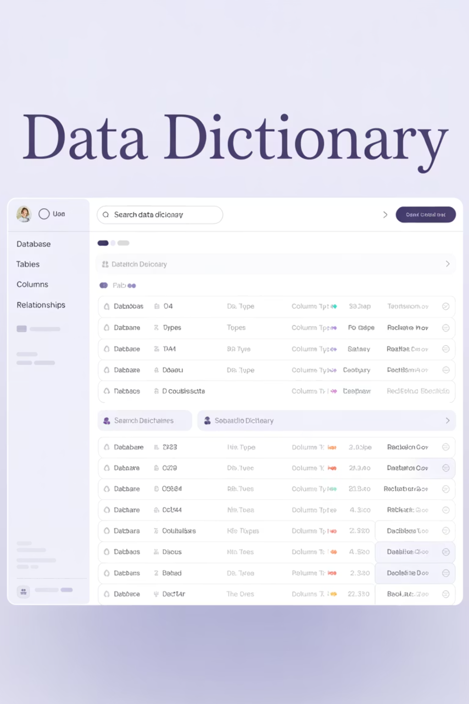

!!! definicion "Definición: Diccionario de datos"
    Descripción de los datos almacenados, útil para los desarrolladores de aplicaciones. Contiene información sobre todos los datos de la base de datos: estructuras lógicas, nombres, descripciones, contenidos y organización.

Es el lugar donde viven los **metadatos** que viste en los bloques 1 a 3: los «datos sobre los datos». En una base de datos relacional, el diccionario de datos informa sobre:

- La estructura lógica y física.
- La definición de tablas, vistas, índices, disparadores, procedimientos, funciones, etc.
- La cantidad de espacio asignado y utilizado por la base de datos.
- La descripción de las restricciones de integridad.
- Los permisos asociados a cada perfil de usuario.
- Los registros de auditoría de acceso y uso de datos.

!!! ejemplo "Ejemplo: El diccionario de datos en MySQL"
    MySQL guarda su diccionario en una base de datos especial llamada `information_schema`. Si ejecutas `SELECT table_name FROM information_schema.tables WHERE table_schema = 'instituto';` obtienes la lista de tablas de la base de datos `instituto`. Estás consultando **metadatos**, no datos.

### 4.5.3 Gestor de base de datos

!!! definicion "Definición: Gestor de base de datos"
    Componente de software responsable de garantizar que el acceso y el almacenamiento de los datos sean **correctos, seguros, íntegros y eficientes**.

Actúa como **intermediario** entre los datos almacenados y los programas de aplicación que los utilizan. Garantiza la privacidad, la seguridad y la integridad de los datos, gestiona el **acceso concurrente** (varios usuarios a la vez) e interactúa con el sistema operativo.

```
  Programas de aplicación          (software que utiliza los datos)
            │

            ▼
  ┌───────────────────────┐
  │  GESTOR DE BASE DE    │  → seguridad e integridad:
  │  DATOS                │    acceso correcto y seguro
  └───────────────────────┘
            │

            ▼
  Datos almacenados                (información estructurada)
```

!!! ejemplo "Ejemplo: Acceso concurrente"
    Dos personas compran a la vez la última entrada de un concierto. Sin un gestor que controle el acceso concurrente, las dos podrían leer «queda 1», las dos comprarían y el stock acabaría en −1. El gestor ordena las operaciones para que solo una se quede la entrada y la otra reciba «agotado».

### 4.5.4 Usuarios de la base de datos


| Usuario | Papel |
|---|---|
| **Administrador de base de datos (DBA)** | Persona o equipo responsable de la administración. Tiene el control centralizado y responde del funcionamiento, de autorizar a los usuarios y de gestionar los recursos de software y hardware necesarios. |
| **Usuarios de la base de datos** | Personas que la utilizan según sus necesidades, con diferentes niveles de acceso y permisos: diseñadores, operadores (personal de mantenimiento), analistas y usuarios finales. |

!!! ojo "Ojo: El DBA y el DCL van de la mano"
    El DBA es quien usa el DCL: crea usuarios y reparte permisos. Si te preguntan «¿quién ejecuta `GRANT`?», la respuesta esperada es el administrador.

### 4.5.5 Herramientas de base de datos

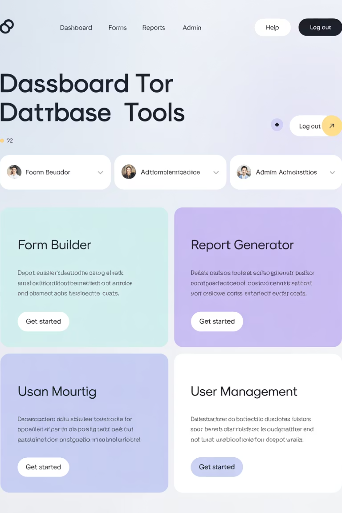

Conjunto de aplicaciones que ayudan a los administradores a gestionar la base de datos, los usuarios y los permisos:

- **Generadores de formularios**: herramientas para crear interfaces de entrada de datos.
- **Generadores de informes**: utilidades para crear reportes y visualizaciones de datos.
- **Interfaces gráficas**: herramientas para facilitar la interacción con la base de datos.

!!! ejemplo "Ejemplo: Herramientas que usarás"
    MySQL Workbench, phpMyAdmin o DBeaver son **interfaces gráficas**: te dejan ver las tablas, lanzar consultas y crear usuarios sin escribir todo a mano. Por debajo, lo que hacen es enviar órdenes DDL, DML y DCL al SGBD.

!!! comprueba "Comprueba: Bloque 4"
    1. ¿Qué diferencia hay entre una base de datos y un SGBD? Pon un ejemplo de cada cosa.
    2. ¿Qué servicios le da el sistema operativo al SGBD?
    3. Relaciona cada función del SGBD con su lenguaje.
    4. Clasifica: `UPDATE`, `CREATE TABLE`, `REVOKE`, `SELECT`, `DROP TABLE`.
    5. ¿Qué guarda el diccionario de datos? Nombra al menos cuatro cosas.

# Bloque 5. Arquitectura y tipos

## 5.1 Los tres niveles de abstracción

Un SGBD tiene una arquitectura pensada para **simplificar el trabajo** de los distintos usuarios de la base de datos, **separando los programas de la base de datos física**. Esta arquitectura proporciona **tres niveles de abstracción**:

```
            ┌───────────────────────────────────────────┐

            │  NIVEL EXTERNO (vista de usuario)         │  ← cada usuario ve

            │  vista 1  ;   vista 2  ;   vista 3 ...  │    solo su parte

            └───────────────────────────────────────────┘

                                 │

            ┌───────────────────────────────────────────┐

            │  NIVEL LÓGICO O CONCEPTUAL                │  ← la estructura

            │  entidades, atributos, relaciones,        │    completa, sin

            │  restricciones                            │    detalles físicos

            └───────────────────────────────────────────┘

                                 │

            ┌───────────────────────────────────────────┐

            │  NIVEL INTERNO O FÍSICO                   │  ← cómo se guarda

            │  ficheros, registros, métodos de acceso   │    en el disco

            └───────────────────────────────────────────┘
```

| Nivel | Qué describe | Cómo lo describe |
|---|---|---|
| **Interno o físico** | La estructura física de la base de datos | Mediante un **esquema interno**: métodos de almacenamiento, métodos de acceso, organización de archivos, tipos de registros, longitudes de campo y unidades de almacenamiento. Es el nivel **más cercano al almacenamiento físico**. |
| **Lógico o conceptual** | La estructura **completa** de la base de datos | Mediante un **esquema** con entidades, atributos, relaciones, operaciones de usuario y restricciones. Los detalles de almacenamiento están ocultos: es un nivel de abstracción **más alto**. |
| **Externo o de vista de usuario** | Las diferentes vistas que tienen los usuarios | Cada usuario o grupo de usuarios ve **solo la parte** de la base de datos que le interesa. |

!!! ejemplo "Ejemplo: La base de datos de un instituto en sus tres niveles"
    **Externo:** la profesora de BD ve una pantalla con los alumnos de su grupo y sus notas; secretaría ve nombre, DNI, dirección y tasas pagadas; el alumno ve solo sus propias notas.
    **Conceptual:** existen las entidades ALUMNO, MÓDULO y NOTA, con sus atributos, y la regla «una nota va de 1 a 10».
    **Interno:** la tabla `alumno` se guarda en el fichero `alumno.ibd` del disco, en bloques de 16 KB, con un índice sobre el NIA.

!!! ojo "Ojo: «Abstracción» sube hacia arriba"
    Cuanto **más arriba**, más abstracto (más lejos del disco y más cerca de la persona). Cuanto **más abajo**, más concreto (bytes, bloques, ficheros). El nivel interno es el **menos** abstracto, aunque se llame «interno».

*(Ampliación: este modelo de tres niveles se conoce como **arquitectura ANSI/SPARC**, por el comité que lo propuso en los años setenta. Si lo ves con ese nombre en otros materiales, es lo mismo.)*

!!! ojo "Ojo: No confundir con los tipos de modelos de datos"
    Aquí «lógico o conceptual» es **un único nivel del SGBD**: el del medio en su arquitectura. En el apartado 3.1 viste otra clasificación, la de los **tipos de modelos de datos**, en la que **conceptual** (modelo E/R, fase de análisis) y **lógico** (modelo relacional, fase de diseño) son **fases distintas** del diseño. Misma palabra, dos clasificaciones diferentes: la arquitectura de un SGBD que ya funciona frente a los pasos para diseñar una base de datos.

Fíjate en la conexión con el bloque 1: el nivel interno es exactamente lo que estudiaste en el Bloque 1 (ficheros, registros físicos, bloques, organizaciones, índices). El SGBD sigue usando todo aquello, pero **te lo esconde**.

## 5.2 Independencia de datos

Para una misma base de datos **solo hay un esquema interno y un esquema conceptual**, pero puede haber **múltiples esquemas externos** (uno por cada tipo de usuario). Gracias a esta separación en niveles, la arquitectura ofrece **independencia de datos** en dos niveles:

!!! definicion "Definición: Independencia lógica"
    El esquema conceptual puede modificarse **sin afectar a los esquemas externos** ni a los programas.

!!! definicion "Definición: Independencia física"
    El esquema interno puede modificarse **sin necesidad de cambiar los esquemas externos o conceptuales**. Es decir, se puede cambiar la organización de los archivos o añadir archivos nuevos sin que el resto de esquemas se entere.

!!! ejemplo "Ejemplo: Independencia física"
    El DBA mueve la base de datos del instituto a un disco SSD nuevo y crea un índice para que las búsquedas por apellido vayan más rápido. Ha cambiado el **nivel interno**. La tabla ALUMNO sigue teniendo los mismos atributos y las aplicaciones siguen funcionando igual: no hay que tocar ni una línea de código.

!!! ejemplo "Ejemplo: Independencia lógica"
    Se añade a ALUMNO un nuevo atributo `telefono_emergencia`. Ha cambiado el **nivel conceptual**. La aplicación de notas de la profesora no usa ese atributo, así que su vista (nivel externo) no cambia y el programa sigue funcionando sin modificaciones.

!!! ojo "Ojo: Cuál es cuál"
    **Física** = cambio **abajo** (disco, ficheros, índices) → no afecta a lo de arriba.
    **Lógica** = cambio **en medio** (estructura: tablas, atributos) → no afecta a las vistas de usuario.
    La independencia lógica es **más difícil** de conseguir que la física: si borras un atributo que una aplicación sí usaba, esa aplicación dejará de funcionar.

## 5.3 Tipos de bases de datos

Las bases de datos se pueden clasificar con **cuatro criterios** distintos. Una misma base de datos tiene una etiqueta en cada criterio a la vez.

### 5.3.1 Según el contenido

| Tipo | Qué contiene | Rasgos |
|---|---|---|
| **Con información actual** | Datos numéricos y actualizados (estadísticas, encuestas, series históricas…) | Sirven para análisis cuantitativos y seguimiento en el tiempo |
| **Directorios** | Información sobre personas o instituciones en un campo concreto (directorios de profesionales, investigadores, empresas, revistas) | Suelen ser más descriptivos que analíticos |
| **Documentales** | Cada registro corresponde a un documento (publicación, archivo audiovisual, etc.) | Se subdividen según incluyan o no el documento completo |

Las **bases de datos documentales**, según si incluyen el contenido completo del documento o no, pueden ser:

- **De texto completo**: contienen documentos completos en formato electrónico, con todo el texto disponible.
- **Archivos de imágenes electrónicas**: contienen referencias que enlazan directamente con la imagen del documento de partida.
- **Referenciales**: no incluyen el texto íntegro del documento, sino la información clave para describir y localizar los documentos.

!!! ejemplo "Ejemplo: Documentales"
    El catálogo de la biblioteca del centro es **referencial**: te dice título, autor y en qué estantería está el libro, pero no te deja leerlo. Un repositorio de artículos en PDF es **de texto completo**.

### 5.3.2 Según el uso

| Tipo | Quién accede | Dónde está |
|---|---|---|
| **Individual** | Un solo usuario a la vez. El control del SGBD y los datos recae en el propio usuario. | Disco duro local o servidor de archivos en una red local (LAN) |
| **Compartida** | Varios usuarios de forma concurrente, normalmente dentro de una organización (empresa, universidad, institución pública) | Servidor potente (servidor de bases de datos), gestionado por un **DBA** que se encarga de seguridad, rendimiento, copias, etc. Los usuarios se conectan por LAN o WAN/Internet |
| **Acceso público** | Cualquier persona | Puede ser gratuita o requerir pago |
| **Propietarias o bancos de datos** | El público general, a veces gratis y a veces pagando una tarifa | Grandes bases de datos desarrolladas por una organización, a menudo especializadas (negocios, economía…). Permiten encontrar rápido información que de otro modo llevaría mucho tiempo |

### 5.3.3 Según la ubicación de la información

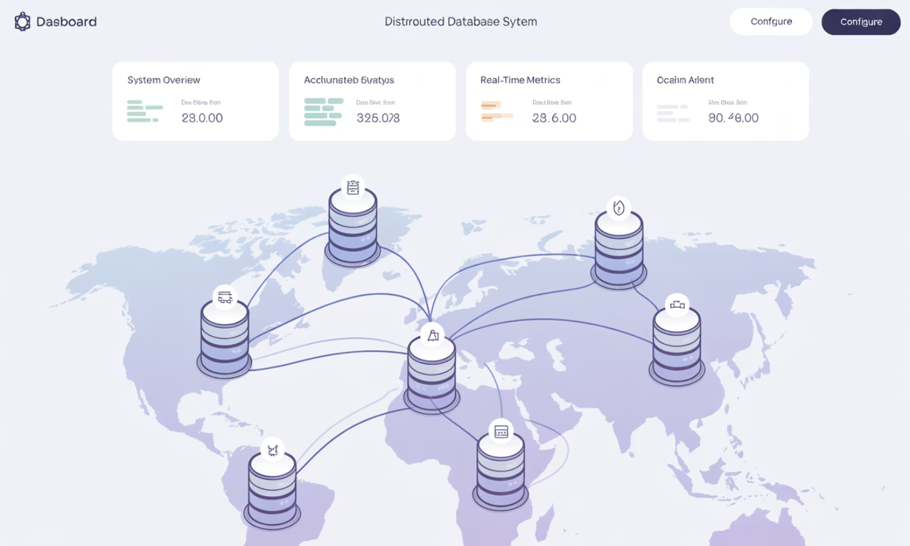

**Bases de datos centralizadas.** Están en **una única ubicación física**. Pueden ser sistemas de un solo usuario en ordenadores personales o sistemas de alto rendimiento en máquinas grandes. Esta configuración **facilita el mantenimiento**, pero hace que los datos sean **más vulnerables a errores** y el acceso es limitado. En una arquitectura cliente/servidor pueden tener dos configuraciones:

- **Basada en host**: las máquinas cliente y servidor son la misma. Los usuarios se conectan directamente a la máquina que aloja la base de datos.
- **Basada en cliente/servidor**: la base de datos está en una máquina servidor y los usuarios acceden desde sus propias máquinas a través de una red.

**Bases de datos distribuidas.** Los datos no están en un único sitio sino en **diferentes ubicaciones**, posiblemente lejos del usuario. Una base de datos distribuida **conecta múltiples bases de datos a través de redes**, y los usuarios acceden a los servicios remotos a través de diversas redes de comunicación.

!!! ejemplo "Ejemplo: Host frente a cliente/servidor"
    Instalas MySQL en tu portátil y trabajas con él desde ese mismo portátil: **basada en host**. En clase, el MySQL está en un servidor del aula y cada alumno se conecta desde su puesto con Workbench: **cliente/servidor**. En los dos casos la base de datos sigue siendo **centralizada**: está en un solo sitio.

Este criterio lo desarrollamos a fondo en el Bloque 6.

### 5.3.4 Según la variabilidad de la información

| Tipo | Qué permite | Uso típico |
|---|---|---|
| **Estáticas** | Solo lectura | Datos históricos para estudiar tendencias, hacer proyecciones y tomar decisiones informadas |
| **Dinámicas** | La información se actualiza: modificación, adición y recuperación de datos | El día a día de cualquier organización |

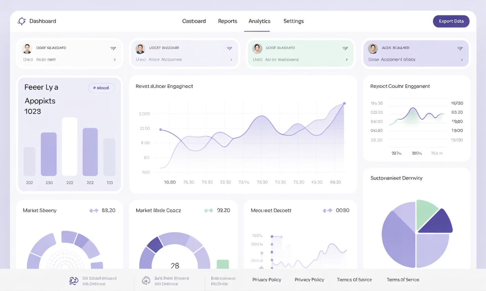

!!! ejemplo "Ejemplo: Estática y dinámica en la misma empresa"
    La base de datos de pedidos de una tienda online es **dinámica**: cambia cada segundo. Cada noche, los pedidos del día se copian a otra base de datos que solo se consulta para hacer gráficas de ventas por mes: esa es **estática**.

## 5.4 Tipos de SGBD

Igual que las bases de datos, los SGBD también se clasifican con **cuatro criterios**.

### 5.4.1 Por modelo lógico

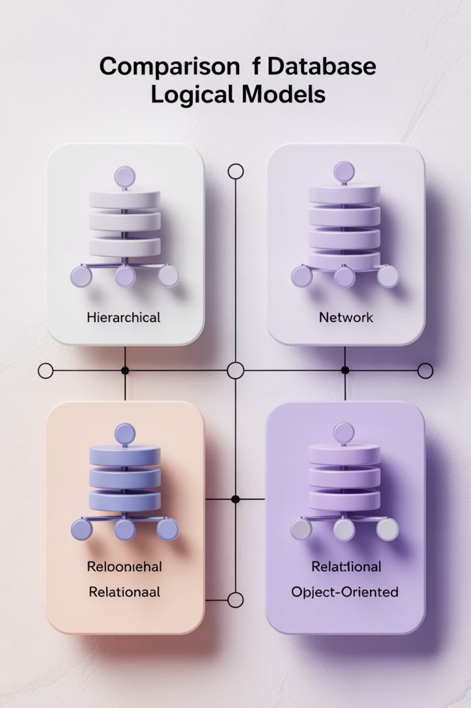

| Modelo | Cómo organiza los datos |
|---|---|
| **Jerárquico** | Estructura de árbol con relaciones padre-hijo |
| **En red** | Relaciones más complejas entre entidades, superando las limitaciones del jerárquico |
| **Relacional** | Tablas relacionadas entre sí mediante claves |
| **Orientado a objetos** | Los datos son objetos con propiedades y métodos |

Estos modelos ya los estudiaste en detalle en el bloque 3. Aquí solo cambia el punto de vista: el SGBD se clasifica **según el modelo que implementa**. MySQL es un SGBD **relacional**.

### 5.4.2 Por número de usuarios

| Tipo | Descripción |
|---|---|
| **Monousuario** | Sirve a un solo usuario a la vez; típico de ordenadores personales |
| **Multiusuario** | Sirve a múltiples usuarios simultáneamente |

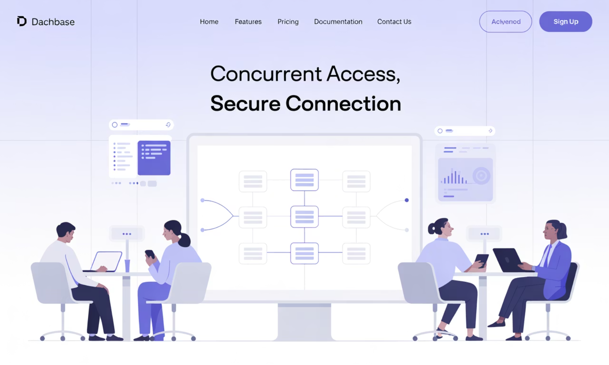

### 5.4.3 Por distribución

| Tipo | Descripción |
|---|---|
| **Centralizado** | Los datos se almacenan en un solo ordenador, pero múltiples usuarios pueden acceder a él |
| **Distribuido** | Los datos y el SGBD se reparten entre varios ordenadores conectados por una red |

Un SGBD distribuido puede ser:

- **Homogéneo**: todos los nodos utilizan **el mismo** SGBD.
- **Heterogéneo**: puede haber **SGBD diferentes** en los nodos, lo que da lugar a **sistemas federados o multibase**.

!!! ejemplo "Ejemplo: Heterogéneo"
    Una empresa compra otra. La primera tiene sus clientes en Oracle; la segunda, en PostgreSQL. Si las conectan para consultarlas como un todo sin migrar los datos, el resultado es un sistema distribuido **heterogéneo** (federado).

### 5.4.4 Por propósito

| Tipo | Descripción |
|---|---|
| **Propósito general** | Pueden manejar cualquier tipo de base de datos |
| **Propósito especial** | Diseñados para aplicaciones específicas donde el rendimiento es crítico. Por ejemplo, los sistemas de reserva de aerolíneas, construidos para altos volúmenes de transacciones sin retrasos |

!!! ojo "Ojo: Clasificar la BD o clasificar el SGBD"
    «Centralizada / distribuida» aparece dos veces: como tipo de **base de datos** (según la ubicación) y como tipo de **SGBD** (por distribución). Es la misma idea vista desde dos lados: dónde están los datos y cómo está montado el software que los gestiona. Lo mismo pasa con «individual / compartida» (uso de la BD) y «monousuario / multiusuario» (tipo de SGBD).

!!! comprueba "Comprueba: Bloque 5"
    1. Nombra los tres niveles de abstracción, de más abstracto a menos abstracto.
    2. ¿Cuántos esquemas internos, conceptuales y externos puede tener una base de datos?
    3. Se cambia la organización de un fichero de secuencial a indexado y las aplicaciones siguen funcionando. ¿Qué independencia se ha puesto en práctica?
    4. ¿Qué diferencia hay entre una base de datos documental referencial y una de texto completo?
    5. ¿Qué es un SGBD distribuido heterogéneo?

# Bloque 6. Bases de datos centralizadas y distribuidas

## 6.1 Bases de datos centralizadas

Cuando preguntamos por la arquitectura de un sistema de base de datos, hay que entender que **depende de la infraestructura informática** que haya por debajo. Tradicionalmente, la arquitectura **centralizada** fue el modelo inicial, aunque hoy se usa menos. Fue la arquitectura de los centros de procesamiento de datos tradicionales, basada en tecnologías simples, bien probadas y robustas.

!!! definicion "Definición: Sistema de base de datos centralizado"
    Aquel en el que el SGBD está instalado en **un solo ordenador**, que gestiona todos los recursos directamente.

**Características clave:**

- Todos los datos se almacenan en una ubicación central, con todos los componentes del sistema en un solo ordenador.
- No hay múltiples elementos de procesamiento ni mecanismos de intercomunicación.
- Sus componentes son los datos, el software de gestión de bases de datos y los dispositivos de almacenamiento.
- Tienen una seguridad más débil que las arquitecturas modernas.

### Ventajas y desventajas

| Ventajas | Desventajas |
|---|---|
| **Evita la redundancia**: usa eficientemente el espacio de almacenamiento | **Fallo total**: un fallo supone perder por completo el procesamiento y la disponibilidad de los datos |
| **Evita la inconsistencia** en los datos, ayudando a mantener la integridad | **Recuperación difícil**: la recuperación ante desastres es complicada |
| **Seguridad centralizada**: simplifica la gestión | **Sin distribución de carga**: el trabajo no se puede repartir entre varios ordenadores, lo que limita la escalabilidad |
| **Mejor rendimiento** en el procesamiento, gracias al control centralizado | |
| **Menores costes de mantenimiento**: requiere menos recursos humanos y la gestión de datos está centralizada | |


!!! ojo "Ojo: ¿Seguridad centralizada o seguridad más débil?"
    Parece una contradicción, pero no lo es. La seguridad centralizada es una ventaja **de gestión** (hay un único sitio que vigilar y configurar). Que la seguridad sea «más débil» se refiere a que todo depende de ese único punto: si alguien lo compromete o se estropea, no hay nada más detrás. A eso se le llama **punto único de fallo**.

## 6.2 Bases de datos distribuidas

La necesidad de **integrar información de múltiples fuentes** y la evolución de las **tecnologías de comunicación** han traído cambios importantes en los sistemas de bases de datos y han llevado a los sistemas distribuidos.

!!! definicion "Definición: Base de datos distribuida (BDD)"
    Conjunto de **múltiples bases de datos lógicamente relacionadas** que están distribuidas en diferentes **nodos** interconectados por una red de comunicación.

!!! definicion "Definición: Sistema de base de datos distribuida (SBDD)"
    Sistema en el que múltiples sitios de bases de datos están vinculados por una red de comunicación, permitiendo a los usuarios acceder a los datos **desde cualquier ubicación como si estuvieran almacenados localmente**.

!!! ojo "Ojo: BDD, SBDD, SGBDD"
    **BDD** = los **datos** repartidos. **SBDD** = el **sistema completo** (datos + red + equipos). **SGBDD** = el **software** que lo gestiona (siguiente apartado). Es la misma distinción que hiciste entre base de datos y SGBD, pero en versión distribuida.

## 6.3 El SGBD distribuido (SGBDD)

!!! definicion "Definición: Sistema de gestión de bases de datos distribuidas (SGBDD)"
    Software que gestiona bases de datos distribuidas y proporciona un **mecanismo de acceso transparente**: los usuarios interactúan con el sistema **como si solo hubiera un SGBD ejecutándose en un solo ordenador**.

**Funcionamiento.** Un SGBDD opera a través de un conjunto de **nodos**. Cada nodo tiene un sistema de procesamiento de datos completo, su **base de datos local** y su **SGBD**, y todos están interconectados:

- Si los nodos están **geográficamente distantes**, se conectan mediante una **red de área amplia (WAN)**.
- Si están **cerca**, pueden conectarse mediante una **red de área local (LAN)**.

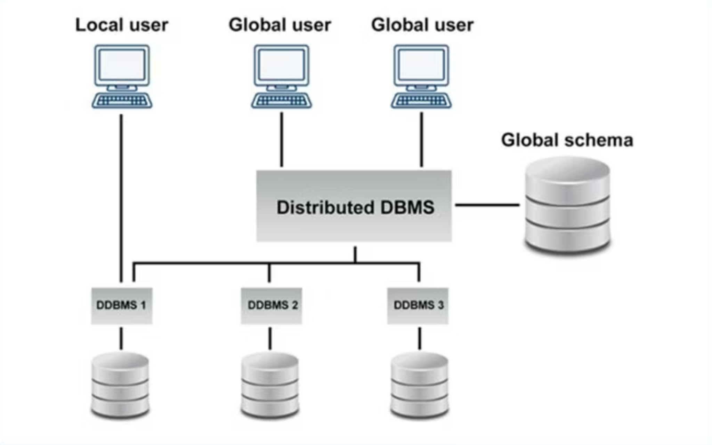

Cómo leer el diagrama:

- Abajo están los **nodos**, cada uno con su SGBD local (DBMS 1, 2 y 3) y su base de datos.
- En el centro, el **SGBD distribuido** (*Distributed DBMS*) los coordina a todos.
- A la derecha, el **esquema global** (*Global schema*): la descripción de la base de datos completa, como si fuera una sola.
- Arriba, los usuarios. Un **usuario local** trabaja con su nodo directamente; un **usuario global** hace consultas contra el conjunto y es el SGBDD quien averigua en qué nodos están los datos.

!!! ejemplo "Ejemplo: Transparencia"
    Una cadena de supermercados tiene un nodo en Palma, otro en Madrid y otro en Barcelona. Desde la central alguien pide «el total de ventas de ayer». No tiene que saber que hay tres servidores: el SGBDD pregunta a cada nodo, junta los resultados y le devuelve un único número. Eso es la **transparencia**.

## 6.4 Ventajas y desventajas de las bases de datos distribuidas

| Ventajas | Desventajas |
|---|---|
| Acceso y procesamiento de datos **más rápido**, porque los nodos comparten la carga de trabajo | **Mayor riesgo de seguridad** si no se toman precauciones |
| Se puede acceder a los datos **desde una ubicación aunque estén guardados en otra** | **Mayor complejidad** para coordinar los nodos de manera efectiva |
| **Tolerancia a fallos**: si un nodo falla, el sistema sigue funcionando | Gestionar la **replicación**, el **control de concurrencia** y la **recuperación** es más complejo |
| Los nodos se pueden **añadir** de forma flexible y fácil | Garantizar el funcionamiento correcto **durante los fallos de nodos y su recuperación** es difícil |
| Los nodos mantienen **independencia local**: pueden operar de forma autónoma | Costes iniciales más bajos, aunque **el mantenimiento puede ser más caro** |

!!! ojo "Ojo: La última fila"
    «Costes iniciales más bajos, aunque el mantenimiento puede ser más caro» aparece entre las desventajas. La desventaja es la **segunda mitad**: se empieza con poco (varios equipos modestos en lugar de uno enorme), pero mantener y coordinar muchos nodos acaba costando más.

### *Centralizada frente a distribuida, cara a cara*

| Aspecto | Centralizada | Distribuida |
|---|---|---|
| Dónde están los datos | En un solo ordenador | Repartidos en varios nodos |
| Si falla un equipo… | Se para todo | El resto sigue funcionando |
| Escalabilidad | Limitada: no se puede repartir la carga | Se añaden nodos |
| Gestión y mantenimiento | Sencilla y barata | Compleja y más cara |
| Coherencia de los datos | Fácil: hay una sola copia | Hay que coordinar réplicas y concurrencia |
| Seguridad | Un único punto que proteger… y un único punto de fallo | Más puntos que proteger |

## 6.5 La fragmentación

En las bases de datos distribuidas, los datos se reparten entre varias ubicaciones o servidores. Para acceder a ellos y consultarlos se utiliza un proceso llamado **fragmentación**.

!!! definicion "Definición: Fragmentación"
    Proceso que consiste en **dividir las tablas** de la base de datos y **distribuir las partes** en diferentes servidores. Puede mejorar la eficiencia de las consultas y el rendimiento del sistema, pero hay que hacerlo con cuidado.

**El equilibrio.** Hay que encontrar el nivel adecuado:

- **Sin fragmentación** (sin dividir) puede ser ineficiente, porque se consulta la tabla entera.
- La **fragmentación excesiva** puede complicar la gestión de los datos y ralentizar las consultas.
- El objetivo es encontrar un nivel apropiado: dividir la tabla en fragmentos más pequeños (**tuplas** o **atributos**) o mantener fragmentos más grandes (**tablas completas**), según las necesidades de las aplicaciones que usan la base de datos.

!!! ejemplo "Ejemplo: Por qué fragmentar"
    Una empresa tiene clientes en el este y en el oeste, con una oficina en cada zona. Si toda la tabla de clientes está en la oficina del este, cada consulta del oeste viaja por la red para buscar datos que en su mayoría ni le interesan. Si cada oficina guarda **sus propios clientes**, las consultas habituales son locales y rápidas.

## 6.6 Reglas fundamentales de la fragmentación

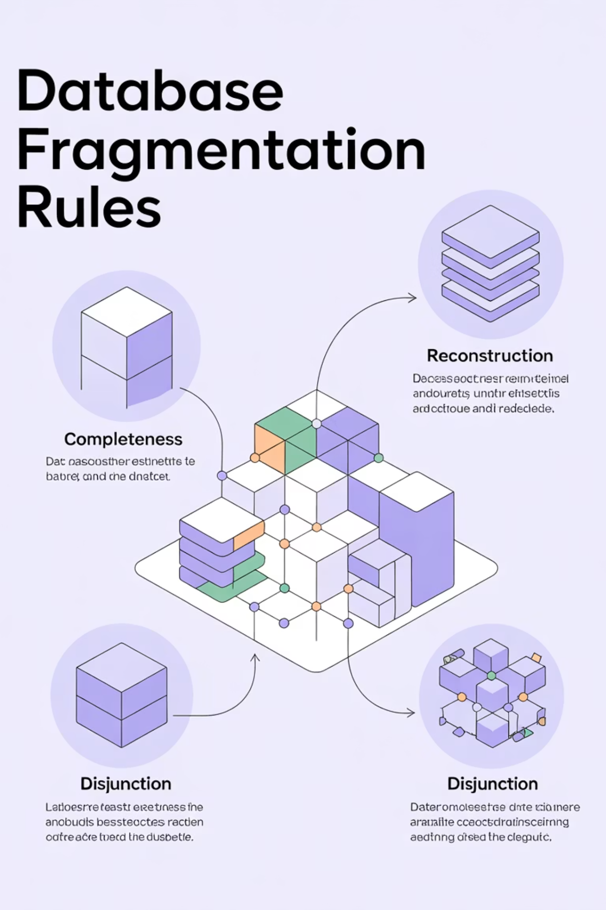

Toda fragmentación correcta cumple **tres reglas**:

| Regla | Qué exige |
|---|---|
| **Completitud** | Todos los datos de la tabla completa deben estar en los fragmentos. Nada puede quedar fuera. |
| **Reconstrucción** | Debe ser posible reconstruir la tabla completa a partir de sus fragmentos sin perder la integridad de los datos. |
| **Disyunción** | Cuando una tabla se fragmenta verticalmente (por columnas), la clave primaria se incluye en todos los fragmentos para mantener la relación entre ellos. |

!!! ojo "Ojo: La disyunción, en otros libros"
    En otros materiales verás la disyunción explicada así: **cada dato va a un solo fragmento**, sin repetirse, y la **única excepción** es la clave primaria en la fragmentación vertical, que se repite a propósito para poder volver a unir los trozos. Es la misma regla vista desde el otro lado: no se duplica nada salvo la clave.

## 6.7 Fragmentación horizontal, vertical e híbrida

Para los tres tipos vamos a usar la misma tabla de clientes:

| CustomerID | Name | Address | PhoneNumber | Email | Age | Region |
|---|---|---|---|---|---|---|
| 1 | Alice | 123 Main St | 555-1234 | alice@mail.com | 25 | East |
| 2 | Bob | 456 Oak St | 555-5678 | bob@mail.com | 30 | West |
| 3 | Charlie | 789 Pine St | 555-9101 | charlie@mail.com | 35 | East |
| 4 | David | 321 Maple St | 555-1122 | david@mail.com | 40 | West |

### 6.7.1 Fragmentación horizontal

!!! definicion "Definición: Fragmentación horizontal"
    Divide la tabla en **subconjuntos de filas**.

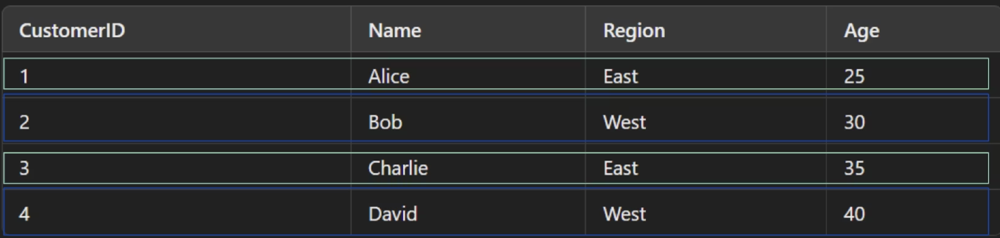

En la imagen, las filas con recuadro verde son las de la región *East* y las de recuadro azul, las de *West*. El resultado son dos fragmentos **con las mismas columnas**:

**Fragmento East**

| CustomerID | Name | Region | Age |
|---|---|---|---|
| 1 | Alice | East | 25 |
| 3 | Charlie | East | 35 |

**Fragmento West**

| CustomerID | Name | Region | Age |
|---|---|---|---|
| 2 | Bob | West | 30 |
| 4 | David | West | 40 |

Comprobamos las reglas: **completitud**, las cuatro filas están en algún fragmento; **reconstrucción**, basta con juntar las filas de los dos fragmentos; **disyunción**, ninguna fila está repetida.

### 6.7.2 Fragmentación vertical

!!! definicion "Definición: Fragmentación vertical"
    Divide la tabla en **subconjuntos de columnas**. Cada fragmento incluye la **clave primaria** para poder recomponer la tabla.

Además:

- Es **más compleja** que la horizontal, porque hay muchas formas de dividir las columnas.
- Su objetivo es **optimizar el tiempo de respuesta** de las consultas de los usuarios.

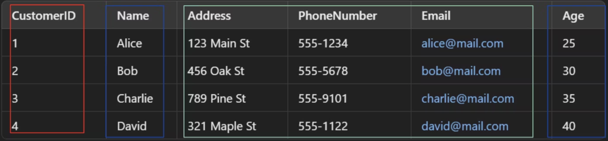

En la imagen, `CustomerID` (en rojo) es la clave primaria y va a los dos fragmentos. Las columnas en verde forman el fragmento **Contact info** y las columnas en azul, el fragmento **Basic info**:

**Fragmento Basic info**

| CustomerID | Name | Age |
|---|---|---|
| 1 | Alice | 25 |
| 2 | Bob | 30 |
| 3 | Charlie | 35 |
| 4 | David | 40 |

**Fragmento Contact info**

| CustomerID | Address | PhoneNumber | Email |
|---|---|---|---|
| 1 | 123 Main St | 555-1234 | alice@mail.com |
| 2 | 456 Oak St | 555-5678 | bob@mail.com |
| 3 | 789 Pine St | 555-9101 | charlie@mail.com |
| 4 | 321 Maple St | 555-1122 | david@mail.com |

!!! ojo "Ojo: Sin clave no hay reconstrucción"
    Si el fragmento *Contact info* no llevara `CustomerID`, tendrías cuatro direcciones y cuatro nombres sueltos y **no sabrías qué dirección es de quién**. Por eso la clave primaria se repite en todos los fragmentos verticales: es lo que permite cumplir la regla de reconstrucción.

### 6.7.3 Fragmentación híbrida

!!! definicion "Definición: Fragmentación híbrida"
    Combina la fragmentación **horizontal** y la **vertical**. Según el orden en que se apliquen se llama **HV** (horizontal-vertical) o **VH** (vertical-horizontal).

El ejemplo que vamos a seguir es una fragmentación **HV**, en dos pasos. Partimos de la tabla completa:

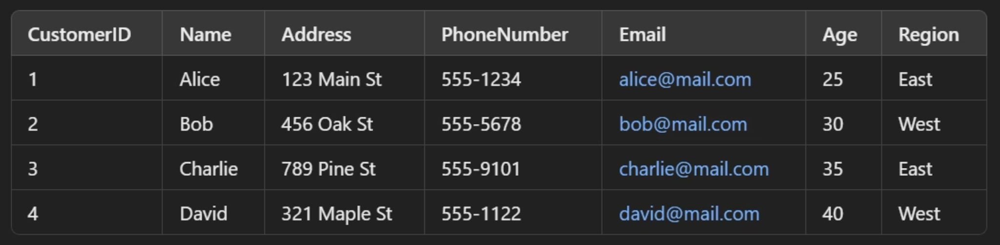

**Paso 1, Primero, por región (horizontal).** La tabla se divide en las filas de *East* y las de *West*:

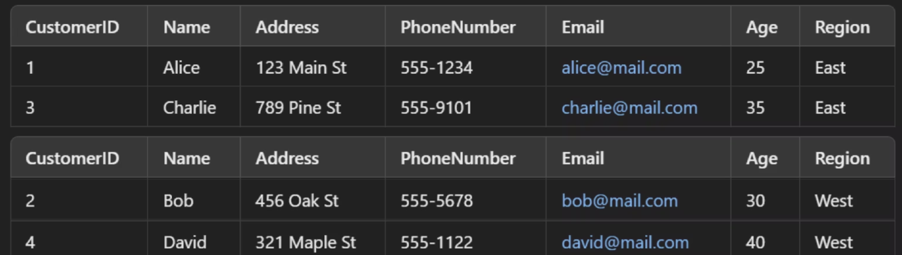

**Paso 2, Después, por su información de contacto (vertical).** Cada uno de los dos fragmentos anteriores se divide a su vez en columnas de contacto y columnas básicas, siempre con `CustomerID`:

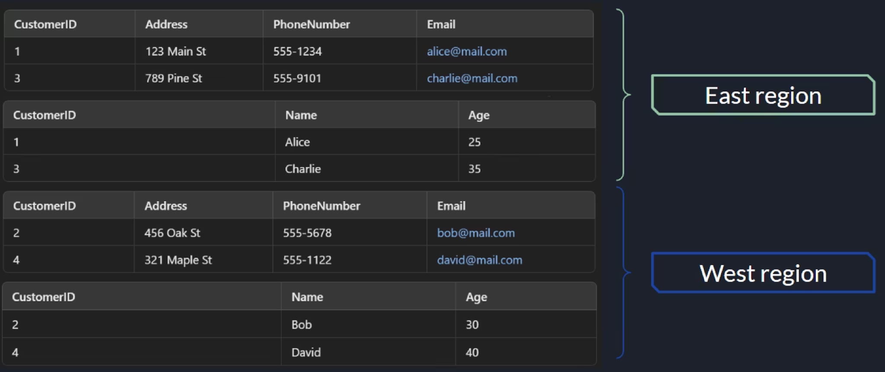

El resultado final son **cuatro fragmentos**:

| Fragmento | Filas | Columnas |
|---|---|---|
| East, contacto | 1, 3 | CustomerID, Address, PhoneNumber, Email |
| East, básica | 1, 3 | CustomerID, Name, Age |
| West, contacto | 2, 4 | CustomerID, Address, PhoneNumber, Email |
| West, básica | 2, 4 | CustomerID, Name, Age |

!!! ejemplo "Ejemplo: ¿Y si fuera VH?"
    Primero separaríamos por columnas (*Basic info* y *Contact info*, las dos con las cuatro filas) y después dividiríamos cada fragmento por región. En este caso concreto llegaríamos a los mismos cuatro trozos: lo que cambia es **el orden** en que se decide cortar, que en sistemas reales depende de qué consultas son las más habituales.

### *Cómo se reconstruye la tabla*

Cuando estudies SQL verás las dos operaciones que usa el SGBD para volver a montar la tabla completa:

| Fragmentación | Se reconstruye… | En SQL |
|---|---|---|
| Horizontal | **Juntando filas** de los fragmentos, una lista debajo de otra | `SELECT * FROM clientes_east UNION SELECT * FROM clientes_west;` |
| Vertical | **Emparejando columnas** por la clave primaria | `SELECT * FROM basic_info JOIN contact_info USING (CustomerID);` |
| Híbrida | Combinando las dos: primero se emparejan columnas en cada región y después se juntan las filas | `UNION` de dos `JOIN` |

No hace falta que sepas escribir estas consultas todavía: lo importante es entender que **horizontal se reconstruye apilando** y **vertical se reconstruye emparejando por la clave**.

!!! comprueba "Comprueba: Bloque 6"
    1. ¿Por qué una base de datos centralizada tiene «fallo total»?
    2. Explica la diferencia entre BDD, SBDD y SGBDD.
    3. ¿Qué significa que un SGBDD ofrece acceso transparente?
    4. Enuncia las tres reglas de la fragmentación.
    5. En una fragmentación vertical, ¿qué columna debe aparecer en todos los fragmentos y por qué?

# Material de repaso

## Glosario

| Término | Definición breve |
|---|---|
| **Acceso concurrente** | Varios usuarios trabajando con los mismos datos a la vez, de forma controlada por el SGBD. |
| **Acceso transparente** | El usuario de un sistema distribuido trabaja como si hubiera un solo SGBD en un solo ordenador. |
| **ACID** | Atomicidad, Consistencia, Aislamiento y Durabilidad: garantías de las transacciones |
| **Atributo** | Propiedad o característica de una entidad; columna de una tabla |
| **Banco de datos** | Gran base de datos propietaria, desarrollada por una organización y a menudo especializada. |
| **Base de datos** | Colección de datos lógicamente relacionados, con estructura y descripción común y mínima redundancia |
| **Base de datos centralizada** | Base de datos situada en una única ubicación física. |
| **Base de datos distribuida (BDD)** | Conjunto de bases de datos lógicamente relacionadas repartidas en nodos conectados por una red. |
| **Bloque (registro físico)** | Cantidad de información transferida entre soporte y memoria en una operación |
| **Campo** | Información elemental que forma parte de un registro |
| **Clave foránea** | Atributo que crea una relación con otra entidad |
| **Clave primaria** | Atributo o conjunto de atributos que identifica de forma única cada registro |
| **Colisión** | Dos claves distintas que generan la misma dirección hash |
| **Completitud** | Regla de fragmentación: todos los datos de la tabla completa están en algún fragmento. |
| **DBA** | Administrador de base de datos: persona o equipo con el control centralizado de la base de datos. |
| **DCL** | Lenguaje de Control de Datos: usuarios, permisos y seguridad (`GRANT`, `REVOKE`). |
| **DDL** | Lenguaje de Definición de Datos (`CREATE`, `ALTER`, `DROP`) |
| **DDL** | Lenguaje de Definición de Datos: estructuras, relaciones y restricciones (`CREATE`, `ALTER`, `DROP`). |
| **Diccionario de datos** | Catálogo donde se almacenan los metadatos |
| **Diccionario de datos** | Descripción de todos los datos almacenados: estructuras, nombres, restricciones, permisos, espacio, auditoría. |
| **Disyunción** | Regla de fragmentación: en la vertical, la clave primaria se incluye en todos los fragmentos para mantener la relación. |
| **DML** | Lenguaje de Manipulación de Datos (`SELECT`, `INSERT`, `UPDATE`, `DELETE`) |
| **DML** | Lenguaje de Manipulación de Datos: consultar, insertar, modificar y eliminar (`SELECT`, `INSERT`, `UPDATE`, `DELETE`). |
| **Dominio** | Conjunto de valores permitidos para un atributo |
| **Entidad** | Objeto real o abstracto sobre el que se almacena información |
| **EOF** | *End Of File*: marca de final de fichero |
| **Esquema** | Descripción de la base de datos en uno de sus niveles (interno, conceptual o externo). |
| **Factor de blocaje** | Número de registros lógicos que entran en un bloque |
| **Fichero** | Conjunto de información relacionada, tratada como un todo y organizada de forma estructurada |
| **Fragmentación** | Dividir las tablas y distribuir las partes entre servidores. |
| **Fragmentación horizontal** | División en subconjuntos de filas. |
| **Fragmentación híbrida** | Combinación de horizontal y vertical (HV o VH). |
| **Fragmentación vertical** | División en subconjuntos de columnas, con la clave primaria en cada fragmento. |
| **Función de hashing** | Función matemática que transforma una clave en una dirección |
| **Gestor de base de datos** | Componente que garantiza un acceso y almacenamiento correcto, seguro, íntegro y eficiente. |
| **Independencia física** | Cambiar el esquema interno sin afectar a los esquemas conceptual ni externos. |
| **Independencia lógica** | Cambiar el esquema conceptual sin afectar a los esquemas externos ni a los programas. |
| **Metadatos** | Datos que describen los datos: estructura, tipos, relaciones |
| **NAS** | Almacenamiento conectado a la red, accedido como carpeta compartida |
| **Nivel externo** | Las vistas que tiene cada usuario o grupo de usuarios. |
| **Nivel interno o físico** | La estructura física: almacenamiento, métodos de acceso, archivos, registros. |
| **Nivel lógico o conceptual** | La estructura completa de la base de datos, sin detalles de almacenamiento. |
| **Nodo** | Cada uno de los equipos de un sistema distribuido, con su base de datos local y su SGBD. |
| **Normalización** | Diseño de la base de datos para organizar los datos de la forma más simple posible |
| **RAID** | Combinación de varios discos en una unidad lógica, por rendimiento y/o redundancia |
| **Reconstrucción** | Regla de fragmentación: la tabla completa se puede recomponer a partir de los fragmentos. |
| **Registro lógico** | Conjunto de datos relativos a un mismo elemento u objeto |
| **Relación** | Conexión entre entidades; también, nombre formal de una tabla |
| **SAN** | Red dedicada de alta velocidad que conecta almacenamiento y servidores |
| **SATA** | Interfaz de disco para PC y servidores, con conexión en caliente |
| **SCSI** | Interfaz de disco empresarial: hasta 15 unidades por controlador |
| **SGBD** | Sistema de Gestión de Bases de Datos (MySQL, SQL Server…) |
| **SGBD** | Sistema de Gestión de Bases de Datos: conjunto de programas para acceder y manejar los datos. |
| **SGBDD** | SGBD distribuido: gestiona bases de datos distribuidas con acceso transparente. |
| **SGBD heterogéneo** | Sistema distribuido con SGBD diferentes en los nodos (federado o multibase). |
| **SGBD homogéneo** | Sistema distribuido con el mismo SGBD en todos los nodos. |
| **Sinónimos** | Claves distintas que generan la misma dirección hash |
| **SQL** | Lenguaje estándar de consulta de bases de datos relacionales |
| **Tupla** | Fila de una tabla; un registro |
| **Índice** | Estructura que acelera búsquedas y consultas |

## Mapa resumen

### Bloques 1 a 3
```
ALMACENAMIENTO DE LA INFORMACIÓN
│
├── 1. FICHEROS
│   ├── Estructura ....... Fichero → Registro lógico → Campo
│   │                      Bloque = registro físico (factor de blocaje)
│   ├── Según función .... Permanentes: maestros; constantes; históricos
│   │                      Temporales: intermedios; maniobras; resultados
│   ├── Soportes ......... Acceso directo (disco); Acceso secuencial (cinta)
│   ├── Organizaciones ... Secuencial; Directo; Indexado
│   │                      Secuencial indexado; Hash (colisiones/sinónimos)
│   └── Parámetros ....... Capacidad; Actividad; Volatilidad; Crecimiento
│
├── 2. BASES DE DATOS
│   ├── Definición ....... Datos relacionados + mínima redundancia + compartidos
│   ├── Metadatos ........ Diccionario de datos → independencia lógica/física
│   ├── Elementos ........ Entidades; Atributos; Registros
│   ├── Claves ........... Primaria (identifica); Foránea (relaciona)
│   ├── Roles ............ Administrador; Diseñador; Programador; Usuario
│   └── Soporte físico ... SATA; SCSI; RAID (0/1); NAS; SAN
│
└── 3. MODELOS
    ├── Niveles .......... Conceptual (E/R); Lógico (Relacional); Físico

    ├── Clásicos ......... Jerárquico (árbol); En red (muchos a muchos)

    ├── Relacional ....... Codd, 1970; Tablas; DDL/DML; SQL; Normalización

    ├── Orientado a obj... Objetos, clases, herencia, encapsulación, polimorfismo

    ├── Objeto-relacional. Híbrido: tablas que contienen objetos

    └── Otros ............ Deductivas; Multidimensionales; Transaccionales (ACID)

                           NoSQL: documentales; columnares; clave-valor; grafos
```

### Bloques 4 a 6
```
SGBD = conjunto de programas para acceder y manejar los datos
│
├── Entorno ........ BD (datos); SO (servicios de bajo nivel); Aplicaciones
│
├── Ventajas ....... abstracción; independencia física; menos redundancia
│                    integridad; acceso rápido; seguridad; compartir
│                    intercambio; copias de seguridad
│
├── Funciones ...... Definición -> DDL   CREATE; ALTER; DROP
│                    Manipulación -> DML   SELECT; INSERT; UPDATE; DELETE
│                    Control ───-> DCL   GRANT; REVOKE
│
├── Componentes .... lenguajes; diccionario de datos; gestor
│                    usuarios (DBA + diseñadores, operadores, analistas, finales)
│                    herramientas (formularios, informes, interfaces gráficas)
│
├── Arquitectura ... EXTERNO   (vistas)          ─┐ independencia lógica
│   (3 niveles)      CONCEPTUAL (estructura)     ─┤
│                    INTERNO   (físico)          ─┘ independencia física
│
├── Tipos de BD .... contenido: información actual; directorios; documentales
│                    uso: individual; compartida; pública; propietaria
│                    ubicación: centralizada; distribuida
│                    variabilidad: estática; dinámica
│
├── Tipos de SGBD .. modelo: jerárquico; red; relacional; OO
│                    usuarios: mono; multi
│                    distribución: centralizado; distribuido (homo/hetero)
│                    propósito: general; especial
│
└── Distribuidas ... BDD; SBDD; SGBDD (acceso transparente, nodos LAN/WAN)
                     Fragmentación: horizontal (filas); vertical (columnas + PK)

                                    híbrida (HV / VH)

                     Reglas: completitud; reconstrucción; disyunción
```

## Autoevaluación

### Bloques 1 a 3

**Parte A. Preguntas cortas**

1. Define «fichero» con las tres ideas que contiene la definición formal.
2. Explica con tus palabras qué es el factor de blocaje y para qué sirve.
3. Clasifica cada uno de estos ficheros (maestro, constante, histórico, intermedio, de maniobras, de resultados):  
   a) Tabla de códigos de provincia; b) Datos de los empleados en activo; c) El fichero de swap; d) Listado de facturas de 2019; e) Un PDF listo para imprimir; f) Un fichero que genera el proceso A para que lo lea el proceso B.
4. ¿Por qué un fichero secuencial no permite insertar registros en medio?
5. Un fichero hash usa `dirección = clave mod 50`. ¿A qué dirección van las claves 1287 y 3437? ¿Qué ha pasado?
6. ¿Qué dos modos de acceso permite un fichero indexado?
7. Explica la diferencia entre actividad y volatilidad de un fichero.
8. ¿Qué son los metadatos y qué independencia permiten?
9. Nombra los cuatro perfiles que trabajan con una base de datos y di cuál es el del programador.
10. ¿Qué diferencia hay entre RAID 0 y RAID 1?
11. ¿Por qué el modelo en red es más potente que el jerárquico, y qué precio se paga?
12. Clasifica como DDL o DML: `DROP TABLE`, `SELECT`, `INSERT`, `ALTER TABLE`, `DELETE`.
13. Enumera los cinco requisitos que debe cumplir una tabla relacional.
14. ¿Qué significan las siglas ACID?
15. ¿Qué tipo de base de datos NoSQL se corresponde con MongoDB? ¿Y con Neo4j?

**Parte B. Tipo test** (una sola respuesta correcta)

1. El número de registros lógicos que caben en un bloque se llama:  
   a) factor de compresión; b) factor de blocaje; c) tasa de renovación; d) dominio
2. Un fichero que almacena los usuarios dados de baja de una plataforma es:  
   a) maestro; b) constante; c) histórico; d) intermedio
3. ¿Cuál de estas organizaciones **no** mantiene el orden por clave?  
   a) secuencial; b) indexado; c) secuencial indexado; d) hash
4. Dos claves que generan la misma dirección hash se llaman:  
   a) duplicadas; b) sinónimos; c) homónimas; d) colisionadas
5. La independencia entre organización lógica y almacenamiento físico la permiten:  
   a) los índices; b) las claves foráneas; c) los metadatos; d) los bloques
6. Un controlador SCSI puede gestionar hasta:  
   a) 4 unidades; b) 8 unidades; c) 15 unidades; d) 32 unidades
7. RAID 0 proporciona:  
   a) redundancia; b) rendimiento; c) las dos cosas; d) ninguna de las dos
8. El modelo relacional fue desarrollado por:  
   a) Bachman, 1964; b) Codd, 1970; c) CODASYL, 1971; d) Chen, 1976
9. `ALTER TABLE` pertenece a:  
   a) DML; b) DDL; c) SQL embebido; d) DCL
10. Cassandra es una base de datos NoSQL de tipo:  
    a) documental; b) clave-valor; c) columnar; d) de grafos

**Parte C. Razona**

1. Una empresa tiene un fichero de 2 millones de registros que se recorre entero una vez al mes para emitir facturas, y que casi nunca se consulta de forma individual. ¿Qué organización recomendarías? Justifica la respuesta con los parámetros de utilización.
2. Explica por qué una aplicación web de reservas de hotel no podría funcionar con ficheros secuenciales.
3. Un compañero dice: «con RAID 1 no necesito hacer copias de seguridad». Explícale por qué se equivoca.

### Bloques 4 a 6

**Parte A. Preguntas cortas**

1. Define SGBD y di cuál es su objetivo principal.
2. ¿Qué tres tareas facilita un SGBD para crear y mantener bases de datos? Pon un ejemplo de cada una.
3. ¿Por qué se dice que el SGBD es el que «otorga los permisos» y no el sistema operativo?
4. Nombra seis ventajas de usar un SGBD.
5. ¿Qué define el DDL? Nombra cuatro elementos que se definen con él.
6. ¿Qué cuatro operaciones permite el DML?
7. ¿Para qué sirve el DCL y quién lo utiliza normalmente?
8. Nombra los cinco componentes de un SGBD.
9. ¿Qué es el gestor de base de datos y entre qué dos elementos hace de intermediario?
10. Describe el nivel interno de la arquitectura de un SGBD.
11. Explica con un ejemplo la independencia lógica.
12. ¿Qué diferencia hay entre una base de datos centralizada basada en host y una basada en cliente/servidor?
13. ¿Qué son los nodos de un SGBDD y cómo se conectan?
14. ¿Qué pasa si no se fragmenta nada? ¿Y si se fragmenta en exceso?
15. ¿Qué significan las siglas HV y VH?

**Parte B. Tipo test** (una sola respuesta correcta)

1. `ALTER TABLE` es una orden de:  
   a) DML; b) DCL; c) DDL; d) ninguna de las anteriores
2. El componente que contiene la definición de tablas, índices, restricciones y permisos es:  
   a) el gestor; b) el diccionario de datos; c) el generador de informes; d) el esquema externo
3. El nivel de abstracción más cercano al almacenamiento físico es:  
   a) externo; b) conceptual; c) lógico; d) interno
4. Una base de datos puede tener:  
   a) un esquema externo y varios internos; b) varios esquemas conceptuales; c) un esquema interno, uno conceptual y varios externos; d) un esquema de cada tipo
5. Añadir un índice sin tener que modificar las aplicaciones es un ejemplo de:  
   a) independencia lógica; b) independencia física; c) redundancia; d) fragmentación
6. Un catálogo de biblioteca que indica dónde está cada libro pero no su contenido es una base de datos:  
   a) de texto completo; b) referencial; c) de imágenes electrónicas; d) estática
7. Un sistema de reservas de una aerolínea es un SGBD de:  
   a) propósito general; b) propósito especial; c) uso individual; d) modelo jerárquico
8. Un sistema distribuido en el que los nodos usan SGBD distintos es:  
   a) homogéneo; b) centralizado; c) heterogéneo; d) monousuario
9. ¿Cuál es una desventaja de las bases de datos centralizadas?  
   a) redundancia; b) inconsistencia; c) fallo total; d) costes de mantenimiento altos
10. Dividir una tabla en subconjuntos de columnas es fragmentación:  
    a) horizontal; b) vertical; c) híbrida; d) completa

**Parte C. Razona**

1. Clasifica cada orden en DDL, DML o DCL y explica por qué `DELETE` y `DROP` no pertenecen al mismo lenguaje: `CREATE TABLE`, `INSERT`, `GRANT`, `DELETE`, `DROP TABLE`, `SELECT`, `REVOKE`, `UPDATE`.
2. Una cadena de gimnasios tiene centros en Palma, Inca y Manacor. Cada centro consulta casi siempre sus propios socios, pero la central necesita a veces estadísticas globales. ¿Propondrías una base de datos centralizada o distribuida? ¿Qué tipo de fragmentación aplicarías a la tabla de socios? Justifica la respuesta.
3. Un compañero fragmenta verticalmente la tabla de clientes en `(Name, Age)` y `(CustomerID, Address, PhoneNumber, Email)`. ¿Qué regla incumple y qué problema causa?
