# Cómo usar este dosier {.nobreak}

Este dosier recoge lo que trabajamos en clase sobre el modelo entidad-relación: leer y dibujar el plano de una base de datos antes de construirla.

Encontrarás cuatro tipos de caja:

!!! definicion "Definición"
    Un término que tienes que saber explicar con tus palabras. Si solo sabes repetirlo de memoria, todavía no lo has aprendido.

!!! ejemplo "Ejemplo"
    Un caso concreto. Léelo despacio: aquí es donde la idea se entiende.

!!! ojo "Ojo"
    Un error típico o dos conceptos que se suelen confundir. Son las preguntas que salen en el examen.

!!! comprueba "Comprueba"
    Preguntas al final de cada bloque. Contesta sin mirar atrás.

Al final tienes un **glosario**, un **mapa resumen** y una **autoevaluación** (sin soluciones: contrastalas en clase).

## Qué vas a aprender

Al terminar esta UT deberías ser capaz de:

- Reconocer y dibujar entidades, atributos y relaciones con la notación de clase.
- Clasificar atributos y fijar cardinalidades (1:1, 1:N, N:M) y participación.
- Distinguir entidades fuertes y débiles, y el grado de las relaciones.
- Aplicar restricciones entre relaciones, jerarquías ISA y agregación.

## Índice

| Bloque | Tema |
|---|---|
| [1](#bloque-1-entidades-y-atributos) | [Entidades y atributos](#bloque-1-entidades-y-atributos) |
| [2](#bloque-2-relaciones-y-cardinalidades) | [Relaciones y cardinalidades](#bloque-2-relaciones-y-cardinalidades) |
| [3](#bloque-3-entidades-fuertes-y-debiles) | [Entidades fuertes y débiles](#bloque-3-entidades-fuertes-y-debiles) |
| [4](#bloque-4-el-grado-de-las-relaciones) | [El grado de las relaciones](#bloque-4-el-grado-de-las-relaciones) |
| [5](#bloque-5-restricciones-sobre-las-relaciones) | [Restricciones sobre las relaciones](#bloque-5-restricciones-sobre-las-relaciones) |
| [6](#bloque-6-generalizacion-y-especializacion) | [Generalización y especialización](#bloque-6-generalizacion-y-especializacion) |
| [7](#bloque-7-agregacion) | [Agregación](#bloque-7-agregacion) |
| Repaso | [Glosario, mapa resumen y autoevaluación](#material-de-repaso) |

# Bloque 1. Entidades y atributos

## 1.1 Qué es un modelo de datos

!!! definicion "Definición"
 Colección de herramientas conceptuales que permite describir los **datos**, sus **relaciones**, su **semántica** (su significado) y las **restricciones** que se les pueden aplicar.


Recuerda de la UT1 que los SGBD tienen una arquitectura pensada para simplificar el trabajo de los distintos usuarios. Su objetivo principal es **separar los programas de aplicación de la base de datos física**, y para ello propone tres niveles de abstracción:

| Nivel | Qué hace |
|---|---|
| **Interno o físico** | Describe cómo se almacenan físicamente los datos en el sistema |
| **Lógico o conceptual** | Define la estructura global de la base de datos y las relaciones entre los datos |
| **Externo o de vista de usuario** | Presenta diferentes vistas personalizadas para distintos tipos de usuarios |

El nivel que más nos interesa es el **lógico o conceptual**, porque es el que contiene la estructura global de los datos: qué datos hay y cómo se relacionan. Esa estructura es justo lo que vas a aprender a dibujar en esta UT.

### *Dos clasificaciones que no hay que mezclar*

En la UT1 viste la palabra «nivel» usada para **dos cosas distintas**. Conviene separarlas desde el principio:

| | Niveles de abstracción del SGBD | Tipos de modelos de datos |
|---|---|---|
| **Qué clasifican** | Cómo está organizado por dentro un SGBD que ya funciona (arquitectura ANSI/SPARC) | Las fases por las que pasa el diseño de una base de datos |
| **Cuáles son** | Externo , conceptual (o lógico) , interno (o físico) | Conceptual , lógico , físico |
| **Dónde lo viste** | UT1, Parte 2 (independencia de datos) | UT1, Parte 1 (qué es un modelo de base de datos) |

En la segunda clasificación, **conceptual y lógico son cosas distintas**:

| Tipo de modelo | Fase | Ejemplo | ¿Depende del SGBD? |
|---|---|---|---|
| **Conceptual** | Análisis | **Modelo Entidad/Relación** | No |
| **Lógico** | Diseño | Modelo relacional (tablas y claves) | Del tipo de SGBD |
| **Físico** | Implementación | Organización de ficheros, índices | Del SGBD concreto |

!!! ojo "Ojo"
 El E/R describe qué datos hay y cómo se relacionan **sin depender de ningún SGBD**: es un modelo **conceptual**, no lógico. La conexión entre las dos clasificaciones es esta: el nivel conceptual del SGBD contiene la estructura global de los datos; esa estructura primero se dibuja con un modelo conceptual (**E/R**) y después se traduce a un modelo lógico (**relacional**) para que el SGBD la entienda.


### *El modelo E/R y el trabajo de diseño*

El modelo Entidad/Relación lo propuso Peter Chen en 1976. Es la herramienta con la que se hace el **plano** de una base de datos antes de construirla. Igual que un arquitecto no empieza a poner ladrillos sin un plano, un diseñador no escribe `CREATE TABLE` sin un diagrama E/R. El camino que vas a recorrer en el módulo es este:

```
 Enunciado Diagrama E/R Modelo relacional SQL
 (lenguaje ──► (entidades, ──► (tablas, claves) ──► CREATE TABLE ...
 natural) relaciones)
 MODELO MODELO MODELO
 CONCEPTUAL LÓGICO FÍSICO
 ▲
 └── estás aquí
```


## 1.2 Entidades

!!! definicion "Definición"
 Entidad que existe de forma **independiente**: su existencia no depende de la existencia de otras entidades. En el modelo E/R se representa con su nombre encerrado en un **rectángulo**.


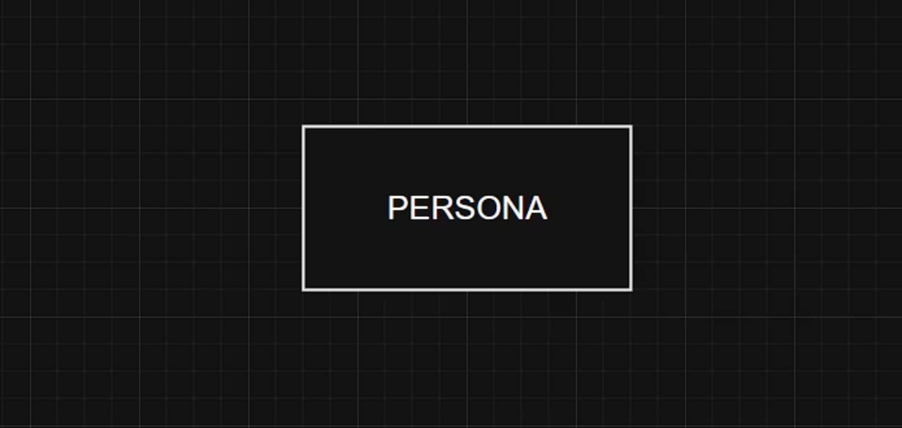

Una entidad es «un tipo de cosa» sobre la que queremos guardar información: PERSONA, ALUMNO, CURSO, PRODUCTO. Por eso su nombre suele ser un **sustantivo** y se escribe en **singular**.

!!! ojo "Ojo"
 PERSONA es la **entidad** (el molde). *Marta Ruiz* o *Joan Pons* son **ocurrencias** (o instancias) de esa entidad: los casos concretos. En el diagrama solo se dibuja la entidad, una vez; las ocurrencias serán después las filas de la tabla. En el apartado 2.4 verás las ocurrencias dibujadas con un diagrama de conjuntos.


## 1.3 Atributos

!!! definicion "Definición"
 Propiedad o característica de una entidad. Los atributos contienen los **datos específicos** que queremos almacenar. En el modelo E/R se representan con su nombre encerrado en un **óvalo**.


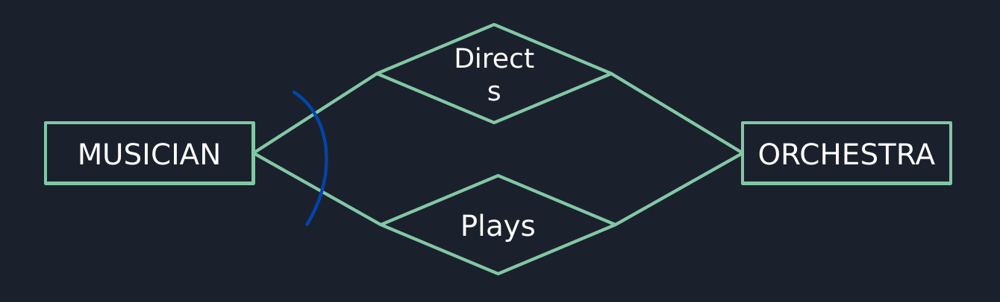

!!! ejemplo "Ejemplo"
 De la entidad PERSONA nos interesa guardar `dni`, `nombre`, `dirección` y `fecha_nac`. Cada uno es un atributo y se dibuja como un óvalo unido al rectángulo de PERSONA con una línea.


## 1.4 Tipos de atributos

Los atributos se clasifican de varias formas. Cada clasificación responde a una pregunta distinta, así que **un mismo atributo tiene una etiqueta en cada una** (por ejemplo, `email` puede ser a la vez opcional, simple y multivaluado).

### 1.4.1 Obligatorio u opcional

*¿Tiene que tener siempre valor?*

| Tipo | Descripción | Ejemplo |
|---|---|---|
| **Obligatorio** | Siempre debe estar definido para una entidad o relación. Una **clave o identificador** es un atributo obligatorio. | `dni` |
| **Opcional** | Puede estar definido o no. Pueden existir ocurrencias de la entidad para las que este atributo no tenga valor. | `num_tlf` |

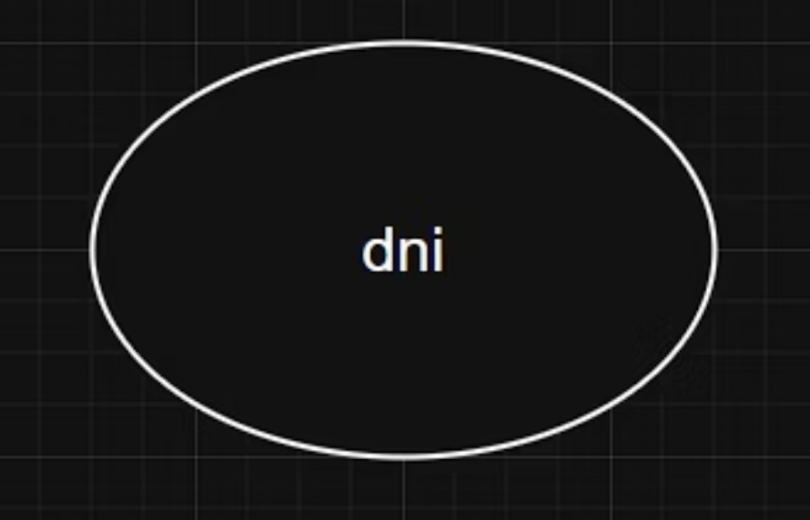

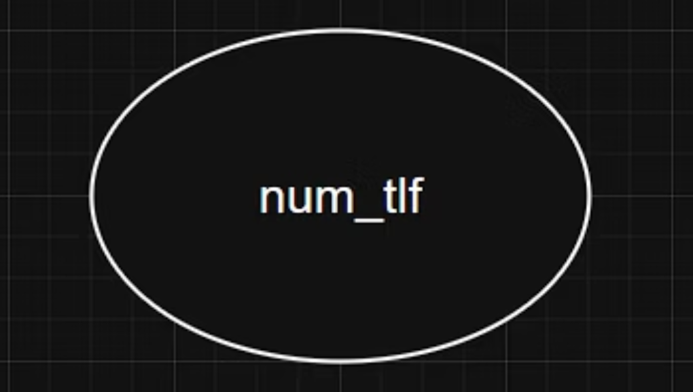

!!! definicion "Definición"
 Atributo (o conjunto de atributos) cuyo valor distingue a cada ocurrencia de todas las demás. En los diagramas se señala **subrayando** su nombre, como verás en `email`, `Code` o `hotel_id` en los ejemplos de este dosier.


### 1.4.2 Simple o compuesto

*¿Se puede dividir en partes con significado propio?*

| Tipo | Descripción | Ejemplo |
|---|---|---|
| **Simple** | No se puede dividir en otras partes o atributos; presenta un solo elemento. No es posible extraer partes más pequeñas que tengan significado. | `nombre` |
| **Compuesto** | Se puede dividir en subpartes, que constituyen otros atributos con significado propio. | `dirección` (calle, ciudad, código postal) |

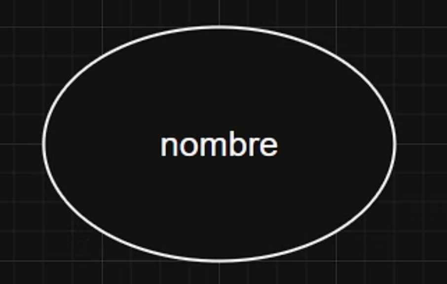

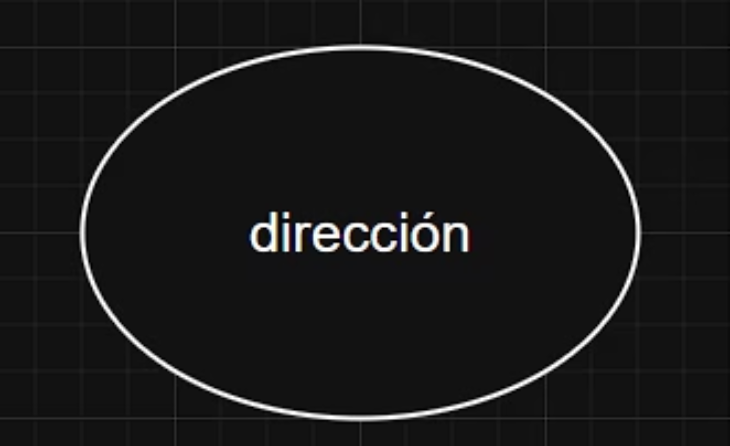

### 1.4.3 Monovaluado o multivaluado

*¿Cuántos valores puede tener una misma ocurrencia?*

| Tipo | Descripción | Ejemplo |
|---|---|---|
| **Monovaluado** | Tiene un solo valor para cada ocurrencia de la entidad. | `fecha_nac`: cada persona tiene una |
| **Multivaluado** | Puede tomar diferentes valores para cada ocurrencia de la entidad. | `email`: una persona puede tener varios |

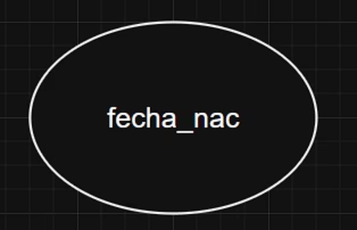

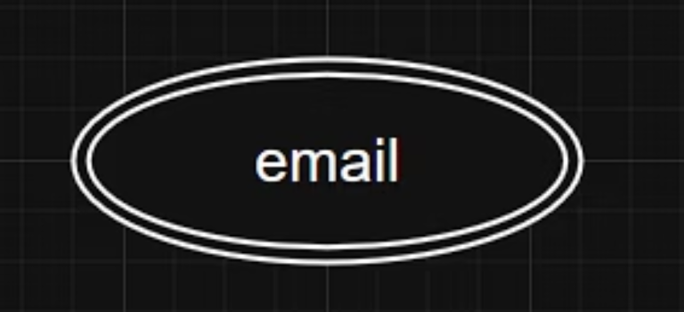

### 1.4.4 Derivado

| Tipo | Descripción | Ejemplo |
|---|---|---|
| **Derivado** | Su valor se puede obtener a partir del valor o valores de otros atributos relacionados. | `edad`, que se calcula a partir de `fecha_nac` |

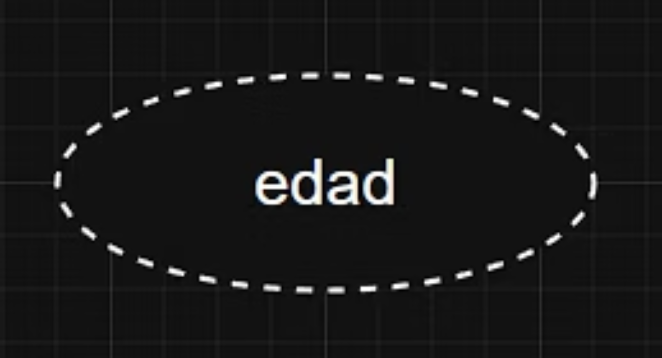

!!! ejemplo "Ejemplo"
 Si guardas `fecha_nac = 2008-03-14`, la edad se calcula sola cada día. Si guardaras la edad como un número fijo (17), el año que viene el dato sería falso y alguien tendría que acordarse de actualizarlo. Un atributo derivado **no hace falta almacenarlo**: se calcula cuando se necesita.
 
 **OJO : Compuesto no es multivaluado**
 **Compuesto** = un solo valor que se puede **partir en trozos** (una dirección tiene calle, ciudad y código postal). **Multivaluado** = **varios valores** del mismo tipo (tres correos electrónicos distintos). Una persona puede tener una sola dirección compuesta y varios correos simples.


## 1.5 Representación gráfica de los atributos

Cada tipo de atributo tiene su propio dibujo:

| Tipo de atributo | Cómo se dibuja |
|---|---|
| Simple | Óvalo sencillo conectado a la entidad |
| Compuesto | Óvalo del que salen otros óvalos (sus partes) |
| Multivaluado | **Óvalo doble** |
| Derivado | **Óvalo punteado**, para indicar que se calcula |
| Clave | Nombre **subrayado** *(ampliación)* |

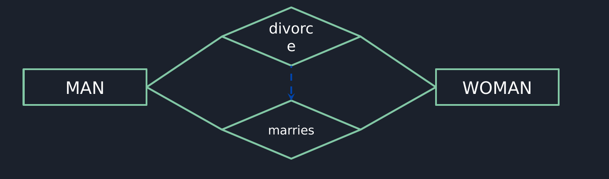

Cómo leer el diagrama de la entidad CLIENT:

- `date_birth` es un atributo **simple**.
- `address` es **compuesto**: se divide en `street`, `city` y `zip_code`.
- `phone_num` es **multivaluado** (óvalo doble): un cliente puede tener varios teléfonos.
- `age` es **derivado** (óvalo punteado): se calcula a partir de `date_birth`.


!!! comprueba "Comprueba"
 1. ¿Qué describe un modelo de datos? Nombra las cuatro cosas.
 2. ¿El modelo E/R es un modelo conceptual, lógico o físico? ¿Por qué?
 3. ¿Con qué figura se dibuja una entidad? ¿Y un atributo?
 4. Clasifica `dirección` según las cuatro clasificaciones de atributos.
 5. ¿Cómo se dibuja un atributo multivaluado? ¿Y uno derivado?


# Bloque 2. Relaciones y cardinalidades

## 2.1 Relaciones

!!! definicion "Definición"
 Elemento fundamental del modelo E/R que permite **conectar datos**. Una relación asocia elementos de una entidad con elementos de otra entidad, mostrando cómo están vinculados.


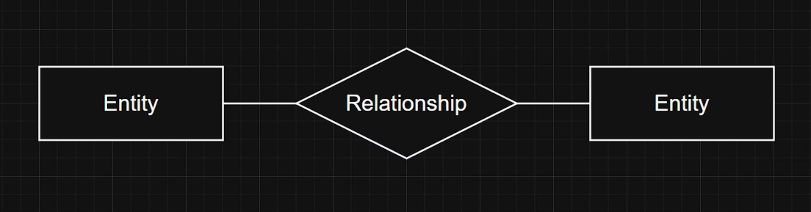

Hay dos ideas clave:

1. **Regla fundamental.** En una relación, **la misma combinación de entidades no puede repetirse**: la misma entidad no puede estar vinculada a otra de la misma manera más de una vez.
2. **Representación gráfica.** Una relación se dibuja con un **rombo** con su nombre dentro. El rombo se une con **líneas rectas** a las entidades que relaciona.

**Cómo nombrar una relación.** El nombre debe referirse al **propósito o razón** de la asociación. Normalmente se usan **verbos en singular**: «forma», «posee», «contrata», «enseña», «aloja».

!!! ejemplo "Ejemplo"
 En la relación PROFESOR *enseña* CURSO, la pareja (Laura, Bases de datos) solo puede aparecer **una vez**. No tiene sentido decir dos veces que Laura enseña Bases de datos. Si hiciera falta guardar que la enseña en dos cursos académicos distintos, habría que cambiar el diseño, pero no repetir la pareja.
 
 **OJO : Sustantivos y verbos**
 Un truco para leer un enunciado: los **sustantivos** suelen ser entidades o atributos, y los **verbos** que los unen suelen ser relaciones. «Un profesor **enseña** cursos» → PROFESOR, CURSO y la relación *enseña*.


## 2.2 Cardinalidad de las relaciones

!!! definicion "Definición"
 Número **máximo** de ocurrencias de una entidad que pueden estar asociadas con otra. Se aplica a las relaciones entre dos entidades y especifica cómo pueden vincularse.


| Tipo | Significado | Ejemplo |
|---|---|---|
| **Uno a uno (1:1)** | Una ocurrencia de A está vinculada a una ocurrencia de B. | Un estudiante tiene un expediente, y cada expediente pertenece a un estudiante. |
| **Uno a muchos (1:N)** | Una ocurrencia de A está vinculada a muchas de B, pero B está vinculada solo a una A. | Un profesor puede enseñar muchas materias, pero cada materia tiene solo un profesor. |
| **Muchos a muchos (N:M)** | Muchas ocurrencias de A pueden vincularse a muchas de B. | Un estudiante puede inscribirse en muchos cursos, y un curso puede tener muchos estudiantes. |

!!! ejemplo "Ejemplo"
 Haz **dos preguntas**, una en cada sentido, y quédate con la respuesta **máxima**:
 1. «Un profesor, ¿cuántas materias puede enseñar?» → **muchas** (N).
 2. «Una materia, ¿cuántos profesores puede tener?» → **uno** (1).
 Resultado: **1:N**. Si las dos respuestas hubieran sido «muchos», sería N:M; si las dos «uno», 1:1.
 
 **OJO : La cardinalidad la decide el enunciado**
 No existe «la» cardinalidad de PROFESOR: MATERIA. En este instituto cada materia tiene un único profesor (1:N), pero en otro centro donde dos profesores comparten una materia sería N:M. Lee el enunciado y aplícalo tal cual, sin inventar.


## 2.3 Cardinalidad de entidades

La cardinalidad de la relación solo dice el **máximo**. La cardinalidad de entidades afina más: dice el **mínimo y el máximo**.

!!! definicion "Definición"
 Grado en que una entidad participa en una relación: el número **mínimo y máximo** de asociaciones que cada instancia de la entidad puede tener. Se escribe con dos números entre paréntesis: **(cardinalidad mínima, cardinalidad máxima)**.


La cardinalidad **mínima** indica si la participación es obligatoria u opcional:

| Participación | Cuándo |
|---|---|
| **Obligatoria (total)** | La cardinalidad mínima es **1** |
| **Opcional (parcial)** | La cardinalidad mínima es **0** |

**Ejemplos de notación:**

| Notación | Significado |
|---|---|
| (0,1) | Opcional, máximo una vez |
| (1,1) | Obligatoria, exactamente una vez |
| (0,N) | Opcional, sin límite superior |
| (1,N) | Obligatoria, al menos una vez |

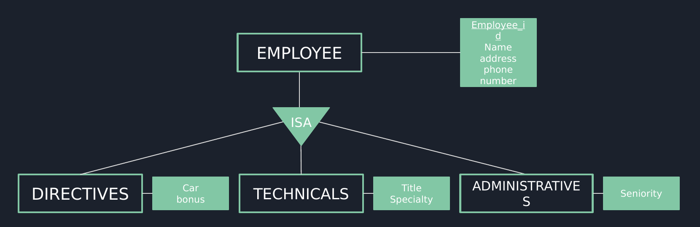

### Cómo leer el ejemplo JUGADOR : EQUIPO

La relación es **N:1** (muchos jugadores, un equipo). Los paréntesis se leen así:

- **(0,1)**, junto a EQUIPO: fijado **un jugador**, ¿en cuántos equipos juega? En ninguno o en uno. La participación del jugador es **opcional** (puede haber jugadores sin equipo).
- **(1,n)**, junto a JUGADOR: fijado **un equipo**, ¿cuántos jugadores tiene? Al menos uno y sin límite. La participación del equipo es **obligatoria**.

!!! ojo "Ojo"
 En los diagramas de este módulo, la pareja (mín, máx) que describe cómo participa una entidad se escribe **en el extremo contrario**, junto a la otra entidad. Para no liarte, usa siempre el mismo método: **tapa una entidad, fija una ocurrencia de ella y pregunta cuántas de la otra le corresponden**. La respuesta se escribe junto a esa otra entidad. Otros libros usan el convenio contrario, así que fíjate siempre en la leyenda del diagrama que estés leyendo.
 
 **EJEMPLO : Del mínimo y máximo a la cardinalidad de la relación**
 Si las cardinalidades son (1,n) y (0,1), cogemos los **máximos**: n y 1. La relación es **1:N** (o N:1, leída al revés). La cardinalidad de la relación sale siempre de los máximos.


## 2.4 El diagrama de conjuntos

Un **diagrama de conjuntos** dibuja las **ocurrencias** reales de cada entidad (como bolas dentro de dos óvalos) y une con flechas las que están relacionadas. Es la mejor forma de comprobar que una cardinalidad tiene sentido.

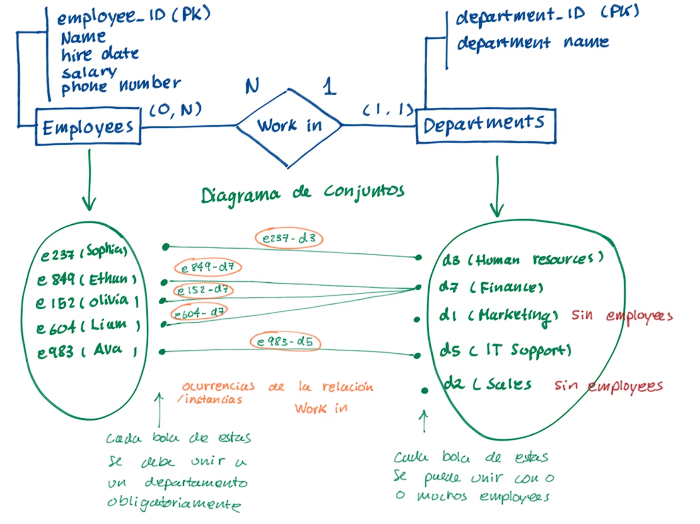

Cómo leer el ejemplo:

- Arriba está el diagrama E/R: **Employees** (`employee_ID` como clave primaria, `Name`, `hire date`, `salary`, `phone number`) se relaciona con **Departments** (`department_ID` como clave primaria, `department name`) a través de **Work in**, con cardinalidad **N:1**.
- Abajo, el diagrama de conjuntos. Cada flecha es una **ocurrencia** o instancia de la relación *Work in*: e237: d3, e849: d7, e152: d7, e604: d7, e983: d5.
- De cada empleado sale **exactamente una** flecha. Cada empleado **debe** unirse a un departamento obligatoriamente: su cardinalidad es **(1,1)**, escrita junto a Departments.
- A cada departamento le llegan **cero o muchas** flechas: d7 (Finance) tiene tres empleados y d1 (Marketing) y d2 (Sales) no tienen ninguno. Su cardinalidad es **(0,N)**, escrita junto a Employees.

!!! ejemplo "Ejemplo"
 Si no sabes si un mínimo es 0 o 1, dibuja las bolas y pregúntate: ¿puede quedar alguna **sin flecha**? Si puede (un departamento recién creado, todavía sin empleados), el mínimo es 0.


## 2.5 Atributos de una relación

Las relaciones **también pueden tener atributos**. Describen características de la **conexión en sí**, no de las entidades que une.

!!! definicion "Definición"
 Atributo que almacena información que pertenece específicamente a la **asociación entre entidades**, no a las entidades individuales.
 
 **EJEMPLO : La relación SE INSCRIBE**
 En una base de datos escolar con las entidades ESTUDIANTE y CURSO hay una relación SE INSCRIBE que indica qué cursos toma cada estudiante. El atributo **calificación** se añade a la relación para guardar la nota que cada estudiante obtuvo en cada curso.
 
 **OJO : La prueba del «de quién es»**
 Pregúntate de quién es el dato. ¿La nota es del estudiante? No: Marta tiene un 8 en Bases de datos y un 6 en Programación. ¿Es del curso? Tampoco: cada alumno saca una nota distinta. La nota solo existe **cuando se juntan un estudiante y un curso concretos**: es de la relación. Los atributos de relación aparecen casi siempre en relaciones **N:M**.


## 2.6 Ejemplo práctico: la escuela

### El enunciado

> Una escuela secundaria necesita un sistema para gestionar información de estudiantes. Para cada estudiante, almacenan nombre, apellido, edad, dirección y una dirección de correo electrónico. El sistema también rastreará los cursos ofrecidos en la escuela, almacenando el nombre del curso y el código. El sistema debe registrar en qué cursos está inscrito cada estudiante, junto con datos relevantes de rendimiento.
>
> La escuela también gestiona información sobre profesores, incluyendo su nombre, apellido, fecha de nacimiento, especialización en materia y un número de teléfono. Los profesores son responsables de enseñar cursos, y el sistema manejará la asignación de cursos a profesores.
>
> Además, el rendimiento de los estudiantes en sus cursos es importante, por lo que el sistema almacenará la calificación que cada estudiante obtiene en cada curso que completa.

### Paso 1 : Marcar el enunciado

El primer paso es **colorear** el enunciado. Es la técnica que tienes que aplicar tú:

| Color | Qué marca | Lo que sale en este enunciado |
|---|---|---|
| Marrón | **Entidades** | estudiante, cursos, profesores |
| Verde | **Atributos** | nombre, apellido, edad, dirección, correo , nombre del curso, código , nombre, apellido, fecha de nacimiento, especialización, teléfono , calificación |
| Azul | **Relaciones** | «en qué cursos están inscritos los estudiantes» , «la asignación de los cursos a cada profesor» |

### Paso 2 : El diagrama resultante

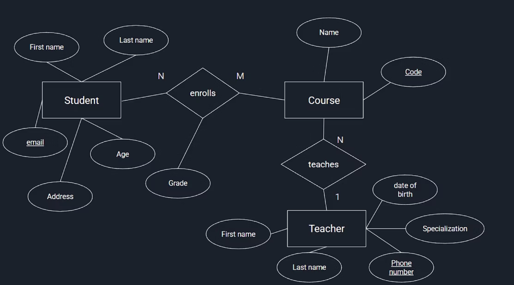

| Elemento | En el diagrama |
|---|---|
| **Student** | First name, Last name, **email** (clave, subrayada), Age, Address |
| **Course** | Name, **Code** (clave) |
| **Teacher** | First name, Last name, date of birth, Specialization, **Phone number** (clave) |
| **enrolls** | Student N : M Course, con el atributo de relación **Grade** |
| **teaches** | Teacher 1 : N Course |

Cómo se justifican las cardinalidades:

- **enrolls es N:M**: un estudiante se inscribe en muchos cursos y un curso tiene muchos estudiantes.
- **teaches es 1:N**: un profesor enseña muchos cursos, y cada curso lo enseña un profesor.
- **Grade va en la relación**: es la calificación de *un estudiante en un curso*, exactamente el caso del apartado 2.5.

!!! ojo "Ojo"
 En el apartado 1.5 `age` aparecía como derivado porque se calculaba a partir de `date_birth`. En la escuela, el enunciado pide guardar la **edad** del estudiante, pero **no** su fecha de nacimiento, así que no hay de dónde calcularla: se dibuja como atributo simple. Dibuja lo que dice el enunciado, no lo que harías tú.


!!! comprueba "Comprueba"
 1. ¿Con qué figura se representa una relación y qué tipo de palabra se usa para nombrarla?
 2. ¿Qué dice la regla fundamental de las relaciones?
 3. ¿Qué significa (0,N)? ¿Y (1,1)?
 4. En Employees: Departments, ¿por qué la cardinalidad junto a Employees es (0,N) y no (1,N)?
 5. ¿Por qué `Grade` es un atributo de la relación *enrolls* y no de Student?


# Bloque 3. Entidades fuertes y débiles

## 3.1 Tipos de entidades

| Tipo | Definición | Cómo se dibuja |
|---|---|---|
| **Entidad fuerte** | Existe de forma independiente: su existencia no depende de la existencia de otras entidades. | Nombre dentro de un **rectángulo** |
| **Entidad débil** | Su existencia depende de la existencia de instancias de otras entidades. | Nombre dentro de un **rectángulo doble** |

!!! ejemplo "Ejemplo"
 Un HOTEL existe por sí mismo. Una HABITACIÓN, en cambio, solo tiene sentido dentro de un hotel: «la habitación 101», sin decir de qué hotel, no identifica nada. HOTEL es fuerte y HABITACIÓN es débil.


## 3.2 Dependencia existencial y de identificación

Las entidades débiles pueden representar **dos tipos de dependencia**:

| Tipo | Qué significa | Frecuencia |
|---|---|---|
| **Dependencia existencial** (E) | Si desaparece una instancia de la entidad fuerte, desaparecen también las instancias de la entidad débil que dependen de ella. | Más raras |
| **Dependencia de identificación** (ID) | Además de la dependencia existencial, cada instancia de la entidad débil **necesita** a una instancia de la fuerte para identificarse por completo. | Las más típicas |

!!! ojo "Ojo"
 La de identificación **incluye** la existencial y añade algo más. Si la habitación se identifica con «hotel + número», al borrar el hotel la habitación no solo se queda sin sentido: se queda sin identificador.


**Reglas de las relaciones con entidades débiles:**

- Son siempre **binarias**: una entidad fuerte y una débil.
- La cardinalidad puede ser **1:N o 1:1**, con la **N siempre en el lado débil**.
- Una relación con una entidad débil **nunca** puede ser **N:M**.


## 3.3 Ejemplos de entidades débiles

Los tres ejemplos usan una notación algo distinta a la del Bloque 1: los atributos de cada entidad se agrupan en una **caja** (*Hotel atributes*, *Room atributes*…) en lugar de dibujar un óvalo por atributo. La clave sigue apareciendo **subrayada**. Es la forma habitual de hacerlo en herramientas como draw.io cuando hay muchos atributos.

### Ejemplo 1 : Hotel y habitación, dependencia de identificación

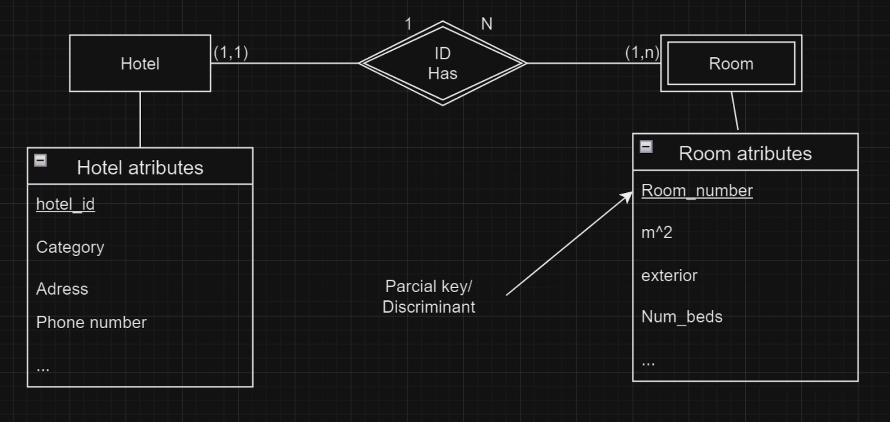

- **Hotel** es fuerte; **Room** es débil (rectángulo doble).
- La relación **Has** está marcada como **ID** y se dibuja con **rombo doble**.
- Cardinalidad **1:N**: un hotel tiene (1,n) habitaciones; cada habitación pertenece a (1,1) hotel.
- `Room_number` es una **clave parcial o discriminante**: identifica la habitación **dentro de su hotel**, pero no sola. La habitación 101 existe en muchos hoteles; para identificarla hace falta `hotel_id` + `Room_number`.

### Ejemplo 2 : Hotel y habitación, dependencia existencial

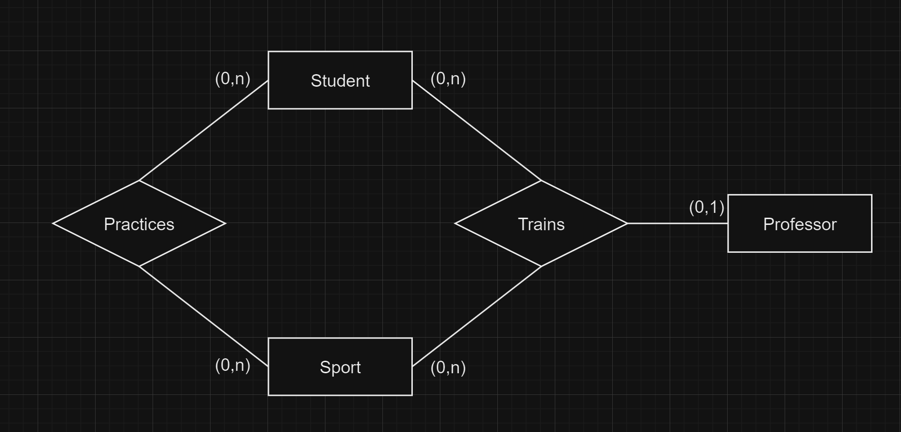

- Las mismas entidades, pero ahora la relación **Has** está marcada como **E**.
- Aquí `Room_number` es una **clave primaria**: un número de habitación **global para todos los hoteles**. Cada habitación se identifica por sí sola, sin necesidad del hotel.
- Sigue habiendo dependencia: si el hotel desaparece, sus habitaciones también. Pero ya no hay dependencia de identificación.

!!! ojo "Ojo"
 Mismo dibujo, misma cardinalidad. La diferencia está en `Room_number`: si solo identifica **dentro del hotel** (discriminante), la dependencia es de **identificación (ID)**; si identifica **por sí solo** (clave global), es solo **existencial (E)**.


### Ejemplo 3 : Empleado y permiso de conducir

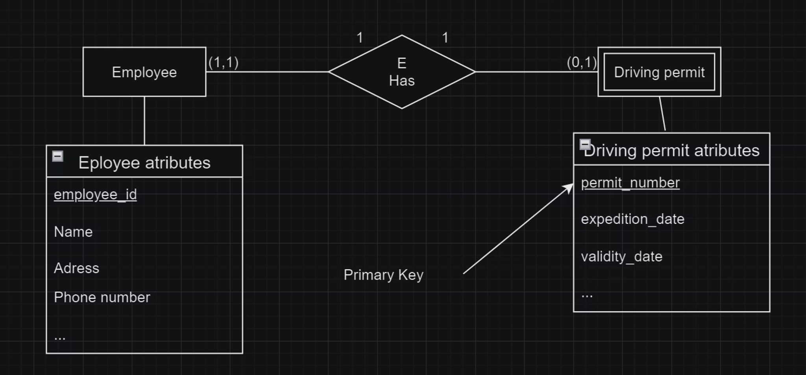

- **Employee** es fuerte y **Driving permit** es débil.
- La relación **Has** es **E** (existencial) y su cardinalidad es **1:1**: un empleado tiene (0,1) permisos de conducir registrados; cada permiso es de (1,1) empleado.
- `permit_number` es **clave primaria**: el número del permiso lo identifica por sí solo. Por eso la dependencia es existencial y no de identificación.

!!! ejemplo "Ejemplo"
 Los tres ejemplos cumplen las reglas del apartado 3.2: son binarios, ninguno es N:M, y en los 1:N la N está en el lado débil (Room).


!!! comprueba "Comprueba"
 1. ¿Cómo se dibuja una entidad débil?
 2. ¿Qué diferencia hay entre dependencia existencial y dependencia de identificación?
 3. ¿Qué es una clave parcial o discriminante? Pon un ejemplo.
 4. ¿Puede una relación con una entidad débil ser N:M? ¿En qué lado va la N?
 5. En Employee: Driving permit, ¿por qué la dependencia es E y no ID?


# Bloque 4. El grado de las relaciones

## 4.1 Grado de una relación

!!! definicion "Definición"
 Número de **entidades** que intervienen en la relación.


| Grado | Nombre | Descripción |
|---|---|---|
| 1 | **Reflexiva** | Una sola entidad que se relaciona **consigo misma**. Ejemplo: «supervisa» dentro de EMPLEADO: un empleado supervisa a otro empleado. |
| 2 | **Binaria** | Dos entidades. Es la más común y en la que nos centramos por ahora. |
| 3 | **Ternaria** | Tres entidades al mismo tiempo. |
| N | **N-aria** | Más de tres. Son poco comunes y deben **simplificarse** en relaciones binarias o ternarias. |

Hay además un caso especial que no depende del grado:

!!! definicion "Definición"
 Se produce cuando **dos entidades** se relacionan a través de **dos relaciones diferentes**. Es un tipo de relación más complejo de gestionar.
 
 **OJO : Grado no es cardinalidad**
 El **grado** cuenta **entidades** (¿cuántos rectángulos toca el rombo?). La **cardinalidad** cuenta **ocurrencias** (¿con cuántos se relaciona cada uno?). Una relación binaria puede ser 1:1, 1:N o N:M; sigue siendo de grado 2.


## 4.2 Relaciones reflexivas o recursivas

Las relaciones reflexivas son especialmente útiles para modelar **jerarquías** organizativas, estructuras de supervisión o cualquier situación en la que elementos **del mismo tipo** se relacionan entre sí **con papeles distintos**.

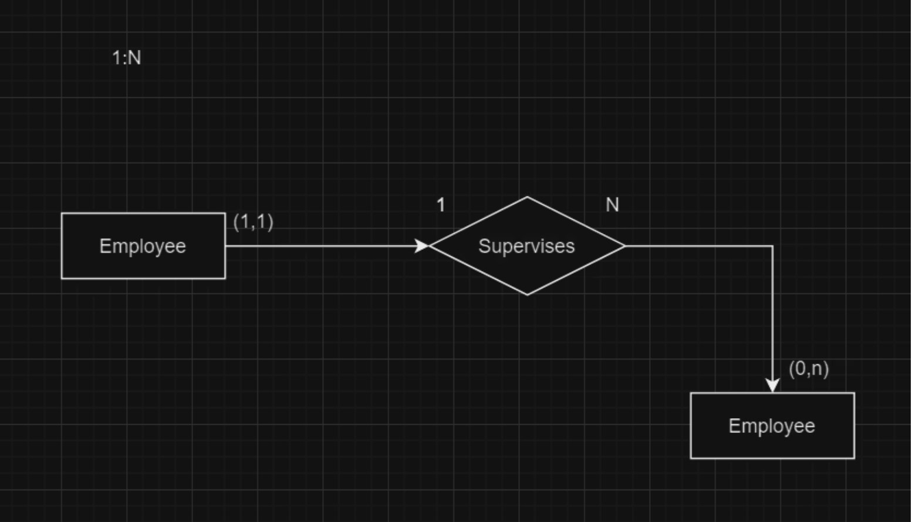

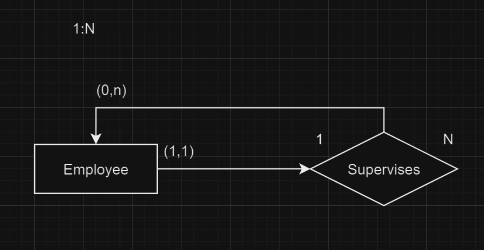

Los dos dibujos representan **lo mismo**: la relación **Supervises**, 1:N, entre empleados. El primero repite el rectángulo Employee para que se vea mejor; el segundo usa un único rectángulo con dos líneas, que es la forma correcta en un diagrama definitivo. Cada empleado juega dos **papeles**: supervisor y supervisado.

- Un empleado supervisado tiene **(1,1)** supervisor.
- Un supervisor supervisa a **(0,n)** empleados.

### Otros ejemplos

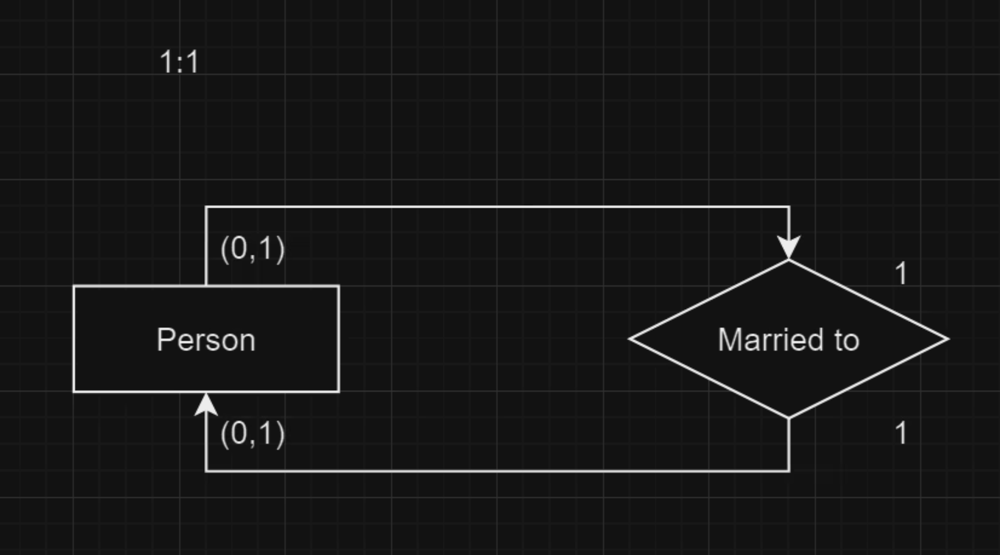

**Married to (1:1).** Una persona está casada con (0,1) personas. Las dos participaciones son opcionales: hay personas que no están casadas.

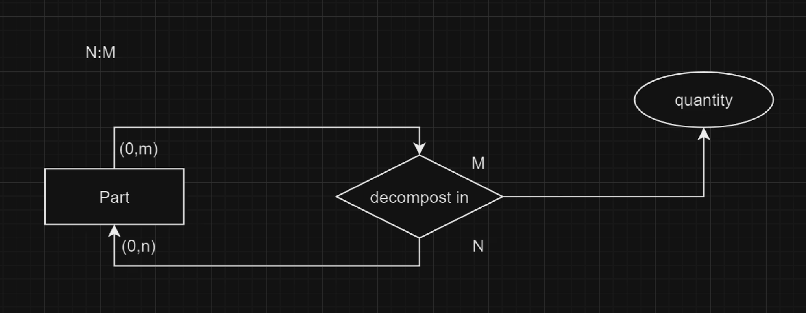

**decompost in (N:M).** Una pieza se descompone en (0,m) piezas y puede formar parte de (0,n) piezas. La relación tiene un atributo, **quantity**, que indica cuántas unidades de una pieza lleva otra. Es el típico «despiece» de un producto: una bicicleta lleva 2 ruedas; una rueda lleva 36 radios.

!!! ejemplo "Ejemplo"
 En *Supervises*, Laura (empleada) supervisa a Pau (empleado). En el diagrama hay una sola entidad, pero en cada ocurrencia de la relación una ocurrencia juega el papel de **supervisor** y la otra el de **supervisado**.


## 4.3 Relaciones ternarias

Una relación ternaria une **tres entidades a la vez** con un único rombo. Sus cardinalidades se escriben con tres valores:

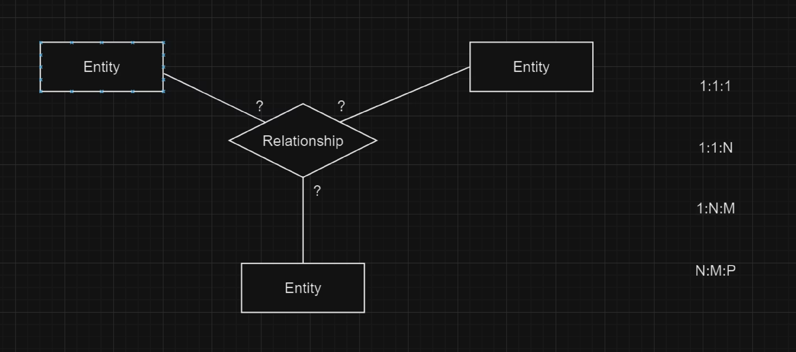

Las combinaciones posibles son **1:1:1**, **1:1:N**, **1:N:M** y **N:M:P**.

### Ejemplo de relación ternaria

Las relaciones ternarias representan asociaciones que **no pueden descomponerse en relaciones binarias sin perder información**. Las entidades del ejemplo son:

| Entidad | Descripción |
|---|---|
| **Proveedor** | Entidad que suministra productos |
| **Producto** | Artículo o servicio comercializado |
| **Cliente** | Empresa que recibe los productos |

La relación «suministra» conecta las tres entidades porque un proveedor concreto suministra un producto concreto para un cliente. Esa información no puede capturarse completamente con relaciones binarias separadas.

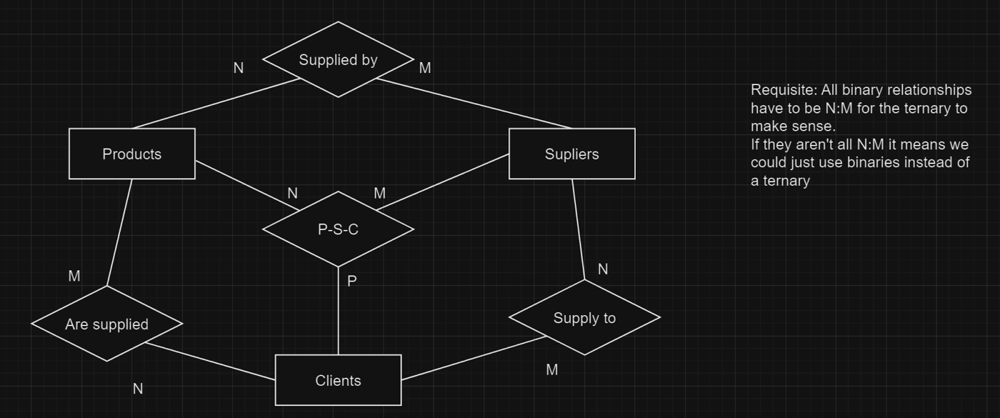

Cómo leer el diagrama (P-S-C: *Products, Supliers, Clients*):

- En el centro está la ternaria **P-S-C**, con cardinalidad **N:M:P**.
- Alrededor están las tres relaciones binarias equivalentes: *Supplied by* (productos: proveedores), *Supply to* (proveedores: clientes) y *Are supplied* (productos: clientes). Las tres son N:M.

!!! ejemplo "Ejemplo"
 Sabemos que Suministros Mar vende tornillos (productos: proveedores), que Suministros Mar trabaja para la empresa Obras Pons (proveedores: clientes) y que Obras Pons compra tornillos (productos: clientes). Con eso **no** sabemos si Obras Pons compra los tornillos **a Suministros Mar** o a otro proveedor. Solo la ternaria guarda el trío completo: (tornillos, Suministros Mar, Obras Pons).


Las relaciones ternarias se usan cuando el hecho solo tiene sentido con las **tres entidades a la vez** y, al partirlo en binarias, se pierde información. Una buena comprobación es mirar las entidades de dos en dos: si todas las parejas son N:M, la ternaria tiene sentido; si alguna es 1:N, normalmente bastaría con binarias.

!!! ojo "Ojo"
 Las parejas N:M son la pista; la cardinalidad de la propia ternaria puede llevar algún 1. En PROFESOR: ASIGNATURA: GRUPO, cada asignatura de un grupo la da un solo profesor (1:N:M), y sigue siendo una ternaria correcta.


## 4.4 Relaciones dobles

Las relaciones dobles se dan cuando **dos entidades** están conectadas mediante **dos relaciones diferentes y distintas**. Cada relación tiene su propio propósito y significado:

| | Qué representa |
|---|---|
| **Primera relación** | Un tipo específico de asociación entre las entidades, con sus propias reglas y cardinalidad |
| **Segunda relación** | Un tipo diferente de asociación entre las mismas entidades, independiente de la primera |

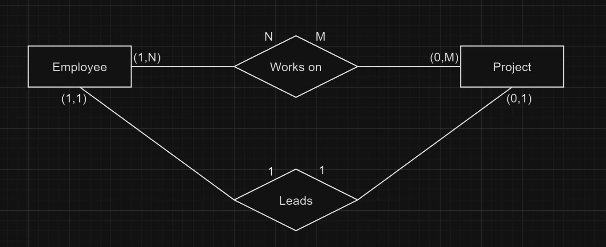

- **Trabaja en** (*Works on*, N:M): indica en qué proyecto trabaja cada empleado. Un empleado trabaja en (0,M) proyectos; un proyecto tiene (1,N) empleados.
- **Dirige** (*Leads*, 1:1): indica qué empleado dirige cada proyecto. Un proyecto lo dirige (1,1) empleado; un empleado dirige (0,1) proyectos.

!!! ejemplo "Ejemplo"
 Si solo existiera *Works on*, no sabríamos cuál de los empleados que trabajan en un proyecto es el que lo dirige. Son dos hechos distintos, con cardinalidades distintas: por eso son dos rombos.


## 4.5 Otras notaciones

La notación de Chen (rectángulos, óvalos y rombos) no es la única. Muchas herramientas usan la notación de **pata de gallo** (*crow's foot*), que dibuja la cardinalidad con símbolos en los extremos de la línea:

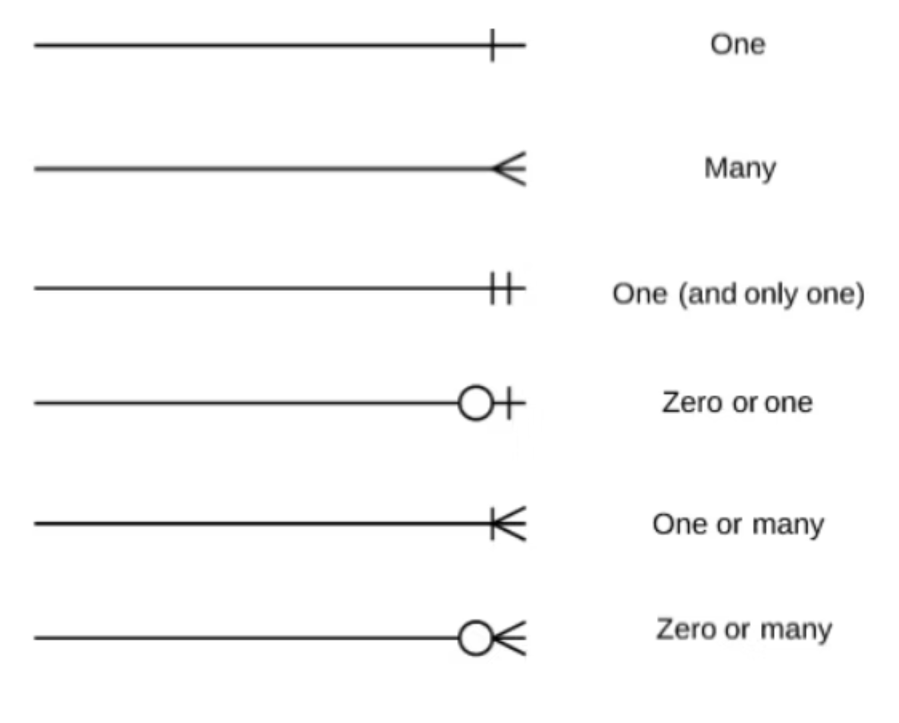

| Símbolo en el extremo | Significado | Equivale a *(ampliación)* |
|---|---|---|
| Raya vertical | One (uno) | máximo 1 |
| Pata de gallo | Many (muchos) | máximo N |
| Doble raya | One (and only one): uno y solo uno | (1,1) |
| Círculo + raya | Zero or one: cero o uno | (0,1) |
| Raya + pata de gallo | One or many: uno o muchos | (1,N) |
| Círculo + pata de gallo | Zero or many: cero o muchos | (0,N) |

*(Ampliación: el truco para leerla es que el símbolo **más cercano a la entidad** es el máximo y el **más alejado** es el mínimo. El círculo es un 0, la raya es un 1 y la pata de gallo es «muchos». Es la notación que verás en MySQL Workbench.)*


!!! comprueba "Comprueba"
 1. ¿Qué mide el grado de una relación? ¿Qué nombre recibe cada grado?
 2. Pon un ejemplo de relación reflexiva y explica los dos papeles.
 3. ¿Cuándo tiene sentido usar una ternaria? ¿Qué comprobación puedes hacer mirando las entidades de dos en dos?
 4. ¿Qué es una relación doble? Explica el ejemplo de empleado y proyecto.
 5. En pata de gallo, ¿cómo se dibuja «cero o muchos»?

# Bloque 5. Restricciones sobre las relaciones

## 5.1 El modelo E/R extendido

El modelo E/R que viste en la Parte 1 se queda corto en algunas situaciones reales. Para cubrirlas se amplió con nuevos elementos, y el resultado se llama **modelo E/R extendido** (en inglés, *Extended E/R* o *EER*). Vamos a ver **tres extensiones**:

| Extensión | Qué añade | Bloque |
|---|---|---|
| **Primera:** restricciones sobre las relaciones | Reglas entre dos relaciones que unen las mismas entidades | 5 |
| **Segunda:** generalización y especialización | Jerarquías de entidades con superclases y subclases | 6 |
| **Tercera:** agregación o entidades asociativas | Relaciones entre relaciones | 7 |

Las cuatro restricciones de este bloque se aplican siempre a una misma situación: **dos entidades unidas por dos relaciones distintas**. Es la *relación doble* que viste en el apartado 4.4 de la Parte 1. La restricción dice qué combinaciones de esas dos relaciones están permitidas.


## 5.2 Restricción de exclusividad

!!! definicion "Definición"
 Una entidad puede participar en varias relaciones, pero **cada ocurrencia** de esa entidad solo puede pertenecer a **una** de esas relaciones.
 
 **EJEMPLO : El músico y la orquesta**
 Un músico solo toca o solo dirige; nunca puede hacer las dos cosas.


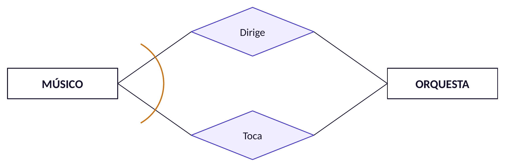

**Cómo se dibuja:** con un **arco** que corta las líneas de las dos relaciones, junto a la entidad a la que afecta la restricción (aquí, MÚSICO).

Leído con ocurrencias: si Marta **toca** en la Orquesta de Palma, ya no puede **dirigir** ninguna orquesta, ni esa ni otra. Cada músico «elige» una de las dos relaciones.


## 5.3 Restricción de exclusión

!!! definicion "Definición"
 Una instancia de una entidad puede formar parte de varias relaciones, pero no puede participar en más de una **al mismo tiempo**.
 
 **EJEMPLO : El monitor y los cursos**
 El monitor A puede **impartir** el curso A, pero no **recibir** el curso A.
 El monitor A puede **recibir** el curso B.


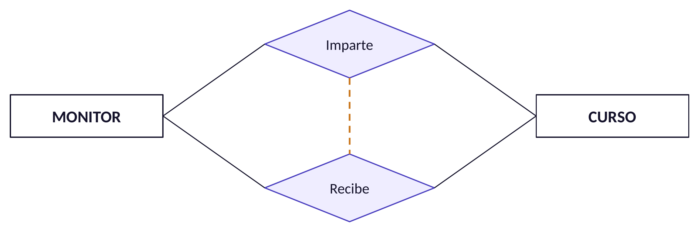

**Cómo se dibuja:** con una **línea discontinua** que une los dos rombos.

!!! ojo "Ojo"
 Los ejemplos aclaran la definición: el monitor A **sí** participa en las dos relaciones (imparte el curso A y recibe el curso B). Lo que no puede es estar unido **al mismo curso** por las dos a la vez. Esa es la diferencia con la exclusividad, donde el músico no puede estar en las dos relaciones **con nadie**.


## 5.4 Restricción de inclusividad

!!! definicion "Definición"
 Se usa para modelar situaciones en las que las ocurrencias de una entidad **solo pueden asociarse mediante una relación después de haberse asociado mediante otra**.


**Cómo se dibuja:**

- Con un **arco acabado en flecha** entre las dos relaciones, junto a la entidad.
- La flecha une la **relación que se exige primero** con la **segunda**, la que depende de ella.
- La **cardinalidad** mínima y máxima se escribe junto a la flecha.

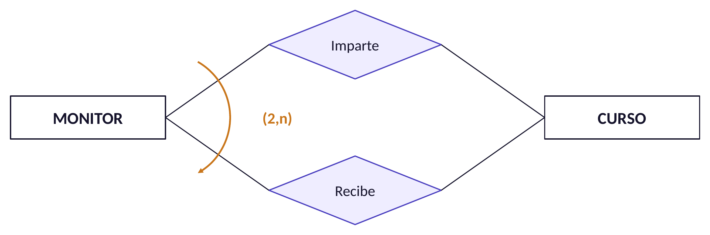

!!! ejemplo "Ejemplo"
 (2,n) significa que un monitor debe haber completado **al menos 2 cursos** antes de poder impartir un curso. No importa cuáles: pueden ser cursos distintos del que va a impartir.
 
 **OJO : El sentido de la flecha**
 En este diagrama la punta de la flecha queda junto a *Recibe*, la relación que se cumple primero. No te quedes con hacia dónde apunta: lo que tienes que saber explicar es la idea: **para participar en *Imparte*, antes hay que haber participado en *Recibe***, y el (2,n) indica cuántas veces.


## 5.5 Restricción de inclusión

!!! definicion "Definición"
 Se establece cuando **toda** instancia de una entidad debe estar asociada con **otro elemento** de una entidad distinta a través de una segunda relación **antes** de poder participar en una asociación concreta.


**Cómo se dibuja:** con una **flecha discontinua** que une las dos relaciones.

!!! ejemplo "Ejemplo"
 Para divorciarse de una mujer, un hombre primero debe estar casado **con ella**.


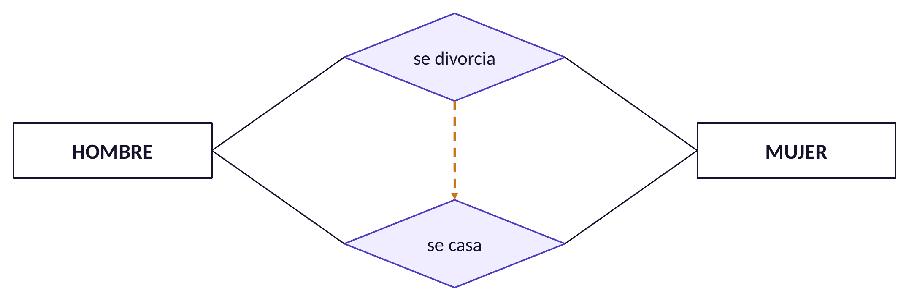

Leído con ocurrencias: la pareja (Joan, Laura) solo puede aparecer en *se divorcia* si antes aparece en *se casa*. Toda pareja de *se divorcia* está **incluida** en *se casa*; de ahí el nombre.


## 5.6 Las cuatro restricciones, cara a cara

Las cuatro restricciones se entienden mejor en dos parejas. En cada pareja, la diferencia es la misma: si la regla afecta a la entidad **en general** o a **la misma pareja** de ocurrencias.

| Restricción | Qué prohíbe o exige | ¿Con la misma ocurrencia de la otra entidad? | Dibujo | Ejemplo |
|---|---|---|---|---|
| **Exclusividad** | Estar en las dos relaciones | No: no puede estar en las dos con nadie | Arco junto a la entidad | Músico toca **o** dirige |
| **Exclusión** | Estar en las dos relaciones **con el mismo** | Sí | Línea discontinua entre rombos | Monitor no imparte y recibe **el mismo** curso |
| **Inclusividad** | Haber estado antes en la otra relación | No: vale con cualquiera, (mín, máx) veces | Arco con flecha y cardinalidad | Recibir 2 cursos antes de impartir |
| **Inclusión** | Haber estado antes en la otra relación **con el mismo** | Sí | Flecha discontinua entre rombos | Casado **con ella** antes de divorciarse |

!!! ojo "Ojo"
 Los nombres se parecen mucho y en el examen se confunden. Truco: las que acaban en **-idad** (exclusiv**idad**, inclusiv**idad**) hablan de la entidad **en general** y se dibujan con un **arco** junto a ella. Las que acaban en **-ión** (exclus**ión**, inclus**ión**) hablan de **la misma pareja** y se dibujan con una línea **discontinua** entre los rombos.


!!! comprueba "Comprueba"
 1. ¿Qué tres extensiones forman el modelo E/R extendido?
 2. ¿Qué diferencia hay entre exclusividad y exclusión? Pon el ejemplo de cada una.
 3. ¿Qué significa (2,n) en el ejemplo del monitor?
 4. ¿Por qué el ejemplo de casarse y divorciarse es de inclusión y no de inclusividad?
 5. ¿Cómo se dibuja cada una de las cuatro restricciones?


# Bloque 6. Generalización y especialización

## 6.1 Superclases y subclases

Los conjuntos de entidades pueden tener **características comunes**. En lugar de repetir los mismos atributos en varias entidades, el modelo extendido permite organizarlas en una **jerarquía**.

!!! definicion "Definición"
 Crear un tipo de entidad de **nivel superior** (superclase) que incluya los rasgos compartidos.
 
 **DEFINICIÓN : Especialización**
 Dividir un conjunto de entidades en **subgrupos** (subclases) según sus rasgos diferenciadores.


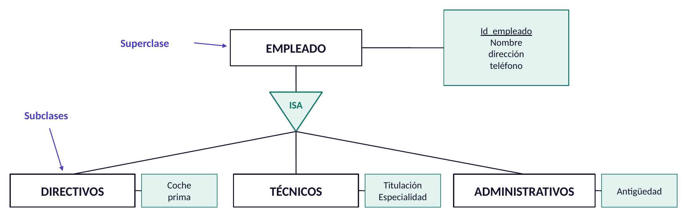

Cómo leer el diagrama:

- **EMPLEADO** es la **superclase** (en otros libros, *supertipo*). Tiene los atributos que comparten todos: `Id_empleado` (la clave, subrayada), `Nombre`, `dirección` y `teléfono`.
- **DIRECTIVOS**, **TÉCNICOS** y **ADMINISTRATIVOS** son las **subclases** (o *subtipos*). Cada una tiene solo sus atributos propios: los directivos, `Coche` y `prima`; los técnicos, `Titulación` y `Especialidad`; los administrativos, `Antigüedad`.
- El **triángulo ISA** une la superclase con las subclases. *ISA* viene del inglés *is a*, «es un»: un directivo **es un** empleado. En libros en castellano lo verás también como **ES_UN**.

!!! ojo "Ojo"
 La diferencia está en **cómo llegas** al diagrama, no en el resultado. **Generalización** = de abajo arriba: tienes DIRECTIVOS, TÉCNICOS y ADMINISTRATIVOS y descubres que comparten atributos, así que creas EMPLEADO. **Especialización** = de arriba abajo: tienes EMPLEADO y descubres que hay grupos con atributos propios, así que lo divides.


## 6.2 Cómo detectar una generalización o especialización

Tres pasos:

1. Busca un conjunto de entidades con **atributos comunes**.
2. Esas entidades forman la **superclase**.
3. Los **atributos específicos** dan lugar a la creación de **subclases**.

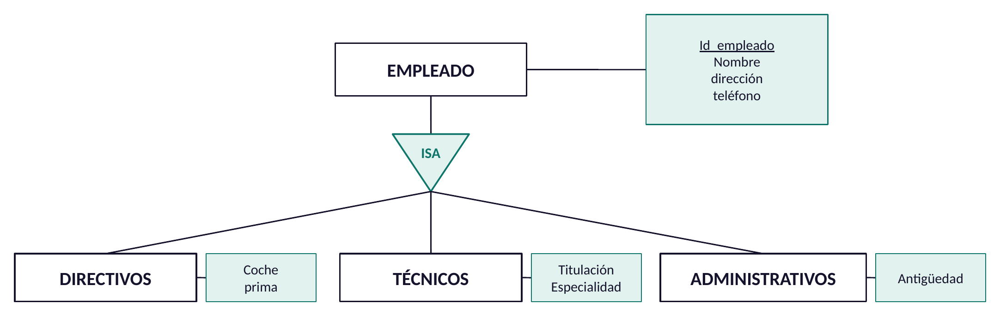

!!! ejemplo "Ejemplo"
 Frases como «los empleados pueden ser directivos, técnicos o administrativos», «de todos se guarda… y además, de los técnicos se guarda…» o «hay dos tipos de…» son pistas de una jerarquía. La palabra **«además»** suele marcar los atributos que van a las subclases.


## 6.3 Jerarquías y herencia

Las jerarquías se caracterizan por la **herencia**:

- Las subclases **heredan los atributos** de su superclase.
- Si una superclase participa en una relación, sus subclases **también participan automáticamente**.

!!! ejemplo "Ejemplo"
 Un técnico tiene sus propios atributos (`Titulación`, `Especialidad`) **y además** los de EMPLEADO (`Id_empleado`, `Nombre`, `dirección`, `teléfono`), aunque en el diagrama no se vuelvan a dibujar. Si EMPLEADO *trabaja en* DEPARTAMENTO, un técnico también trabaja en un departamento, sin necesidad de dibujar otra relación.
 
 **OJO : Los atributos comunes no se repiten**
 Un error típico es volver a colgar `Nombre` o `Id_empleado` de cada subclase. No hace falta, y además es incorrecto: en las subclases solo se dibujan los atributos **propios**. Lo común va una sola vez, en la superclase.


## 6.4 Restricciones semánticas en la generalización/especialización

Una jerarquía se clasifica con dos preguntas:

| Pregunta | Respuesta | Tipo |
|---|---|---|
| ¿Toda instancia de la superclase pertenece a alguna subclase? | Sí | **Total** (totalidad) |
| | No, puede haber instancias que no estén en ninguna | **Parcial** (parcialidad) |
| ¿Una instancia puede pertenecer a más de una subclase? | Sí | **Solapada** (solapamiento) |
| | No, solo a una | **Exclusiva** (exclusividad) |

Combinando las dos respuestas salen **cuatro tipos**:

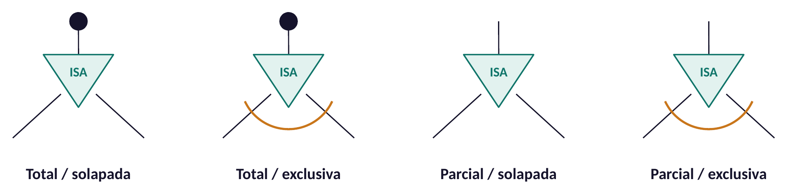

**Cómo se dibujan:**

- **Total:** un **círculo relleno** sobre la línea que une el triángulo con la superclase. **Parcial:** la línea sin círculo.
- **Exclusiva:** un **arco** que corta las líneas que van a las subclases. **Solapada:** sin arco.

!!! ejemplo "Ejemplo"
 **Total / exclusiva:** CUENTA → CUENTA CORRIENTE, CUENTA DE AHORRO, en un banco que solo tiene esos dos tipos: toda cuenta es de uno de ellos y solo de uno.
 **Total / solapada:** MIEMBRO de un club → SOCIO, VOLUNTARIO, cuando todo miembro es al menos una de las dos cosas y puede ser ambas.
 **Parcial / exclusiva:** VEHÍCULO → TURISMO, CAMIÓN, si también hay vehículos que no son ninguno de los dos (motos) y ninguno es las dos cosas.
 **Parcial / solapada:** EMPLEADO → DELEGADO SINDICAL, SOCORRISTA: muchos empleados no son ninguna de las dos cosas y alguno puede ser ambas.
 
 **OJO : «Exclusividad» otra vez**
 La palabra *exclusividad* sale en el Bloque 5 (restricción entre dos relaciones) y aquí (tipo de jerarquía). La idea es parecida («solo una de las opciones»), pero el contexto y el dibujo son distintos: allí es un arco junto a una entidad que corta dos relaciones; aquí, un arco bajo el triángulo ISA que corta las líneas de las subclases.


## 6.5 Ejemplo: turismos y camiones

El enunciado:

> Supongamos la existencia de dos entidades TURISMO y CAMION. Los atributos de la entidad TURISMO son: Num_bastidor, Fecha_fab, precio y Num_puertas. Los atributos de la entidad CAMION son: Num_bastidor, Fecha_fab, precio, Num_ejes y Tonelaje.

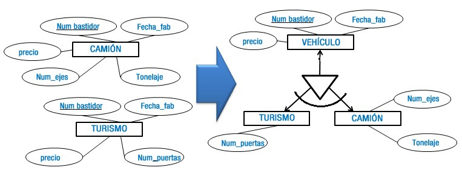

Aplicando los tres pasos del apartado 6.2:

| Paso | Resultado |
|---|---|
| 1. Atributos comunes | `Num_bastidor`, `Fecha_fab`, `precio` |
| 2. Superclase | **VEHÍCULO**, con esos tres atributos (`Num_bastidor` es la clave) |
| 3. Subclases | **TURISMO** con `Num_puertas` , **CAMIÓN** con `Num_ejes` y `Tonelaje` |

Es una **generalización**: se parte de dos entidades y se sube a una superclase. El dibujo lleva el **arco** de exclusiva bajo el triángulo y **no** lleva el círculo de total, así que, con la notación del apartado 6.4, se lee como **parcial y exclusiva**: un vehículo no puede ser turismo y camión a la vez.

!!! ojo "Ojo"
 Esta imagen viene de otro material y usa flechas en las líneas del triángulo. No cambia el significado: la superclase está arriba y las subclases abajo.


!!! comprueba "Comprueba"
 1. ¿Qué diferencia hay entre generalización y especialización si el dibujo es el mismo?
 2. ¿Qué significa ISA?
 3. ¿Qué hereda una subclase de su superclase?
 4. Explica qué es una jerarquía total y solapada, y cómo se dibuja.
 5. En el ejemplo de VEHÍCULO, ¿qué atributos van en la superclase y por qué?


# Bloque 7. Agregación

## 7.1 Qué es la agregación

El modelo Entidad-Relación estándar **no puede representar relaciones entre relaciones**, y eso limita el modelado de situaciones reales complejas. La tercera extensión lo resuelve.

!!! definicion "Definición"
 Abstracción que trata las **relaciones como entidades de nivel superior**. Permite expresar relaciones **entre relaciones**, o **entre entidades y relaciones**, lo que aumenta la flexibilidad y la capacidad del modelo en el diseño de bases de datos. También se llaman **entidades asociativas**.


**Cómo se dibuja:** con un **rectángulo grande** que encierra la relación agregada y sus entidades. Ese rectángulo se comporta como si fuera una entidad más: se puede unir a otras relaciones.

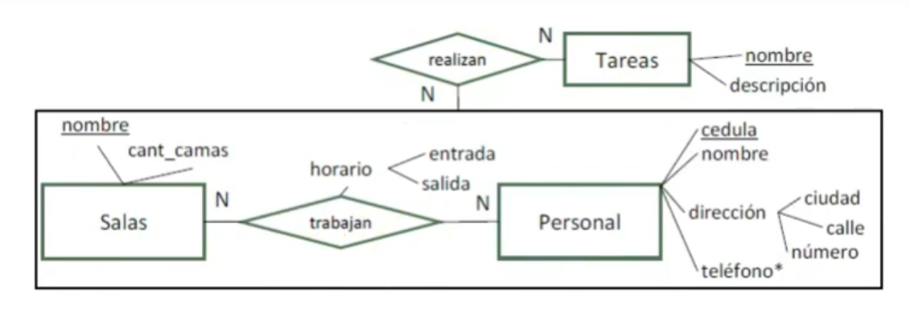

Cómo leer el ejemplo:

- Dentro del rectángulo está la relación **trabajan** entre SALAS y PERSONAL (N:N), con el atributo compuesto `horario` (entrada, salida).
- Todo el bloque «personal que trabaja en una sala» se relaciona con **TAREAS** mediante **realizan**. Es decir, las tareas no se asignan a una persona ni a una sala por separado, sino a **la persona trabajando en esa sala**.
- Fíjate también en `teléfono*`: el asterisco es otra forma de marcar un atributo **multivaluado**, y `dirección` es un atributo **compuesto** (ciudad, calle, número). Son las notaciones de la Parte 1 dibujadas de otra manera.


## 7.2 El problema: alumnos, deportes y profesores

**Contexto:** tenemos la relación binaria N:M **Practica** entre ALUMNO y DEPORTE.

**Situación:** queremos registrar el **PROFESOR** responsable de entrenar a un alumno en un deporte concreto.

**Primera idea:** crear una relación **ternaria** llamada **Entrena**, entre ALUMNO, DEPORTE y PROFESOR. Así se recoge la asociación de las tres entidades y se puede saber qué profesor entrena a cada alumno en cada deporte.

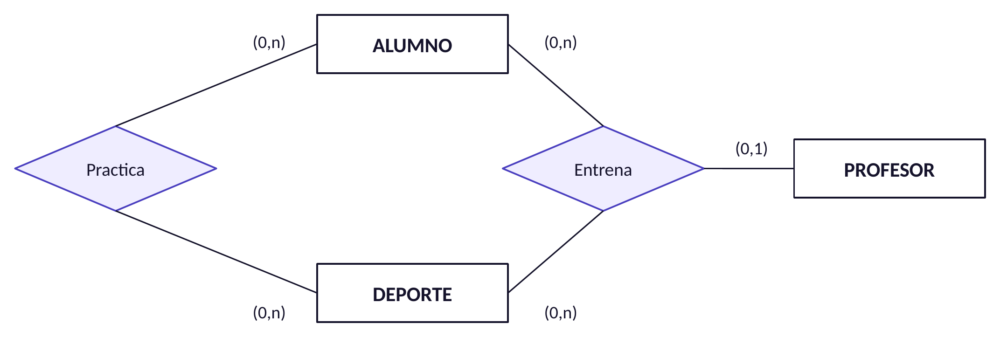

Parece razonable, pero en el apartado siguiente verás por qué **es un mal diagrama**.


## 7.3 Por qué la ternaria está mal

Hay dos relaciones que se pisan:

| Relación | Qué representa |
|---|---|
| **Practica** | La participación de los alumnos en los deportes |
| **Entrena** | La relación de entrenamiento entre alumnos, profesores y deportes |

**Diferencia clave.** No todas las ocurrencias de *Practica* tendrán un PROFESOR asociado. Por tanto, **fusionar** *Practica* y *Entrena* en una sola ternaria no es correcto: perderíamos a los alumnos que practican un deporte sin entrenador.

**Problema de redundancia.** Si mantenemos las dos, *Entrena* contiene información **redundante**: toda combinación de ALUMNO y DEPORTE que aparece en *Entrena* ya está en *Practica*.

!!! ejemplo "Ejemplo"
 *Practica* guarda (Marta, baloncesto). *Entrena* guarda (Marta, baloncesto, Laura). La pareja (Marta, baloncesto) está **dos veces**. Si Marta deja el baloncesto y solo se borra de *Practica*, *Entrena* sigue diciendo que Laura la entrena en baloncesto: los datos ya no cuadran.
 
 **OJO : Conecta con la Parte 1**
 En el apartado 4.3 viste que una ternaria se usa cuando el hecho necesita las tres entidades a la vez (y que, mirándolas de dos en dos, lo normal es que salgan N:M). Aquí el problema es otro: la ternaria **repite** una relación binaria que ya existe (*Practica*). Cuando una ternaria contiene a una binaria que tiene vida propia, la solución suele ser la agregación.


## 7.4 La solución con agregación

**Si el profesor fuera solo un valor** (por ejemplo, un nombre sin más datos), bastaría con añadirlo como **atributo de la relación** *Practica*, como hacías en la Parte 1 con la calificación.

**Pero el profesor es una entidad** que ya existe, con sus propios atributos y relaciones, no un simple valor. Hace falta otro enfoque.

**Solución:** usar la **agregación de entidades**. Se trata la relación *Practica* entre ALUMNO y DEPORTE como una entidad de nivel superior llamada «Practica», y se relaciona esa entidad con PROFESOR mediante *Entrena*.

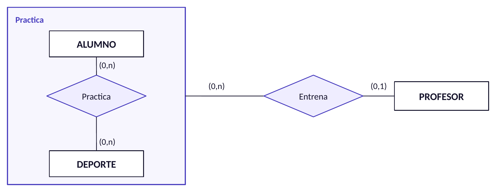

Cómo leer las cardinalidades:

- Cada práctica (un alumno en un deporte) tiene **(0,1)** profesor: puede no tener entrenador, y como mucho tiene uno.
- Cada profesor entrena **(0,n)** prácticas.

**Ventajas de la agregación:**

- Permite incluir entidades adicionales (como PROFESOR) **sin redundancia**: la pareja (alumno, deporte) solo está en *Practica*.
- Facilita la representación de relaciones complejas **manteniendo la claridad** del modelo.

!!! ejemplo "Ejemplo"
 *Practica* guarda (Marta, baloncesto) y (Pau, tenis). *Entrena* guarda solo (práctica «Marta-baloncesto», Laura). Pau practica tenis sin entrenador y no pasa nada. Si Marta deja el baloncesto, al borrar su práctica desaparece también el entrenamiento que dependía de ella.


## 7.5 Otro ejemplo: empleados, sucursales y managers

El último ejemplo es un esquema hecho a mano, con notas en inglés y en castellano, que repite la misma idea con otro caso.

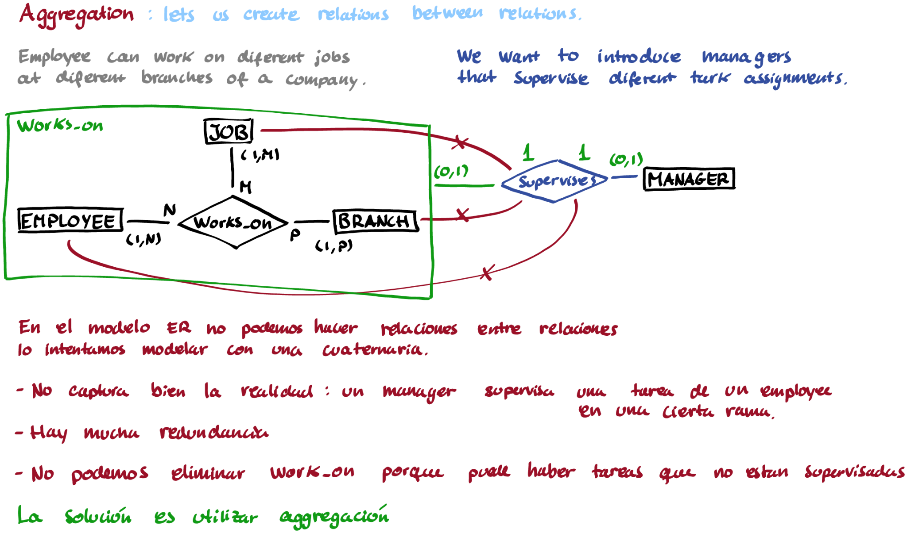

**Situación:**

- Los empleados pueden trabajar en distintos trabajos (*jobs*) en distintas sucursales (*branches*) de una empresa. Es la ternaria **Works_on** entre EMPLOYEE (1,N), JOB (1,M) y BRANCH (1,P).
- Queremos introducir **managers** que supervisen distintas asignaciones de tareas.

**Lo que no funciona (las líneas rojas tachadas):** unir MANAGER con EMPLOYEE, JOB y BRANCH por separado, es decir, intentar modelarlo con una **cuaternaria**. Las notas de la imagen explican por qué:

- En el modelo E/R no podemos hacer relaciones entre relaciones, así que se intenta con una cuaternaria.
- No captura bien la realidad: un manager supervisa **una tarea de un empleado en una cierta sucursal**, no a un empleado, un trabajo y una sucursal sueltos.
- Hay mucha redundancia.
- No podemos eliminar *Works_on*, porque puede haber tareas que no estén supervisadas.

**La solución es utilizar agregación:** el rectángulo verde convierte *Works_on* en una entidad de nivel superior, y **Supervises** la une con MANAGER. Cada asignación se supervisa (0,1) veces y cada manager supervisa (0,1) asignaciones (1:1 en el dibujo).

!!! ojo "Ojo"
 En los dos ejemplos hay una relación que tiene sentido por sí sola (*Practica*, *Works_on*) y un nuevo dato que depende de **cada ocurrencia de esa relación** (quién entrena, quién supervisa). Esa es la señal para usar agregación.


!!! comprueba "Comprueba"
 1. ¿Qué no puede representar el modelo E/R estándar que sí permite la agregación?
 2. ¿Por qué no se puede fusionar *Practica* en la ternaria *Entrena*?
 3. ¿Qué información redundante tiene el diagrama con *Practica* y *Entrena* a la vez?
 4. ¿Cuándo bastaría con un atributo en la relación en lugar de una agregación?
 5. ¿Cómo se dibuja una agregación?

# Material de repaso

## Glosario

| Término | Significado |
|---|---|
| **Atributo** | Propiedad o característica de una entidad; se dibuja con un óvalo. |
| **Atributo compuesto** | Se puede dividir en subpartes con significado propio (dirección → calle, ciudad…). |
| **Atributo de relación** | Dato que pertenece a la asociación entre entidades, no a una entidad sola (la calificación). |
| **Atributo derivado** | Su valor se obtiene de otros atributos (edad a partir de la fecha de nacimiento); óvalo punteado. |
| **Atributo monovaluado** | Tiene un solo valor por ocurrencia. |
| **Atributo multivaluado** | Puede tener varios valores por ocurrencia; óvalo doble. |
| **Atributo obligatorio** | Siempre tiene valor. La clave es obligatoria. |
| **Atributo opcional** | Puede no tener valor en algunas ocurrencias. |
| **Atributo simple** | No se puede dividir en partes con significado. |
| **Cardinalidad de entidad** | Pareja (mín, máx) de asociaciones que puede tener cada instancia de una entidad en una relación. |
| **Cardinalidad de relación** | Número máximo de ocurrencias asociadas: 1:1, 1:N o N:M. |
| **Clave o identificador** | Atributo que distingue cada ocurrencia de las demás; se subraya. |
| **Clave parcial o discriminante** | Atributo que identifica a una entidad débil solo dentro de su entidad fuerte. |
| **Dependencia de identificación (ID)** | La entidad débil necesita a la fuerte para existir y para identificarse. |
| **Dependencia existencial (E)** | Si desaparece la instancia fuerte, desaparecen las débiles que dependen de ella. |
| **Diagrama de conjuntos** | Dibujo de las ocurrencias de dos entidades y de las parejas que forman en una relación. |
| **Entidad débil** | Entidad cuya existencia depende de otra; rectángulo doble. |
| **Entidad fuerte** | Entidad que existe de forma independiente; rectángulo. |
| **Grado** | Número de entidades que intervienen en una relación. |
| **Modelo conceptual** | Modelo de datos de la fase de análisis, independiente del SGBD. Ejemplo: el E/R. |
| **Modelo de datos** | Herramientas conceptuales para describir datos, relaciones, semántica y restricciones. |
| **Modelo lógico** | Modelo de datos de la fase de diseño, que ya depende del tipo de SGBD. Ejemplo: el relacional. |
| **Ocurrencia o instancia** | Caso concreto de una entidad o de una relación. |
| **Participación obligatoria (total)** | Cardinalidad mínima 1. |
| **Participación opcional (parcial)** | Cardinalidad mínima 0. |
| **Pata de gallo** | Notación que dibuja la cardinalidad con símbolos en los extremos de las líneas. |
| **Relación** | Asociación entre entidades; rombo con un verbo en singular. |
| **Relación binaria** | Relación de grado 2. |
| **Relación doble** | Dos entidades unidas por dos relaciones distintas. |
| **Relación n-aria** | Relación de grado mayor que 3; debe simplificarse. |
| **Relación reflexiva o recursiva** | Relación de grado 1: una entidad consigo misma, con papeles distintos. |
| **Relación ternaria** | Relación de grado 3. |


## Mapa resumen

```
MODELO E/R (modelo conceptual: no depende de ningún SGBD)
│
├── ENTIDADES ........ fuerte [ RECTÁNGULO ]
│ débil [[ RECTÁNGULO DOBLE ]]
│ ├─ dependencia existencial (E)
│ └─ dependencia de identificación (ID) → rombo doble
│ , siempre binaria , 1:1 o 1:N (N en el lado débil)
│ , nunca N:M
│
├── ATRIBUTOS ........ ( ÓVALO )
│ obligatorio / opcional clave → subrayado
│ simple / compuesto compuesto → óvalos colgando
│ monovaluado / multivaluado multivaluado → (( óvalo doble ))
│ derivado derivado → ( óvalo punteado )
│
├── RELACIONES ....... < ROMBO > , verbo en singular , sin parejas repetidas
│ cardinalidad de la relación ... 1:1 , 1:N , N:M (se toman los máximos)
│ cardinalidad de entidad ....... (mín, máx): (0,1) (1,1) (0,N) (1,N)
│ mín 0 = opcional , mín 1 = obligatoria
│ atributos de relación ......... casi siempre en N:M (calificación)
│
├── GRADO ............ 1 reflexiva , 2 binaria , 3 ternaria , N n-aria
│ ternaria → el hecho necesita las tres a la vez (pista: parejas N:M)
│ doble → dos entidades, dos relaciones distintas
│
└── OTRAS NOTACIONES . pata de gallo: | uno , < muchos , || uno y solo uno
 o| cero o uno , |< uno o muchos , o< cero o muchos
```


## Autoevaluación

**Parte A. Preguntas cortas**

1. Define modelo de datos.
2. ¿Qué es una entidad fuerte y cómo se representa?
3. ¿Qué diferencia hay entre una entidad y una ocurrencia de esa entidad?
4. Explica la diferencia entre un atributo compuesto y uno multivaluado con un ejemplo de cada uno.
5. ¿Por qué `edad` suele ser un atributo derivado?
6. ¿Qué dice la regla fundamental de las relaciones?
7. ¿Qué tipo de palabra se usa para nombrar una relación? Pon tres ejemplos.
8. Define cardinalidad de una relación y enumera sus tres tipos.
9. ¿Cuándo es obligatoria la participación de una entidad en una relación? ¿Y opcional?
10. ¿Qué es un atributo de relación? Pon un ejemplo.
11. ¿Qué es una clave parcial o discriminante?
12. Enuncia las tres reglas de las relaciones con entidades débiles.
13. ¿Qué es una relación reflexiva? Pon un ejemplo distinto de *supervisa*.
14. ¿Qué hay que simplificar cuando aparece una relación n-aria?
15. ¿Qué es una relación doble?

**Parte B. Tipo test** (una sola respuesta correcta)

1. Un atributo multivaluado se dibuja con:
 a) óvalo punteado , b) óvalo doble , c) rectángulo doble , d) rombo doble
2. Una entidad débil se dibuja con:
 a) rectángulo doble , b) óvalo doble , c) rombo , d) rectángulo punteado
3. La cardinalidad (0,N) significa:
 a) obligatoria, una vez , b) opcional, máximo una , c) opcional, sin límite , d) obligatoria, al menos una
4. «Un estudiante tiene un expediente y cada expediente pertenece a un estudiante» es:
 a) 1:1 , b) 1:N , c) N:M , d) reflexiva
5. La participación es obligatoria cuando:
 a) la cardinalidad máxima es N , b) la mínima es 0 , c) la mínima es 1 , d) la máxima es 1
6. Una relación con una entidad débil **nunca** puede ser:
 a) 1:1 , b) 1:N , c) binaria , d) N:M
7. Si `Room_number` solo identifica la habitación dentro de su hotel, la dependencia es:
 a) existencial , b) de identificación , c) reflexiva , d) ternaria
8. Una relación en la que interviene una sola entidad es:
 a) binaria , b) doble , c) reflexiva , d) débil
9. En una ternaria bien planteada, lo normal es que las relaciones binarias entre sus entidades sean:
 a) 1:1 , b) 1:N , c) N:M , d) reflexivas
10. En pata de gallo, un círculo junto a una raya significa:
 a) uno y solo uno , b) cero o uno , c) uno o muchos , d) cero o muchos

**Parte C. Razona**

1. Una biblioteca guarda de cada **socio** su número de socio, nombre, varios teléfonos y su dirección (calle, ciudad y código postal). De cada **libro** guarda el ISBN y el título. Un socio puede tener prestados varios libros y un libro puede haber sido prestado a muchos socios a lo largo del tiempo; de cada préstamo interesa la **fecha**. Identifica las entidades, sus atributos con su tipo, la relación, su cardinalidad y dónde va el atributo *fecha*.
2. En una empresa, cada empleado tiene exactamente un jefe, que también es empleado, excepto el director general, que no tiene jefe. Un jefe puede tener muchos empleados a su cargo. ¿De qué grado es la relación? Escribe su cardinalidad y las dos parejas (mín, máx).
3. Un compañero modela un **edificio** y sus **plantas** como una relación N:M entre dos entidades fuertes. Explica qué ha hecho mal y cómo lo modelarías tú.

## Glosario del E/R extendido

## Glosario

| Término | Significado |
|---|---|
| **Agregación** | Abstracción que trata una relación como entidad de nivel superior para poder relacionarla con otras. También, *entidad asociativa*. |
| **Especialización** | Dividir una entidad en subclases según sus rasgos diferenciadores (de arriba abajo). |
| **Generalización** | Crear una superclase con los rasgos comunes de varias entidades (de abajo arriba). |
| **Herencia** | Las subclases reciben los atributos y las relaciones de su superclase. |
| **ISA** | *Is a*, «es un». Triángulo que une superclase y subclases. |
| **Jerarquía exclusiva** | Una instancia de la superclase solo puede estar en una subclase. Arco bajo el triángulo. |
| **Jerarquía parcial** | Puede haber instancias de la superclase que no estén en ninguna subclase. Sin círculo. |
| **Jerarquía solapada** | Una instancia de la superclase puede estar en varias subclases. Sin arco. |
| **Jerarquía total** | Toda instancia de la superclase está en alguna subclase. Círculo relleno sobre la línea superior. |
| **Modelo E/R extendido** | E/R ampliado con restricciones sobre relaciones, generalización/especialización y agregación. |
| **Restricción de exclusión** | Una ocurrencia no puede estar unida a la misma ocurrencia de la otra entidad por las dos relaciones. Línea discontinua. |
| **Restricción de exclusividad** | Cada ocurrencia solo puede participar en una de las relaciones. Arco junto a la entidad. |
| **Restricción de inclusión** | Para participar en una relación con una ocurrencia, antes hay que estar unido a esa misma ocurrencia por la otra. Flecha discontinua. |
| **Restricción de inclusividad** | Para participar en una relación, antes hay que haber participado en la otra (mín, máx) veces. Arco con flecha. |
| **Subclase** | Entidad de nivel inferior de una jerarquía, con los atributos propios. |
| **Superclase** | Entidad de nivel superior de una jerarquía, con los atributos comunes. |


## Mapa resumen

```
MODELO E/R EXTENDIDO = E/R + 3 extensiones
│
├── 1) RESTRICCIONES SOBRE RELACIONES (2 entidades, 2 relaciones)
│ ¿en general? ¿con la misma pareja?
│ EXCLUSIVIDAD arco junto a entidad EXCLUSIÓN línea discontinua
│ músico toca O dirige monitor no imparte y recibe
│ el MISMO curso
│ INCLUSIVIDAD arco con flecha INCLUSIÓN flecha discontinua
│ + (mín,máx): recibir 2 cursos divorciarse de ella exige
│ antes de impartir estar casado con ella
│
├── 2) GENERALIZACIÓN / ESPECIALIZACIÓN
│ superclase (atributos comunes) ── ISA ── subclases (atributos propios)
│ generalización ↑ (de abajo arriba) , especialización ↓ (de arriba abajo)
│ herencia: atributos + relaciones de la superclase
│ total (círculo) / parcial exclusiva (arco) / solapada
│
└── 3) AGREGACIÓN (entidades asociativas)
 relación tratada como entidad → relaciones entre relaciones
 señal: ternaria que repite una binaria con vida propia
 [ ALUMNO - Practica - DEPORTE ] -- Entrena -- PROFESOR
```


## Autoevaluación

**Parte A. Preguntas cortas**

1. ¿Por qué hizo falta ampliar el modelo E/R?
2. Define la restricción de exclusividad y di cómo se dibuja.
3. Define la restricción de exclusión y explica el ejemplo del monitor.
4. ¿Qué indica la cardinalidad que acompaña a una restricción de inclusividad?
5. ¿Qué exige la restricción de inclusión? Pon el ejemplo de casarse y divorciarse.
6. ¿Qué diferencia hay entre generalización y especialización?
7. Enumera los tres pasos para detectar una generalización.
8. ¿Qué dos cosas heredan las subclases?
9. ¿Qué significa que una jerarquía sea total? ¿Y parcial?
10. ¿Qué significa que una jerarquía sea solapada? ¿Y exclusiva?
11. ¿Qué es la agregación?
12. ¿Por qué el diagrama con *Practica* y la ternaria *Entrena* tiene redundancia?
13. ¿En qué caso bastaría con añadir el profesor como atributo de *Practica*?
14. En el esquema de empleados y managers, ¿por qué no se puede eliminar *Works_on*?
15. ¿Qué señal en un diagrama indica que conviene una agregación?

**Parte B. Tipo test** (una sola respuesta correcta)

1. Un arco junto a una entidad que corta las líneas de dos relaciones indica:
 a) inclusión , b) exclusividad , c) jerarquía total , d) agregación
2. Una línea discontinua sin flecha entre dos rombos indica:
 a) exclusión , b) inclusión , c) inclusividad , d) exclusividad
3. «Para divorciarse de una mujer, hay que estar casado con ella» es una restricción de:
 a) exclusividad , b) exclusión , c) inclusividad , d) inclusión
4. En la inclusividad, (2,n) junto a la flecha significa:
 a) como mucho 2 , b) al menos 2 , c) exactamente 2 , d) entre 0 y 2
5. El triángulo ISA se lee:
 a) «tiene un» , b) «es un» , c) «pertenece a» , d) «depende de»
6. Pasar de TURISMO y CAMIÓN a VEHÍCULO es una:
 a) especialización , b) agregación , c) generalización , d) exclusión
7. Si toda instancia de la superclase está en alguna subclase, la jerarquía es:
 a) total , b) parcial , c) solapada , d) exclusiva
8. En la notación que usamos, una jerarquía exclusiva se marca con:
 a) un círculo relleno , b) una flecha , c) un arco bajo el triángulo , d) una línea doble
9. La agregación permite:
 a) relaciones reflexivas , b) relaciones entre relaciones , c) atributos multivaluados , d) entidades débiles
10. Si el profesor fuera solo un nombre sin más datos, lo correcto sería:
 a) una ternaria , b) una agregación , c) un atributo de *Practica* , d) una jerarquía

**Parte C. Razona**

1. En un hospital, un MÉDICO puede participar en una OPERACIÓN como cirujano (relación *opera*) o como anestesista (relación *anestesia*). Puede hacer las dos cosas a lo largo de su carrera, pero nunca en la misma operación. ¿Qué restricción es y cómo la dibujarías? ¿Por qué no es exclusividad?
2. Una empresa de alquiler tiene COCHES (matrícula, marca, modelo, plazas) y FURGONETAS (matrícula, marca, modelo, carga_máxima). Todo vehículo de la empresa es coche o furgoneta, nunca las dos cosas. Diseña la jerarquía, indica sus atributos y clasifícala.
3. En una academia, los ALUMNOS se matriculan en ASIGNATURAS (N:M). De algunas matrículas, no de todas, se quiere guardar qué PROFESOR hace de tutor. Un compañero lo modela con una ternaria ALUMNO: ASIGNATURA: PROFESOR y elimina la relación de matrícula. ¿Qué problema tiene y cómo lo resolverías?
