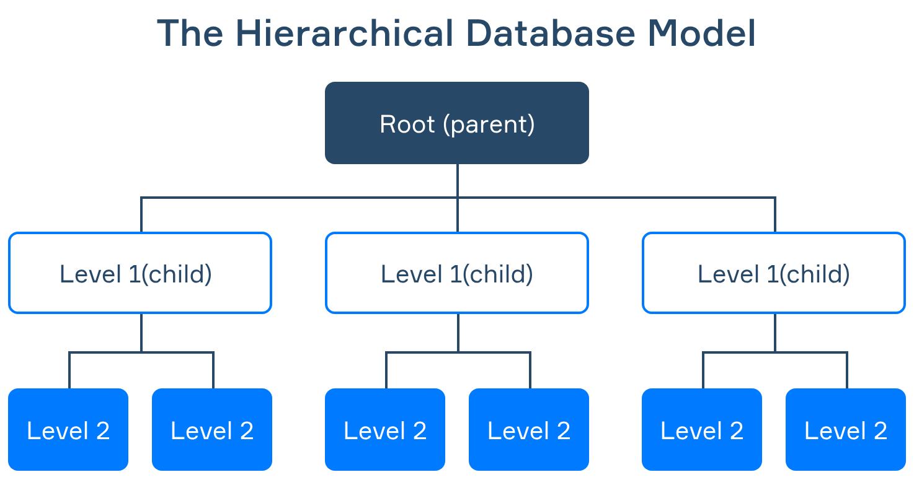
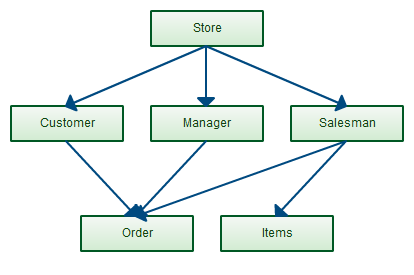
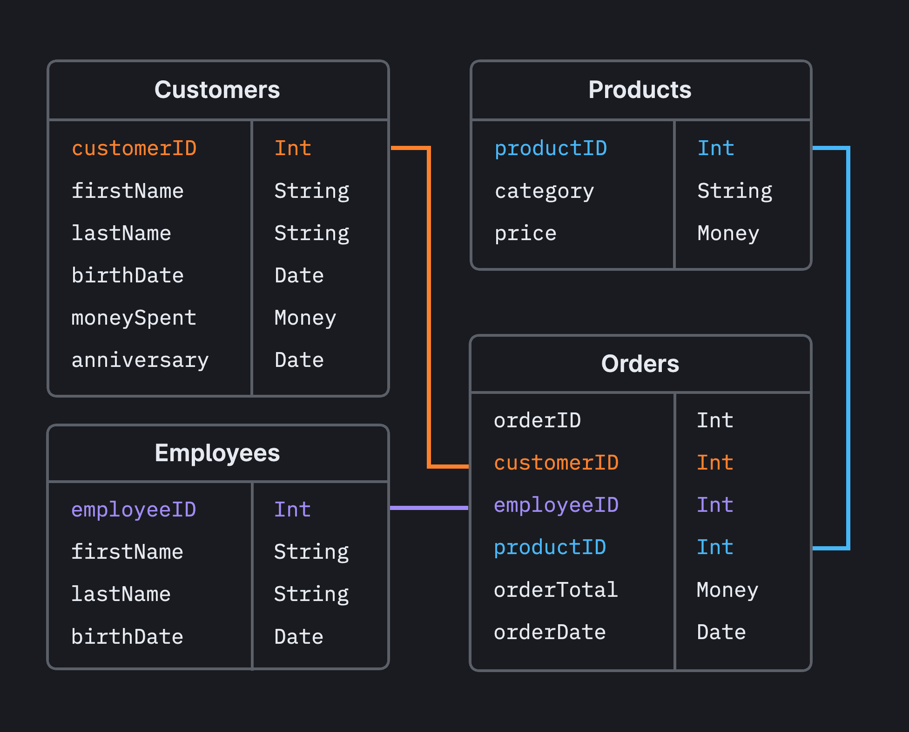
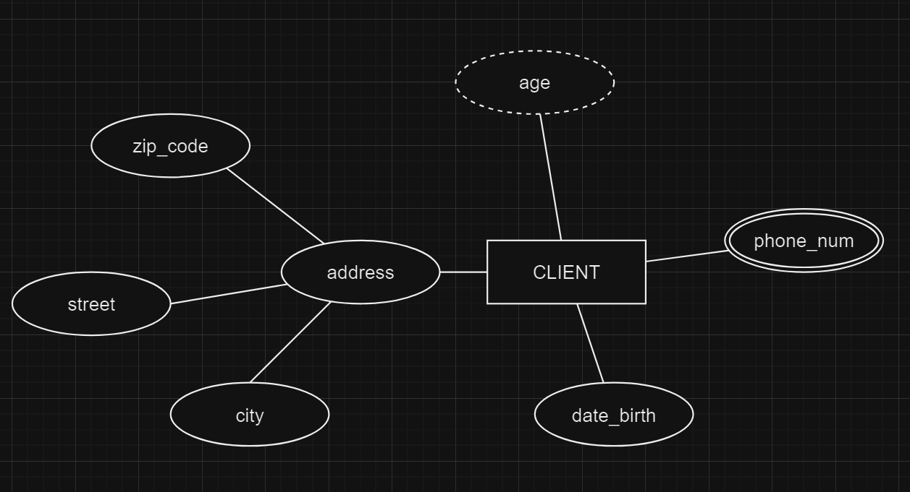
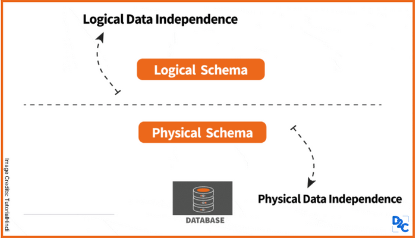
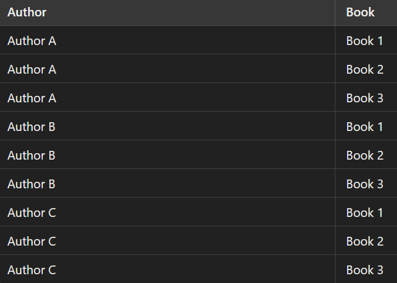
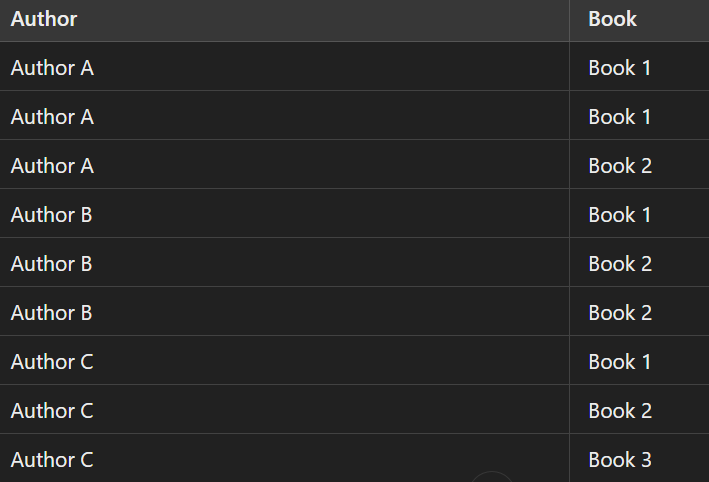

# Cómo usar este dosier {.nobreak}

Este dosier recoge todo lo que trabajamos en clase sobre el modelo relacional, con explicaciones, ejemplos y ejercicios para que puedas estudiar por tu cuenta.

Las palabras clave de SQL (`NULL`, `VARCHAR`, `IS NULL`…) y los nombres de columnas de las tablas de ejemplo (`StudentID`, `CourseID`…) se escriben en inglés, tal como los verás en las bases de datos.

Encontrarás cuatro tipos de caja:

!!! definicion "Definición"
    Un término que tienes que saber explicar con tus palabras. Si solo sabes repetirlo de memoria, todavía no lo has aprendido.

!!! ejemplo "Ejemplo"
    Un caso concreto, con valores reales siempre que se pueda. Léelo despacio: aquí es donde la idea se entiende.

!!! ojo "Ojo"
    Un error típico o dos conceptos que se suelen confundir. Son las preguntas que salen en el examen.

!!! comprueba "Comprueba"
    De tres a cinco preguntas al final de cada bloque. Contesta sin mirar atrás. Si te atascas, vuelve a leer el bloque.

Al final tienes un **glosario**, un **mapa resumen** y una **autoevaluación**.

## Qué vas a aprender

Al terminar esta UT deberías ser capaz de:

- Explicar qué es un modelo de datos y qué cuatro cosas describe (estructuras, restricciones, operaciones y permisos), y relacionarlas con DDL, DML y DCL.
- Describir el modelo relacional propuesto por E. F. Codd y por qué es independiente de cómo se almacenan físicamente los datos.
- Usar con propiedad el vocabulario del modelo relacional: relación, atributo, tupla, dominio, grado y cardinalidad, y sus equivalentes en tablas.
- Enumerar las características que debe cumplir toda relación y los principales tipos de datos.
- Distinguir relaciones base, vistas, instantáneas (*snapshots*) y relaciones temporales.
- Identificar las claves candidatas, primaria, alternativas y ajenas de una tabla, y justificar por qué una clave compuesta es irreducible.
- Explicar qué es un índice, cómo acelera las búsquedas y qué cuesta.
- Usar `NULL` correctamente: qué significa, cómo se comporta en las operaciones lógicas y cómo buscarlo con `IS NULL`.
- Explicar qué es una vista, para qué sirve y qué pasa cuando se modifican datos a través de ella.
- Describir usuarios, permisos (de sistema y de objeto) y roles, y por qué los roles facilitan la administración.

## Índice

| Bloque | Tema |
|---|---|
| 1 | Modelos de datos y modelo relacional |
| 2 | Anatomía de una relación |
| 3 | Tipos de relaciones |
| 4 | Claves |
| 5 | Índices |
| 6 | Información que falta: NULL |
| 7 | Vistas |
| 8 | Usuarios, permisos y roles |
| Repaso | Glosario, mapa resumen y autoevaluación |

# Bloque 1. Modelos de datos y modelo relacional

## 1.1 ¿Qué es un modelo de datos?

!!! definicion "Definición"
    Un **modelo de datos** es un esquema teórico de un sistema. Ayuda a describir los elementos que intervienen en un problema y cómo se relacionan entre sí.

Piensa en él como el «lenguaje» que eliges para dibujar el problema. A lo largo de los años ha habido varios modelos de datos. Estas cuatro imágenes muestran cuatro de ellos; cada una es una forma distinta de representar el mismo tipo de información:









La última ya la conoces: es el diagrama **entidad-relación (E-R)** que dibujaste en la unidad anterior. La tercera es lo que estudiamos ahora: el **modelo relacional**.

## 1.2 Los modelos de datos en informática

En informática, un modelo de datos es un lenguaje para describir cuatro cosas:

| Qué describe | Ejemplo | Sublenguaje de SQL |
|---|---|---|
| **Estructuras de datos** (tipos de datos y sus relaciones) | «Un cliente tiene un nombre de hasta 50 caracteres» | **DDL**: lenguaje de definición de datos |
| **Restricciones de integridad** (reglas que deben cumplir los datos) | «La edad debe estar entre 1 y 120» | **DDL** |
| **Operaciones de manipulación** (insertar, borrar, modificar) | «Añadir un cliente», «borrar el pedido 103» | **DML**: lenguaje de manipulación de datos |
| **Quién puede ver, modificar o manipular los datos** (*grant*, *revoke*) | «Los invitados solo pueden leer la tabla Productos» | **DCL**: lenguaje de control de datos |

Los tres sublenguajes juntos forman **SQL**, el lenguaje que usarás durante el resto del módulo.

!!! ejemplo "Ejemplo"
    La misma base de datos vista desde los tres sublenguajes (lo aprenderás en las próximas unidades):
    `CREATE TABLE cliente (...)` → DDL: define la estructura.
    `INSERT INTO cliente VALUES (...)` → DML: manipula los datos.
    `GRANT SELECT ON cliente TO invitado` → DCL: controla quién puede hacer qué.

## 1.3 Introducción al modelo relacional

El modelo relacional lo propuso **Edgar Frank Codd** mientras trabajaba en **IBM** (1970). Organiza los datos de forma lógica y estructurada, **independiente de cómo se almacenan físicamente**.




Esa última idea es la clave de todo el modelo. Tú trabajas con tablas, filas y columnas (el nivel **lógico**) y nunca necesitas saber en qué fichero, bloque de disco u orden se guardan realmente los datos (el nivel **físico**). Si el administrador pasa la base de datos a un disco más rápido, tus consultas siguen funcionando exactamente igual.

!!! ojo "Ojo"
    Aquí «lógico / físico» habla de **niveles de un SGBD** (lo que ve el usuario frente a cómo se guarda). No lo mezcles con las **fases del diseño** conceptual / lógico / físico: el diagrama E-R es el diseño conceptual; el conjunto de tablas que obtendrás a partir de él es el diseño lógico. Mismas palabras, ideas distintas.

## 1.4 La analogía de la estantería

Imagina una colección de libros. Según el espacio que tengamos (habitaciones, tamaño de las estanterías…), podemos ordenar los libros de distintas maneras para encontrarlos fácilmente. **Los libros siguen siendo los mismos**: solo cambiamos cómo los colocamos. El modelo relacional funciona igual con los datos.


## 1.5 Una relación combina datos

Desde el punto de vista matemático, una **relación** es como una tabla en la que se combinan datos de distintas columnas. Por ejemplo, podemos relacionar autores con sus libros combinando dos conjuntos de datos:

| Authors (autores) | Books (libros) |
|---|---|
| Author A | Book 1 |
| Author B | Book 2 |
| Author C | Book 3 |

!!! ojo "Ojo"
    En el modelo relacional, **relación = tabla** (en inglés, *relation*). No la confundas con las **interrelaciones** del modelo E-R (los rombos que unen entidades). Al pasar un diagrama E-R a tablas, una interrelación puede acabar convertida en una clave ajena o en una tabla nueva, pero no son lo mismo.

## 1.6 El producto cartesiano: combinar todos los datos

!!! definicion "Definición"
    El **producto cartesiano** de dos conjuntos combina cada elemento de un conjunto con todos los elementos del otro. Da **todas las combinaciones posibles**.

En nuestro ejemplo, significa combinar cada autor con cada libro:



!!! ejemplo "Ejemplo"
    3 autores × 3 libros = **9** combinaciones: (A,1), (A,2), (A,3), (B,1), (B,2), (B,3), (C,1), (C,2), (C,3). Con 10 autores y 50 libros saldrían 10 × 50 = 500 filas. El número de filas de un producto cartesiano es siempre el **producto** de los tamaños.

No todas las combinaciones son verdad en el mundo real: quizá el autor A solo escribió el libro 1. La relación «quién escribió qué» es solo el **subconjunto** del producto cartesiano que describe la realidad. Esa es justamente la definición matemática de relación, y por eso volverás a encontrarte el producto cartesiano cuando escribas consultas con varias tablas (`FROM authors, books` sin ninguna condición te devuelve las 9 combinaciones).

## 1.7 Mantener las filas únicas

Cuando trabajamos con relaciones (tablas), nos aseguramos de que **cada fila sea única**, evitando duplicados para mantener la integridad de los datos (**unicidad**).



!!! ejemplo "Ejemplo"
    En la tabla de la izquierda, «Author A, Book 1» y «Author B, Book 2» aparecen dos veces. La segunda copia no aporta información y, peor aún, si cuentas «cuántos libros escribió el autor A» obtendrías un número equivocado. La tabla de la derecha las elimina.

!!! comprueba "Comprueba"
    1. ¿Qué cuatro cosas describe un modelo de datos? ¿Qué sublenguaje de SQL se ocupa de cada una?
    2. ¿Quién propuso el modelo relacional y qué significa «independiente de cómo se almacenan físicamente los datos»?
    3. ¿Cuántas filas tiene el producto cartesiano de un conjunto de 4 alumnos y otro de 6 asignaturas?
    4. ¿Por qué las filas duplicadas son un problema?
    5. ¿Qué diferencia hay entre una *relación* y una *interrelación* del modelo E-R?

# Bloque 2. Anatomía de una relación

## 2.1 Las relaciones vistas como tablas

A partir de ahora consideramos una relación como una **tabla**, formada por **atributos** (columnas) que representan características de la entidad que se describe.

| Address_id | City | Street |
|---|---|---|
| 101 | New York | 5th Avenue |
| 102 | Chicago | Lakeshore Drive |

*Tabla Address (direcciones)*

## 2.2 Atributos y tuplas

!!! definicion "Definición"
    Los **atributos** son las columnas de una tabla. Cada atributo representa una característica o propiedad de la entidad que describe la tabla.

!!! definicion "Definición"
    Las **tuplas** son las filas de una tabla. Cada tupla representa un registro o ejemplar concreto de la entidad que describe la tabla.

En la tabla *Address*, `Address_id`, `City` y `Street` son los atributos; `(101, New York, 5th Avenue)` es una tupla.

Las tuplas deben cumplir dos criterios:

- Deben corresponder a un **elemento del mundo real**.
- **No puede haber dos tuplas idénticas** (no pueden tener los mismos valores en todas las columnas).

## 2.3 Dominio

!!! definicion "Definición"
    Un **dominio** es el conjunto de valores permitidos para un atributo (columna) de una tabla. Define el tipo de dato y las restricciones del atributo.

!!! ejemplo "Ejemplo"
    En la tabla *Students*, el dominio de `Age` (edad) es **entero [1, 120]**. El valor 87 es válido. El valor **0** no lo es: es un entero, pero está fuera del rango. Un valor como «veinte» tampoco sería válido, porque no es un entero.

## 2.4 Valores atómicos

En el modelo relacional, los valores deben ser **atómicos**: cada celda contiene un único valor indivisible.

| Age | ¿Válido? | Por qué |
|---|---|---|
| 87 | Sí | Un único valor entero |
| 25, 30 | No | Dos valores en la misma celda |
| 25 years | No | Mezcla un número con texto; no es un entero |

!!! ojo "Ojo"
    Si necesitas guardar dos teléfonos de una persona, la solución **no** es «123, 456» en la misma celda. Cómo resolverlo bien (otra tabla con una clave ajena) lo verás en la unidad de normalización.

## 2.5 Grado y cardinalidad

!!! definicion "Definición"
    El **grado** de una tabla es su número de columnas (atributos). La **cardinalidad** es su número de filas (registros).

!!! ejemplo "Ejemplo"
    La tabla *Students* del ejemplo tiene 3 columnas (Age y dos más) y 4 filas (87, 25, 30, 20): **grado 3, cardinalidad 4**. Si insertas un alumno nuevo, la cardinalidad pasa a 5, pero el grado sigue siendo 3. El grado solo cambia si cambias la *estructura* (añadir o quitar una columna).

!!! ojo "Ojo"
    «Cardinalidad» también salió en el modelo E-R, donde significaba *con cuántas ocurrencias de una entidad se puede relacionar otra* (1:N, N:M…). Aquí significa simplemente **número de filas**. Misma palabra, distinto significado: fíjate siempre en el contexto.

## 2.6 Sinónimos

Los mismos conceptos tienen dos nombres: el formal (modelo relacional) y el cotidiano (tablas).

| Terminología del modelo relacional | Terminología de tablas |
|---|---|
| RELACIÓN | TABLA |
| TUPLA | FILA |
| ATRIBUTO | COLUMNA |
| GRADO | NÚMERO DE COLUMNAS |
| CARDINALIDAD | NÚMERO DE FILAS |

## 2.7 Características de una relación (tabla)

Toda relación debe cumplir estas reglas:

| Regla | Qué significa en la práctica |
|---|---|
| Cada relación (tabla) debe tener un **nombre único** dentro de la base de datos para identificarla sin ambigüedad. | No puede haber dos tablas llamadas `cliente` en la misma base de datos. |
| Cada atributo (columna) debe tener un **nombre único** dentro de la tabla, aunque puede repetirse en tablas distintas. | `cliente.nombre` y `producto.nombre` pueden convivir. |
| Los valores de cada celda deben ser **atómicos**: cada celda contiene un único valor indivisible. | Nada de listas dentro de una celda. |
| No puede haber dos tuplas (filas) **completamente idénticas**. | Unicidad, bloque 1. |
| El **orden** de las tuplas o de los atributos no importa. | La fila 1 no es «más importante» que la 5; nunca dependas del orden en que se insertaron. |
| Todos los valores de un atributo deben pertenecer al **mismo dominio**. | Una columna de fechas solo contiene fechas. |

## 2.8 Tipos de datos

| Tipo de dato | Descripción |
|---|---|
| **Texto** | Guarda cadenas de caracteres, como palabras o frases (p. ej., `VARCHAR`, `CHAR` en SQL). |
| **Numérico** | Guarda números para hacer operaciones matemáticas. Pueden ser enteros (`INT`) o decimales (`FLOAT`, `DOUBLE`). |
| **Fecha/hora** | Guarda fechas, horas o una combinación de ambas (p. ej., `DATE`, `TIME`, `DATETIME` en SQL). |
| **Booleano (sí/no)** | Guarda datos con dos valores posibles: verdadero/falso. |
| **Autoincremento** | Un valor numérico que aumenta automáticamente con cada registro nuevo (p. ej., `AUTO_INCREMENT` en SQL). |
| **Moneda** | Un subtipo numérico que guarda importes con precisión decimal. |

Hay además un valor especial, **NULL**, que puede aparecer en columnas de cualquier tipo; lo veremos en el bloque 6.

!!! ojo "Ojo"
    Cuando escribas SQL en MySQL, dos filas de esta tabla funcionan algo distinto: **`AUTO_INCREMENT`** no es un tipo por sí mismo, sino una propiedad que se añade a una columna entera (`id INT AUTO_INCREMENT`), y no existe un tipo `CURRENCY`: el dinero se guarda con **`DECIMAL`**, por ejemplo `DECIMAL(10,2)`. Evita `FLOAT`/`DOUBLE` para el dinero: pueden dar errores de redondeo como 0.1 + 0.2 = 0.30000000000000004.

### CHAR frente a VARCHAR

| Tipo de dato | Descripción | Cuándo usarlo |
|---|---|---|
| **CHAR(n)** | Cadena de longitud fija. Rellena con espacios hasta llegar a n. | Datos de longitud constante (p. ej., códigos de país). |
| **VARCHAR(n)** | Cadena de longitud variable. Guarda hasta n caracteres sin rellenar. | Datos de longitud variable (p. ej., nombres de usuario, correos). |

!!! ejemplo "Ejemplo"
    Guardamos el texto «USA» en dos columnas:
    `CHAR(5)` → se guarda como «USA␣␣» (rellenado con 2 espacios hasta 5 caracteres).
    `VARCHAR(5)` → se guarda como «USA» (solo ocupa 3 caracteres).
    Una columna de códigos postales (siempre 5 dígitos, «07001») es un buen `CHAR(5)`; una columna de correos es claramente un `VARCHAR(100)`.

Formatos de fecha y hora:

| Tipo | Formato | Ejemplo |
|---|---|---|
| DATE | AAAA-MM-DD (`YYYY-MM-DD`) | 2026-10-17 |
| TIME | HH:MM:SS | 16:30:00 |
| DATETIME | AAAA-MM-DD HH:MM:SS | 2026-10-17 16:30:00 |

!!! comprueba "Comprueba"
    1. Una tabla tiene 7 columnas y 1 200 filas. ¿Cuáles son su grado y su cardinalidad? ¿Qué cambia si borras 200 filas?
    2. ¿Por qué «25 years» no es un valor válido para una columna `Age` con dominio entero [1, 120]?
    3. ¿Pueden dos tablas distintas tener una columna llamada `email`? ¿Y una misma tabla tener dos?
    4. ¿Qué tipo usarías para un DNI («12345678Z»)? ¿Y para la descripción de un producto? ¿Por qué?
    5. ¿Importa el orden de las filas de una tabla? ¿Por qué?

# Bloque 3. Tipos de relaciones

Las relaciones pueden ser **persistentes** o **temporales**.

| Tipo | Quién la borra | Clases |
|---|---|---|
| **Persistente** | Solo los usuarios: los datos permanecen hasta que se eliminan explícitamente. | Relaciones base, vistas, instantáneas |
| **Temporal** | El sistema, automáticamente (por ejemplo, al terminar la sesión). | Ninguna |

!!! ojo "Ojo"
    Aquí «temporal» significa **provisional**: se borra sola. No tiene nada que ver con el tiempo ni con las fechas. En SQL las verás como tablas temporales (*temporary tables*).

## 3.1 Relaciones persistentes

**Relaciones base**

- Son independientes y se crean al definir su estructura y sus registros.
- Son la base del almacenamiento: aquí es donde viven realmente los datos.

**Vistas**

- Tablas que solo guardan la **definición de una consulta** y generan una tabla a partir de los datos de tablas base, vistas o instantáneas.
- Se actualizan automáticamente cuando cambian las tablas base de las que dependen.
- Ofrecen una representación dinámica de los datos.

**Instantáneas (*snapshots*)**

- Parecidas a las vistas, pero guardan los **datos reales** junto con la consulta con la que se crearon.
- Solo actualizan sus resultados cuando el sistema las refresca, cada cierto intervalo.
- Funcionan como una «foto» de los datos, válida durante un tiempo limitado.

| | ¿Guarda la consulta? | ¿Guarda los datos? | ¿Cuándo está al día? |
|---|---|---|---|
| Relación base | No | Sí | Siempre (es el dato en sí) |
| Vista | Sí | No | Siempre: se calcula cada vez que la usas |
| Instantánea | Sí | Sí | Solo después de cada refresco |

!!! ejemplo "Ejemplo"
    Una tienda quiere una tabla de «ventas por mes» para la dirección. Como **vista**, cada vez que alguien la abre la base de datos vuelve a sumar todas las ventas: siempre exacta, pero más lenta. Como **instantánea** refrescada cada noche a las 03:00, se abre al momento, pero una venta hecha a las 10:00 no aparecerá hasta la noche siguiente.

En Oracle y PostgreSQL las instantáneas se llaman **vistas materializadas**. MySQL, que es el que usaremos, no las tiene como tales.

!!! comprueba "Comprueba"
    1. ¿Qué diferencia hay entre una relación persistente y una temporal?
    2. ¿Una vista ocupa espacio con copias de los datos? ¿Y una instantánea?
    3. Tu jefe necesita cifras *siempre* al día. ¿Vista o instantánea? ¿Y si solo las necesita una vez al día, pero muy rápido?

# Bloque 4. Claves

Hay cuatro tipos de claves: **candidata**, **alternativa**, **primaria** y **ajena** (o foránea). Las tres primeras identifican filas dentro de una tabla; la clave ajena enlaza tablas.

## 4.1 Claves candidatas

!!! definicion "Definición"
    Una **clave candidata** es un atributo o combinación de atributos que identifica de forma única cada fila de una tabla.

Puntos clave:

- **Toda tabla** debe tener al menos una clave candidata, pero puede tener más.
- **Clave compuesta**: cuando una clave candidata está formada por más de un atributo, se llama clave compuesta.

Características:

- **Unicidad**: no puede haber dos filas con los mismos valores en esos atributos.
- **Irreducibilidad**: si se quita cualquier atributo de la clave, deja de ser única.

!!! ejemplo "Ejemplo"
    Tabla *Students* (alumnos):

    | StudentID | FirstName | LastName | Email | DateOfBirth | PhoneNumber |
    |---|---|---|---|---|---|
    | 1001 | John | Doe | john.doe@example.com | 2001-01-15 | 555-1234 |
    | 1002 | Jane | Smith | jane.smith@example.com | 2000-05-20 | 555-5678 |
    | 1003 | John | Doe | john.doe2@example.com | 1999-11-03 | 555-4321 |

    Hay **tres claves candidatas**: `StudentID`, `Email` y `PhoneNumber`. Cada una, por sí sola, es distinta en todas las filas. `FirstName + LastName` **no** es clave candidata: hay dos «John Doe».

### Una clave candidata compuesta: CourseRegistrations

La tabla *CourseRegistrations* registra qué alumnos están matriculados en qué cursos:

| StudentID | CourseID | Semester | Grade |
|---|---|---|---|
| 1001 | CS101 | 2024-01 | A |
| 1001 | MATH202 | 2024-01 | B |
| 1002 | CS101 | 2024-01 | A |
| 1003 | PHYS301 | 2024-01 | B+ |
| 1002 | MATH202 | 2023-09 | B |

Aquí ninguna columna es única por sí sola. La clave candidata es **StudentID + CourseID + Semester**. ¿Es irreducible? Probemos a quitar cada atributo:

| Si quitamos… | Nos queda… | Por qué falla |
|---|---|---|
| StudentID | CourseID + Semester | Varios alumnos pueden cursar la misma asignatura en el mismo semestre. |
| CourseID | StudentID + Semester | Un alumno puede cursar varias asignaturas en el mismo semestre. |
| Semester | StudentID + CourseID | Un alumno puede cursar la misma asignatura en semestres distintos (p. ej., si repite). |

Como no se puede quitar ninguno de los tres, la clave es **irreducible**.

!!! ojo "Ojo"
    La irreducibilidad hay que justificarla con el **mundo real**, no solo con las filas que ves. En la tabla de arriba, `StudentID + CourseID` resulta ser única *hoy*, pero un alumno que suspenda MATH202 y la repita la rompería. Pregúntate siempre: «¿esto se podría repetir alguna vez?»

### Otra clave compuesta: EventsLog

| Timestamp | UserID | EventType | IPAddress |
|---|---|---|---|
| 2024-10-17 10:15:12.001 | 1234 | Login | 192.168.1.10 |
| 2024-10-17 10:15:12.001 | 5678 | Login | 192.168.1.12 |
| 2024-10-17 10:16:05.543 | 1234 | Logout | 192.168.1.10 |
| 2024-10-17 10:17:30.879 | 5678 | Logout | 192.168.1.12 |
| 2024-10-17 10:18:45.112 | 1234 | Login | 192.168.1.11 |

Aquí la clave candidata necesita **los cuatro** atributos:

- **Si quitamos Timestamp**: el mismo usuario podría hacer el mismo evento desde la misma IP en momentos distintos.
- **Si quitamos UserID**: varios usuarios podrían hacer el mismo evento desde la misma IP en el mismo instante.
- **Si quitamos EventType**: un usuario podría hacer varias acciones distintas en el mismo instante desde la misma IP.
- **Si quitamos IPAddress**: un usuario podría iniciar sesión desde direcciones IP distintas en el mismo instante.

## 4.2 Clave primaria y claves alternativas

!!! definicion "Definición"
    La **clave primaria** (PK) es la clave candidata **elegida** para identificar de forma única las filas de una tabla. Las claves candidatas que no se eligen se llaman **claves alternativas**.

Puntos clave:

- **Unicidad garantizada**: como no puede haber dos filas idénticas, siempre existe al menos una clave primaria posible. En el peor de los casos, formada por todos los atributos juntos.
- **Subconjunto mínimo**: normalmente se elige un conjunto pequeño de atributos.

!!! ejemplo "Ejemplo"
    En *Students*, las candidatas eran `StudentID`, `Email` y `PhoneNumber`. La elección natural es **`StudentID`** como clave primaria: es corta, no cambia nunca y siempre se conoce. `Email` y `PhoneNumber` pasan a ser **claves alternativas** (un alumno puede cambiar de teléfono; el identificador se mantiene).

!!! ojo "Ojo"
    Toda clave primaria es una clave candidata, pero no toda clave candidata es la clave primaria. Una tabla tiene **una** clave primaria (que puede ser compuesta), pero puede tener **varias** claves candidatas.

## 4.3 Claves ajenas

!!! definicion "Definición"
    Una **clave ajena** o foránea (FK, *foreign key*) es un atributo o conjunto de atributos de una tabla cuyos valores coinciden con los valores de la clave primaria de otra tabla (o, a veces, de la misma).

- **Para qué sirve**: para establecer y enlazar relaciones entre tablas.
- **Sin unicidad**: a diferencia de las claves primarias, los valores de una clave ajena se pueden repetir dentro de la misma tabla.
- **Integridad referencial**: los valores de la clave ajena **deben existir** en la columna de clave primaria correspondiente **o** bien la clave ajena puede contener valores **NULL**.

!!! ejemplo "Ejemplo"
    Tablas *Customer* (clientes) y *Order* (pedidos):

    | CustomerID (PK) | CustomerName | Email | Phone |
    |---|---|---|---|
    | 1 | Alice Johnson | alice@example.com | 555-1234 |
    | 2 | Bob Smith | bob@example.com | 555-5678 |
    | 3 | Carol Davis | carol@example.com | 555-9101 |

    | OrderID (PK) | OrderDate | Amount | CustomerID (FK) |
    |---|---|---|---|
    | 101 | 2024-10-16 | $200 | 1 |
    | 102 | 2024-10-17 | $150 | 2 |
    | 103 | 2024-10-18 | $250 | 1 |

    Los pedidos 101 y 103 son de Alice (CustomerID 1): el valor 1 de la FK **se repite** y no pasa nada. Insertar un pedido con `CustomerID = 7` rompería la integridad referencial, porque el cliente 7 no existe.

!!! ojo "Ojo"
    La clave ajena siempre va en la tabla del lado «muchos»: un cliente tiene muchos pedidos, así que `CustomerID` se guarda en *Order*, no al revés. Si lo pusieras en *Customer*, un cliente solo podría tener un pedido.

### Una clave ajena compuesta: Course y Enrollment

| CourseID | Semester | CourseName |
|---|---|---|
| CSE101 | Fall 2024 | Introduction to CS |
| CSE102 | Fall 2024 | Data Structures |
| CSE101 | Spring 2025 | Introduction to CS |
| CSE103 | Fall 2024 | Web Development |

*Tabla Course (asignaturas): la clave primaria es **CourseID + Semester** (CSE101 aparece dos veces, en semestres distintos).*

| StudentID | CourseID (FK) | Semester (FK) | Grade |
|---|---|---|---|
| 1 | CSE101 | Fall 2024 | A |
| 2 | CSE102 | Fall 2024 | B |
| 1 | CSE101 | Spring 2025 | A |
| 3 | CSE103 | Fall 2024 | C |

*Tabla Enrollment (matrículas).*

Si la clave primaria a la que apunta es compuesta, la clave ajena **también debe ser compuesta**, con las mismas columnas. `CourseID` solo no bastaría: «CSE101» no nos dice si es la edición de otoño de 2024 o la de primavera de 2025.

### Una clave ajena a la misma tabla: Employee

| EmployeeID | EmployeeName | Position | ManagerID (FK) |
|---|---|---|---|
| 1 | Alice Johnson | CEO | NULL |
| 2 | Bob Smith | Manager | 1 |
| 3 | Carol Davis | Developer | 2 |
| 4 | David Brown | Developer | 2 |
| 5 | Eva White | Designer | 1 |

`ManagerID` apunta a `EmployeeID` **de la misma tabla**: la jefa de Bob es Alice (1); el jefe de Carol y de David es Bob (2). Alice es la directora general y no tiene jefe, así que su `ManagerID` es **NULL**. Eso significa que ahí no hay valor y que la **cardinalidad mínima es 0**: tener jefe es **opcional**.

!!! ojo "Ojo"
    **NULL no es un tipo de dato** que elijas para una columna (como `INT` o `VARCHAR`); es una **marca** especial que puede contener cualquier columna de cualquier tipo, salvo que lo prohíbas con `NOT NULL`. Y «cardinalidad mínima 0» es la forma de decirlo del modelo E-R: en el diagrama E-R esta interrelación sería **(0,1)** en el lado del jefe.

!!! comprueba "Comprueba"
    1. ¿Qué diferencia hay entre clave candidata, clave primaria y clave alternativa?
    2. En la tabla *CourseRegistrations*, ¿por qué no basta con `StudentID + CourseID`?
    3. ¿Una clave ajena puede tener valores repetidos? ¿Puede ser NULL? ¿Puede tener un valor que no exista en la tabla a la que apunta?
    4. ¿Por qué la FK de *Enrollment* tiene que tener dos columnas?
    5. En *Employee*, ¿qué pasaría si insertáramos un empleado con `ManagerID = 9`?

# Bloque 5. Índices

## 5.1 ¿Qué es un índice?

!!! definicion "Definición"
    Un **índice** es como un atajo en la base de datos que nos ayuda a encontrar datos rápidamente. Es parecido al índice de un libro: en lugar de revisar todas las páginas, vas al índice para encontrar la página exacta donde está la información.


## 5.2 ¿Cómo ayuda un índice?

Un índice acelera las búsquedas en una tabla usando uno o más campos (p. ej., `Name` o `Join Date`). Es especialmente útil en consultas frecuentes, como buscar los usuarios que se registraron antes de cierta fecha.

| UserID | Name | Join Date | Email |
|---|---|---|---|
| 1 | Alice Smith | 2022-01-15 | alice@example.com |
| 2 | Bob Johnson | 2021-11-23 | bob@example.com |
| 3 | Carol White | 2022-03-05 | carol@example.com |
| 4 | David Brown | 2023-02-10 | david@example.com |
| 5 | Eva Green | 2021-09-18 | eva@example.com |

Un índice sobre `Join Date` (fecha de alta) guarda dos cosas por cada fila: el **valor** (la fecha) y una **referencia a la fila** (su ID).

| Join Date (valor) | Referencia a la fila con ID |
|---|---|
| 2021-09-18 | 5 |
| 2021-11-23 | 2 |
| 2022-01-15 | 1 |
| 2022-03-05 | 3 |
| 2023-02-10 | 4 |

Para saber quién se dio de alta el 2022-01-15, la base de datos busca esa fecha en el índice (que está ordenado), encuentra la referencia a la fila 1 y salta directamente a ella **sin recorrer toda la tabla**.

!!! ojo "Ojo"
    El índice mantiene sus valores **ordenados**, aunque la tabla no lo esté. Ese orden es lo que lo hace rápido: como en un diccionario, no lees todas las palabras; lo abres cerca de la letra correcta.

!!! ejemplo "Ejemplo"
    Una tabla tiene 1 000 000 de usuarios. Sin índice, encontrar una fecha puede obligar a leer hasta 1 000 000 de filas. Con un índice ordenado, la búsqueda descarta la mitad de las posibilidades en cada paso: 1 000 000 → 500 000 → 250 000… y en unos **20 pasos** la encuentra (2²⁰ ≈ 1 000 000).

## 5.3 ¿Por qué usar un índice?

Los índices son útiles cuando se hacen **búsquedas frecuentes**: mejoran la velocidad de las consultas al reducir la necesidad de recorrer la tabla entera.

## 5.4 ¿Qué pasa cuando cambian los datos?

Cuando añadimos, modificamos o borramos datos de la tabla, los índices **se actualizan automáticamente**. Ocurre de forma transparente: no tenemos que hacer nada. Puedes pensar en él como una instantánea, pero en lugar de refrescarse cada cierto tiempo, se refresca cada vez que cambia la tabla principal.

## 5.5 Independencia de los índices

Los índices son independientes de la tabla a la que se refieren. Podemos **crearlos o borrarlos en cualquier momento** sin afectar a los datos reales de la tabla. Borrar un índice solo hace más lentas algunas búsquedas; nunca borra una fila.

## 5.6 ¿Cuándo conviene usar índices?

- Se puede crear un índice para cada columna, pero no siempre hace falta.
- **Buena práctica**: indexar las columnas que se usan con frecuencia en las búsquedas.
- **Ejemplo**: si a menudo buscas usuarios por «apellido», crear un índice sobre esa columna es buena idea.

## 5.7 Ventajas e inconvenientes


| | Efecto de un índice |
|---|---|
| **Búsquedas** | Mucho más rápidas. |
| **Insertar / actualizar / borrar** | Más lento, porque cada índice también se tiene que actualizar. |

Es fundamental **equilibrar** la necesidad de búsquedas rápidas con el coste que supone para la manipulación de datos.

!!! ejemplo "Ejemplo"
    Una tabla de *lecturas de sensores* recibe 500 inserciones por segundo y se consulta una vez al día: pocos índices. Un *catálogo de productos* se actualiza unas pocas veces por semana y se consulta miles de veces al día: conviene indexar las columnas por las que se busca (nombre, categoría…).

!!! comprueba "Comprueba"
    1. ¿Qué dos cosas guarda un índice por cada fila?
    2. Si borras un índice, ¿pierdes datos? ¿Qué pierdes?
    3. ¿Por qué las inserciones son más lentas cuando una tabla tiene muchos índices?
    4. En una tabla de usuarios buscas a menudo por `LastName` y nunca por `DateOfBirth`. ¿Cuál indexarías?

# Bloque 6. Información que falta: NULL

## 6.1 ¿Qué pasa cuando los datos están incompletos?

Cuando guardamos información sobre usuarios, es habitual que falten datos o que algunos no sean necesarios:

| User ID | First Name | Last Name | Email | Phone Number | Join Date |
|---|---|---|---|---|---|
| 1 | John | Doe | john.doe@example.com | NULL | 2024-01-15 |
| 2 | Jane | Smith | jane.smith@example.com | 123-456-7890 | 2024-02-20 |
| 3 | NULL | Johnson | alice.j@example.com | 987-654-3210 | 2024-03-10 |
| 4 | Bob | Doe | NULL | NULL | 2024-04-05 |
| 5 | Charlie | Brown | charlie.b@example.com | 555-123-4567 | 2024-05-12 |

## 6.2 Uso de los valores NULL

!!! definicion "Definición"
    **NULL** es un valor especial que se usa para representar la **ausencia de información**.

- **Indica ausencia**: NULL significa que el dato no está.
- **No es lo mismo que cero ni que vacío**: NULL es distinto de 0 y de la cadena vacía `""`; indica explícitamente que falta información.

| Valor | Significado en una columna `Phone` |
|---|---|
| `NULL` | **No sabemos** el teléfono (o no tiene). |
| `""` (cadena vacía) | Lo sabemos y es un texto vacío. |
| `0` | Es el número cero. |

!!! ejemplo "Ejemplo"
    En una columna `Descuento`: `0` significa «este cliente tiene un 0 % de descuento»; `NULL` significa «todavía no lo hemos decidido». Si calculas el descuento medio, el 0 cuenta; el NULL se ignora.

## 6.3 NULL en las claves ajenas

Si una clave ajena vale NULL, la fila **no está relacionada** con ninguna fila de la otra tabla.

- **Sin relación**: la fila queda sola, sin ninguna asociación.
- **Flexibilidad**: permite **relaciones opcionales**, en las que algunas filas no necesitan estar enlazadas con otra tabla.

Es el caso de Alice, la directora general, en la tabla *Employee* (bloque 4): `ManagerID = NULL` porque no tiene jefe.

## 6.4 NULL en las operaciones lógicas

Cuando usamos NULL en operaciones lógicas (AND, OR, NOT), el resultado puede ser distinto de TRUE o FALSE:

| Operación lógica | Resultado |
|---|---|
| TRUE AND NULL | NULL |
| FALSE AND NULL | FALSE |
| TRUE OR NULL | TRUE |
| FALSE OR NULL | NULL |
| NOT NULL | NULL |

El truco para entender la tabla: lee NULL como **«no lo sé»**. *FALSO y no-lo-sé* es FALSO seguro, porque con un falso basta para que AND sea falso. *VERDADERO o no-lo-sé* es VERDADERO seguro, porque con un verdadero basta para OR. En todos los demás casos la respuesta depende del valor desconocido, así que el resultado también es «no lo sé»: NULL.

## 6.5 Buscar valores NULL en las consultas

Para comprobar si un valor es NULL se usa el operador **IS NULL**.

```sql
SELECT * FROM users
WHERE phone IS NULL
```

Esta consulta devuelve todos los registros en los que el campo `phone` no tiene valor:

| User ID | Name | Phone |
|---|---|---|
| 1 | Alice Smith | 123-456-7890 |
| **2** | **Bob Johnson** | **NULL** ← la devuelve |
| 3 | Carol Lee | 987-654-3210 |
| **4** | **David Brown** | **NULL** ← la devuelve |
| 5 | Eva White | 555-555-5555 |

!!! ojo "Ojo"
    No escribas nunca `WHERE phone = NULL`. Comparar cualquier cosa con NULL da NULL («no lo sé»), nunca TRUE, así que esa consulta devuelve **cero filas** y ningún mensaje de error. Usa siempre `IS NULL` o `IS NOT NULL`.

!!! comprueba "Comprueba"
    1. ¿Qué diferencia hay entre NULL, 0 y ""?
    2. ¿Qué significa que una clave ajena sea NULL?
    3. ¿Cuánto da `FALSE AND NULL`? ¿Y `TRUE AND NULL`? Explica por qué.
    4. Escribe la consulta que obtiene los usuarios que **sí** tienen correo electrónico.

# Bloque 7. Vistas

## 7.1 ¿Qué es una vista?

!!! definicion "Definición"
    Una **vista** es una tabla «virtual» creada a partir de una o más tablas existentes. **No guarda datos**; guarda una **consulta** que se usa para mostrar los datos.

Por eso decimos que es «virtual»: en la vista no hay ninguna copia física de los datos; actúa como un **filtro** para ver información de las tablas originales.

## 7.2 Ejemplo de vista

Tabla `empleados`:

| id_empleado | nombre | apellido | departamento | salario | estado |
|---|---|---|---|---|---|
| 1 | Ana | Pérez | Ventas | 3000.00 | activo |
| 2 | Luis | Gómez | Marketing | 2500.00 | inactivo |
| 3 | Carla | Ramírez | Ventas | 3200.00 | activo |
| 4 | Pedro | Torres | Finanzas | 2800.00 | activo |
| 5 | María | López | Recursos Humanos | 2600.00 | inactivo |

```sql
CREATE VIEW vista_empleados_activos AS
SELECT id_empleado, nombre, apellido, departamento, salario
FROM empleados
WHERE estado = 'activo';
```

Esta sentencia crea una vista llamada `vista_empleados_activos` que muestra solo el `id_empleado`, `nombre`, `apellido`, `departamento` y `salario` de los empleados cuyo estado es «activo».

## 7.3 Consultar datos a través de una vista

Una vista se consulta exactamente igual que una tabla:

```sql
SELECT * FROM vista_empleados_activos;
```

| id_empleado | nombre | apellido | departamento | salario |
|---|---|---|---|---|
| 1 | Ana | Pérez | Ventas | 3000.00 |
| 3 | Carla | Ramírez | Ventas | 3200.00 |
| 4 | Pedro | Torres | Finanzas | 2800.00 |

Esta consulta devuelve todos los registros de la vista: solo los empleados activos de la tabla original. La vista hace dos cosas a la vez: **filtra filas** (solo `activo`) y **oculta columnas** (`estado` no aparece).

!!! ejemplo "Ejemplo"
    Mañana Luis (id 2) vuelve a estar activo: `UPDATE empleados SET estado='activo' WHERE id_empleado=2`. Sin tocar la vista, el siguiente `SELECT * FROM vista_empleados_activos` ya muestra cuatro filas. La vista no guarda nada: repite su consulta cada vez.

## 7.4 ¿Sobre qué se puede construir una vista?

Una vista se puede construir sobre **tablas**, sobre **otras vistas** y sobre **instantáneas**.

## 7.5 Ventajas de las vistas

- **Sencillez**: las vistas simplifican y organizan la obtención de datos, y facilitan trabajar con consultas complejas. Escribes la consulta complicada una sola vez y luego usas la vista como si fuera una tabla sencilla.
- **Seguridad**: las vistas limitan el acceso de los usuarios a determinados datos y ocultan información sensible, como los datos personales. Por ejemplo, puedes dejar que un usuario vea una vista sin la columna `salario`, pero no la tabla original.

## 7.6 Modificar datos a través de vistas

- Cuando modificas datos a través de una vista, en realidad estás actualizando los datos originales de las **tablas base**.
- Los cambios en las tablas base se reflejan en la vista.
- Que se puedan modificar datos a través de una vista depende de su complejidad y del sistema gestor que se use.
- Por ejemplo, MySQL y SQL Server permiten modificar datos a través de vistas; Oracle es más restrictivo y en algunos casos no lo permite.

!!! ojo "Ojo"
    Lo que más pesa es la **complejidad** de la vista. En MySQL, en SQL Server **y también en Oracle**, una vista sencilla (una sola tabla, sin `GROUP BY`, sin `DISTINCT`, sin columnas calculadas…) normalmente se puede actualizar. Una compleja (con uniones de varias tablas, totales, etc.) normalmente no. Oracle también permite actualizar a través de vistas sencillas.

| | Vista | Índice | Instantánea |
|---|---|---|---|
| ¿Guarda datos? | No, solo la consulta | Valores + referencias a filas | Sí, una copia |
| Se actualiza… | Cada vez que la usas | Cada vez que cambia la tabla | Cada cierto intervalo |
| Para qué sirve | Simplificar y proteger | Buscar más rápido | Acceder rápido a una «foto» de los datos |

!!! comprueba "Comprueba"
    1. ¿Por qué se dice que una vista es una tabla «virtual»?
    2. Escribe una vista que muestre el `nombre` y el `departamento` de los empleados del departamento «Ventas».
    3. ¿Cómo puede ayudar una vista a proteger datos personales?
    4. Si actualizas una fila a través de una vista, ¿dónde se produce realmente el cambio?

# Bloque 8. Usuarios, permisos y roles

## 8.1 Usuarios

!!! definicion "Definición"
    Un **usuario** se define por un conjunto de **permisos** que se aplican a una **conexión** con una base de datos.

- Los usuarios pueden **ser propietarios de objetos**, como tablas o vistas.
- Pueden hacer copias de seguridad y tienen un espacio de almacenamiento limitado.

Permisos típicos que puede tener un usuario una vez conectado: crear tablas, modificar tablas, insertar valores, consultar tablas.

Qué puede hacer un usuario de la base de datos:

- Acceder a los datos y modificarlos, según sus permisos.
- Ser propietario de tablas y vistas.
- Definir dónde se guardan los objetos.
- Hacer operaciones concretas, como copias de seguridad.

## 8.2 Permisos (privilegios)

!!! definicion "Definición"
    Los **permisos** (o privilegios) determinan qué puede hacer un usuario en la base de datos.

| Tipo | Qué controla | Ejemplo |
|---|---|---|
| **Permisos de sistema** | Acciones sobre la base de datos en conjunto | Crear usuarios |
| **Permisos de objeto** | Acciones sobre un objeto concreto | Leer o modificar una tabla |

## 8.3 Usuarios de la aplicación y usuarios de la base de datos

Son dos cosas distintas, aunque se llamen igual:

- **Usuario de la aplicación**: una persona que usa el programa (una clienta, un editor, la administradora). Entra con su login y sus datos suelen guardarse en una tabla, por ejemplo `usuarios`. Lo que puede hacer lo decide el código de la aplicación.
- **Usuario de la base de datos**: una cuenta del gestor, creada con `CREATE USER` y con permisos dados con `GRANT`. No es una persona.

Lo normal es que la aplicación atienda a muchos usuarios, pero se conecte al gestor con **una única cuenta** de base de datos, por ejemplo `app_tienda`. Para el gestor, Marta y la administradora son la misma conexión: solo ve a la aplicación y aplica los permisos de esa cuenta.

```text
Marta, Pedro, Ana  →  Aplicación  →  (1 cuenta: app_tienda)  →  Base de datos
```

### Mínimo privilegio

La cuenta de la aplicación debe tener **solo los permisos que necesita**, nunca los de un administrador (`root`, `sa`, `SYSTEM`). Si alguien se cuela en la aplicación o explota una inyección SQL, actuará con los permisos de esa cuenta: cuantos menos tenga, menos daño podrá hacer.

```sql
CREATE USER 'app_tienda'@'%' IDENTIFIED BY '...';
GRANT SELECT, INSERT, UPDATE, DELETE ON tienda.* TO 'app_tienda'@'%';
-- sin DROP, CREATE USER ni GRANT: los cambios de estructura se hacen con otra cuenta
```

!!! ojo "Ojo"
    Que la aplicación tenga roles propios (administrador, editor, cliente) no sustituye a los permisos de la base de datos. Los primeros los controla el código; los segundos, el gestor.

## 8.4 Roles

!!! definicion "Definición"
    Un **rol** es un **grupo de permisos** que se puede asignar a uno o varios usuarios. Simplifica la gestión de permisos al agruparlos.

!!! ejemplo "Ejemplo"
    Para los usuarios que solo deben consultar datos, creamos un rol **«Read-Only»** (solo lectura): permite ver los datos, pero no modificarlos. Se lo damos a Guest1, Guest2, Guest3… GuestN. Otro rol, **«Employee»** (empleado), también puede insertar datos, y se asigna a User1, User2, User3… UserN.

### ¿Por qué usar roles?

- **Eficiencia**: si 200 usuarios comparten el mismo rol, al modificar el rol el cambio se aplica a todos **al instante**.
- Ahorra tiempo y simplifica la gestión de permisos.

!!! ejemplo "Ejemplo"
    La empresa decide que los empleados también pueden **crear tablas**. Sin roles: 200 cambios, uno por usuario (y es fácil olvidarse de alguno). Con roles: **1** cambio en el rol «Employee», y los 200 usuarios reciben el nuevo permiso a la vez. Fácil y eficiente.

Así se hace en MySQL (lo practicarás más adelante, con el DCL):

```sql
CREATE ROLE solo_lectura;
GRANT SELECT ON tienda.* TO solo_lectura;   -- el rol solo puede leer
GRANT solo_lectura TO 'invitado1'@'%';      -- invitado1 recibe el rol
```

!!! ojo "Ojo"
    Un **usuario** es quien se conecta; un **permiso** es lo que se puede hacer; un **rol** es un *paquete* de permisos. A una tabla no se le da un rol: se dan permisos a un rol y el rol a los usuarios.

!!! comprueba "Comprueba"
    1. ¿Qué diferencia hay entre un permiso de sistema y uno de objeto? Pon un ejemplo de cada uno.
    2. ¿Qué es un rol y por qué ahorra tiempo?
    3. Un alumno en prácticas solo debe poder leer datos. ¿Qué harías?
    4. ¿Qué diferencia hay entre un usuario de la aplicación y un usuario de la base de datos?
    5. ¿Por qué la cuenta con la que se conecta la aplicación no debería ser `root`?

# Material de repaso

## Glosario

| Término | Significado |
|---|---|
| Atributo | Columna de una tabla; una propiedad de la entidad. |
| Autoincremento | Valor numérico que aumenta solo con cada registro nuevo. |
| Cardinalidad (de una tabla) | Número de filas. |
| Clave ajena (foránea) | Atributo(s) cuyos valores coinciden con la clave primaria de otra tabla (o de la misma). |
| Clave alternativa | Clave candidata que no se ha elegido como primaria. |
| Clave candidata | Atributo(s) que identifican cada fila de forma única e irreducible. |
| Clave compuesta | Clave formada por más de un atributo. |
| Clave primaria | Clave candidata elegida para identificar las filas. |
| DCL | Lenguaje de control de datos: quién puede hacer qué (`GRANT`, `REVOKE`). |
| DDL | Lenguaje de definición de datos: estructuras y restricciones (`CREATE`, `ALTER`…). |
| DML | Lenguaje de manipulación de datos: insertar, borrar, modificar y consultar datos. |
| Dominio | Conjunto de valores permitidos para un atributo. |
| Grado | Número de columnas de una tabla. |
| Índice | Estructura que guarda valores y referencias a filas para encontrar datos rápido. |
| Instantánea (*snapshot*) | Copia guardada del resultado de una consulta, que se refresca cada cierto tiempo. |
| Integridad referencial | Todo valor de una FK debe existir en la PK a la que apunta, o ser NULL. |
| Irreducibilidad | Propiedad de una clave: si se quita cualquier atributo, deja de ser única. |
| Modelo de datos | Esquema teórico de un sistema: estructuras, restricciones, operaciones y permisos. |
| NULL | Marca de información que falta; distinta de 0 y de "". |
| Permiso de objeto | Permiso sobre un objeto concreto (p. ej., leer una tabla). |
| Permiso de sistema | Permiso sobre la base de datos en conjunto (p. ej., crear usuarios). |
| Producto cartesiano | Todas las combinaciones posibles de los elementos de dos conjuntos. |
| Relación | Tabla, en el modelo relacional. |
| Relación base | Tabla persistente donde se guardan realmente los datos. |
| Relación temporal | Relación que el sistema borra automáticamente. |
| Rol | Grupo de permisos que se asigna a usuarios. |
| Tupla | Fila de una tabla. |
| Usuario | Conjunto de permisos que se aplica a una conexión con la base de datos. |
| Valor atómico | Un único valor indivisible en una celda. |
| Vista | Tabla virtual que solo guarda una consulta. |

## Mapa resumen

```text
MODELO RELACIONAL (E. F. Codd, IBM)
│  datos organizados de forma lógica, independiente del almacenamiento físico
│
├── RELACIÓN = TABLA
│   ├── atributo = columna      → grado = n.º de columnas
│   ├── tupla = fila            → cardinalidad = n.º de filas
│   ├── dominio = valores permitidos (+ valores atómicos)
│   └── reglas: nombres únicos, atómicos, sin filas iguales, el orden no importa
│
├── TIPOS DE RELACIONES
│   ├── persistentes ─ relaciones base (datos reales)
│   │                ─ vistas       (solo la consulta, siempre al día)
│   │                ─ instantáneas (datos + consulta, se refrescan)
│   └── temporales   ─ las borra el sistema
│
├── CLAVES
│   ├── candidata   (única + irreducible; puede ser compuesta)
│   │   ├── primaria     (la elegida)
│   │   └── alternativa  (las demás)
│   └── ajena       (apunta a una PK; se repite; puede ser NULL)
│
├── ÍNDICES   valor + referencia → búsquedas rápidas, escrituras más lentas
├── NULL      ausencia de información ≠ 0 ≠ "" → IS NULL
├── VISTAS    tabla virtual → sencillez + seguridad
└── USUARIOS ─ permisos (de sistema / de objeto) ─ roles (grupos de permisos)
```

## Autoevaluación

### A. Preguntas cortas

1. Define *dominio* y pon un ejemplo con un rango.
2. ¿Qué miden el grado y la cardinalidad de una tabla?
3. Nombra las seis características que debe cumplir toda relación.
4. ¿Qué diferencia hay entre `CHAR(10)` y `VARCHAR(10)` al guardar «Palma»?
5. ¿Qué diferencia hay entre una vista y una instantánea?
6. Define *clave ajena* e *integridad referencial*.
7. ¿Por qué un índice hace más lentas las inserciones?
8. ¿Qué es un rol?

### B. Tipo test (una respuesta correcta)

1. Una tabla tiene 5 columnas y 30 filas. Su grado es:
   a) 30 b) 5 c) 150 d) 35
2. El producto cartesiano de un conjunto de 4 autores y otro de 5 libros tiene:
   a) 9 filas b) 5 filas c) 20 filas d) 4 filas
3. ¿Cuál de estos valores rompe la atomicidad?
   a) `42` b) `NULL` c) `"rojo, azul"` d) `"Palma"`
4. Una clave candidata que no se ha elegido como clave primaria es:
   a) una clave ajena b) una clave alternativa c) una clave compuesta d) un índice
5. ¿Qué afirmación sobre las claves ajenas es **falsa**?
   a) Sus valores se pueden repetir. b) Pueden ser NULL. c) Pueden contener valores que no existen en la PK a la que apuntan. d) Pueden apuntar a la misma tabla.
6. `FALSE OR NULL` da:
   a) TRUE b) FALSE c) NULL d) error
7. ¿Qué consulta devuelve los usuarios sin teléfono?
   a) `WHERE phone = NULL` b) `WHERE phone IS NULL` c) `WHERE phone = 0` d) `WHERE phone = ''`
8. Dar un permiso nuevo a 200 usuarios en un solo paso es posible gracias a:
   a) las vistas b) los índices c) los roles d) las instantáneas

### C. Razona la respuesta

1. Una tabla *Libros* tiene las columnas `ISBN`, `Titulo`, `Autor` y `Anio`. ¿Cuáles son las claves candidatas? ¿Cuál elegirías como clave primaria y por qué?
2. Una tabla *Prestamos* guarda `SocioID`, `ISBN`, `FechaPrestamo` y `FechaDevolucion`. Un socio puede llevarse el mismo libro varias veces, pero nunca dos veces el mismo día. ¿Cuál es la clave primaria? Demuestra que es irreducible.
3. En la tabla *Employee*, ¿por qué `ManagerID` puede ser NULL y `EmployeeID` no?
4. Alguien propone: «Pongamos un índice en cada columna y así todo irá más rápido». ¿Estás de acuerdo? Explícalo.
