# Cómo usar este dosier {.nobreak}

Esta unidad tiene dos partes. En la primera aprenderás a coger un diagrama entidad-relación (E/R) y convertirlo, paso a paso, en las tablas que después crearás con SQL. Es una traducción con reglas concretas: si las aplicas con orden, el resultado sale casi solo.

En la segunda revisarás esas tablas para quitar la información repetida que da problemas al insertar, modificar o borrar. Esa revisión se llama **normalización** y consiste en comprobar una serie de reglas, las **formas normales**.

Cada bloque presenta una situación (una entidad débil, una relación 1:N, la segunda forma normal…) con su regla y un ejemplo resuelto.

Para escribir las tablas usamos siempre la misma notación:

- `TABLA(columna1, columna2, …)` es el nombre de la tabla y sus columnas entre paréntesis.
- La **clave primaria** lleva el sufijo `_PK` y las **claves ajenas**, el sufijo `_FK`. Si una columna es a la vez parte de la clave primaria y clave ajena, lleva `_PK_FK` (primero PK y después FK). Por ejemplo: `ROOM(id_hotel_PK_FK, room_number_PK, dimensions, num_beds)`.
- En los dibujos de tablas, la columna de la izquierda indica **PK**, **FK** o **PK, FK**. La clave va subrayada y cada clave ajena indica a qué tabla apunta (`→ HOTEL`).
- `A → B` se lee «A determina B». En los diagramas de dependencias, las flechas salen del atributo que determina y apuntan al que depende de él.

Los nombres de tablas y columnas de los ejemplos (`PERSON`, `id_hotel`, `DNIAl`…) se mantienen tal cual, igual que las palabras clave de SQL (`PRIMARY KEY`, `FOREIGN KEY`, `NOT NULL`…), porque así es como los verás en la base de datos.

Encontrarás cuatro tipos de caja:

!!! definicion "Definición"
    Un término que tienes que saber explicar con tus palabras. Si solo sabes repetirlo de memoria, todavía no lo has aprendido.

!!! ejemplo "Ejemplo"
    Un caso concreto, resuelto paso a paso. Léelo despacio y con lápiz: aquí es donde la regla se entiende.

!!! ojo "Ojo"
    Un error típico o dos casos que se suelen confundir. Son las preguntas que salen en el examen.

!!! comprueba "Comprueba"
    De tres a cinco preguntas al final de cada bloque. Contesta sin mirar atrás. Si te atascas, vuelve a leer el bloque.

Al final tienes un **glosario**, un **mapa resumen** y una **autoevaluación**.

## Qué vas a aprender

Al terminar esta unidad deberías ser capaz de:

- Explicar qué significa pasar del diseño conceptual (diagrama E/R) al diseño lógico (modelo relacional).
- Aplicar los cinco pasos generales de la transformación y justificar cuándo se fusionan tablas.
- Transformar entidades fuertes y débiles, atributos multivaluados, relaciones binarias, reflexivas y ternarias, y jerarquías.
- Escribir el esquema relacional resultante con su notación (claves primarias y ajenas) y relacionarlo con el `CREATE TABLE` de SQL.
- Explicar qué es la normalización y reconocer las anomalías de inserción, modificación y borrado.
- Identificar dependencias funcionales completas, parciales y transitivas, y escribirlas con la notación `A → B`.
- Comprobar si una tabla está en 1FN, 2FN o 3FN y normalizarla separando atributos en tablas nuevas enlazadas con claves ajenas.

## Índice

| Bloque | Tema |
|---|---|
| [1](#bloque-1-del-diagrama-er-al-modelo-relacional) | Del diagrama E/R al modelo relacional |
| [2](#bloque-2-entidades-fuertes-y-debiles) | Entidades fuertes y débiles |
| [3](#bloque-3-atributos-multivaluados) | Atributos multivaluados |
| [4](#bloque-4-relaciones-binarias-nm-1n-y-11) | Relaciones binarias: N:M, 1:N y 1:1 |
| [5](#bloque-5-relaciones-reflexivas-y-ternarias) | Relaciones reflexivas y ternarias |
| [6](#bloque-6-jerarquias-herencia) | Jerarquías (herencia) |
| [7](#bloque-7-por-que-normalizar) | Por qué normalizar |
| [8](#bloque-8-dependencias-entre-atributos) | Dependencias entre atributos |
| [9](#bloque-9-primera-forma-normal-1fn) | Primera forma normal (1FN) |
| [10](#bloque-10-segunda-forma-normal-2fn) | Segunda forma normal (2FN) |
| [11](#bloque-11-tercera-forma-normal-3fn) | Tercera forma normal (3FN) |
| Repaso | Glosario, mapa resumen y autoevaluación |

# Bloque 1. Del diagrama E/R al modelo relacional

## 1.1 Del mundo conceptual al mundo lógico

Cuando dibujas un diagrama E/R estás en el **mundo conceptual**: describes la realidad con entidades, relaciones y atributos, sin pensar todavía en cómo se guardará. Para crear la base de datos necesitas pasar al **mundo lógico**, donde los datos se representan con el **modelo relacional**: tablas, columnas y registros (filas).

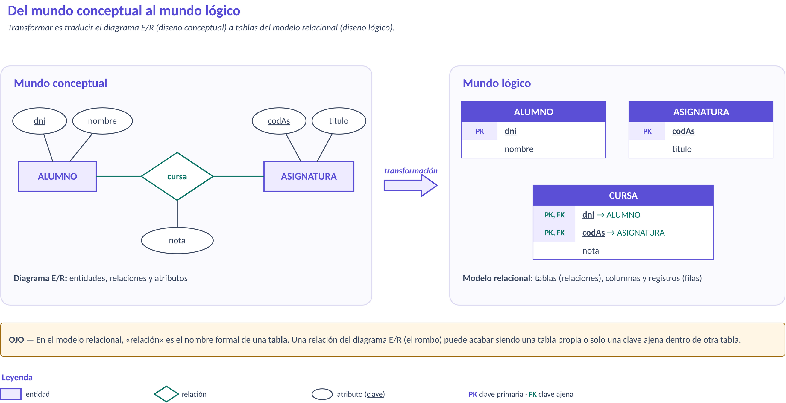

| Mundo conceptual (diagrama E/R) | Mundo lógico (modelo relacional) |
|---|---|
| Entidades | Tablas |
| Atributos | Columnas |
| Ocurrencias de una entidad | Registros (filas) |
| Relaciones | Tablas propias o claves ajenas dentro de otras tablas |
| Identificador (atributo clave) | Clave primaria |

### Cómo leer los diagramas

| Símbolo | Significado |
|---|---|
| Rectángulo / doble rectángulo | Entidad / entidad débil |
| Rombo / doble rombo | Relación / relación de identificación |
| Elipse (doble, discontinua) | Atributo (multivaluado, derivado) |
| Atributo subrayado / subrayado discontinuo | Clave / clave parcial |
| **1**, **N**, **M** junto al rombo | Cardinalidad de la relación (1:N, N:M…) |
| Barra doble en la línea | Uno y obligatorio (la FK lleva `NOT NULL`) |
| Círculo y barra | Cero o uno (la FK admite `NULL`) |
| Pata de gallo y barra | Uno o muchos |
| Pata de gallo y círculo | Cero o muchos |

El símbolo que hay junto a una entidad dice **cuántas ocurrencias de esa entidad** se relacionan con cada ocurrencia de la otra: la barra indica un mínimo de 1 (obligatorio) y el círculo, un mínimo de 0 (opcional).

!!! ojo "Ojo"
    Existen varias notaciones para los diagramas E/R: pares (mín,máx) junto a cada entidad, patas de gallo, UML… En este módulo usamos la de Chen con la cardinalidad **1 / N** junto al rombo y **patas de gallo** en las líneas. La leyenda de cada diagrama explica todos los símbolos que aparecen en él.

!!! definicion "Definición"
    **Transformar** (o *traducir*) un diagrama E/R es obtener, a partir de él, el **esquema relacional**: la lista de tablas con sus columnas, su clave primaria y sus claves ajenas.

!!! ojo "Ojo"
    Recuerda la diferencia entre las fases del diseño: el diagrama E/R es el **diseño conceptual**; el esquema relacional que obtienes en esta unidad es el **diseño lógico**; el `CREATE TABLE` concreto para MySQL, Oracle o PostgreSQL será el **diseño físico**.

## 1.2 Los cinco pasos generales

Para hacer una traducción correcta, sigue estos pasos en orden:

1. **Cada entidad se convierte en una tabla.**
2. **Elige una clave primaria para cada tabla.**
3. **Para cada relación, crea una tabla** que incluya los atributos propios de la relación y las claves primarias de las entidades que conecta.
4. **Elige la clave primaria de cada una de estas tablas de relación.**
5. **Valora fusionar tablas**, añadiendo la clave primaria de una tabla dentro de otra, para reducir la redundancia y no tener tablas innecesarias.

Los pasos 1 a 4 son mecánicos y siempre funcionan. El paso 5 es el que exige pensar: depende de las cardinalidades, y es lo que estudiarás en el bloque 4.

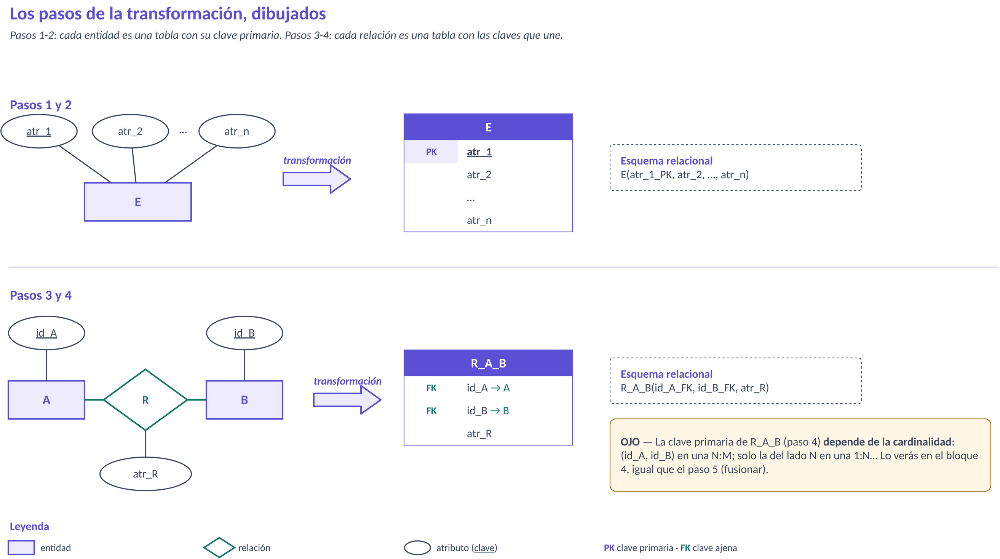

!!! definicion "Definición"
    Una **clave ajena** (*foreign key*, FK) es una columna (o grupo de columnas) de una tabla cuyos valores tienen que existir como clave primaria en otra tabla. Es lo que «enlaza» las tablas y sustituye a las líneas del diagrama E/R.

## 1.3 Un ejemplo completo: profesores, alumnado, notas y asignaturas

El siguiente diagrama tiene cuatro entidades: `PROFESOR`, `ALUMNO`, `NOTA` y `ASIGNATURA`. Cada nota es de un alumno, de una asignatura y la pone un profesor; además, cada profesor imparte varias asignaturas y cada asignatura la pueden impartir varios profesores.

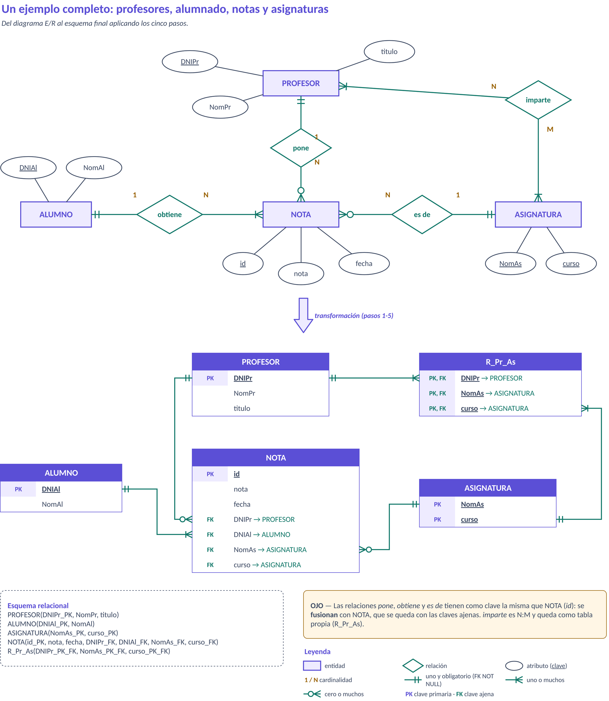

**Pasos 1 y 2.** Una tabla por entidad, con su clave primaria:

| Tabla | Columnas | Clave primaria |
|---|---|---|
| `PROFESOR` | `NomPr`, `DNIPr`, `titulo` | `DNIPr` |
| `ALUMNO` | `NomAl`, `DNIAl` | `DNIAl` |
| `NOTA` | `id`, `nota`, `fecha` | `id` |
| `ASIGNATURA` | `NomAs`, `curso` | (`NomAs`, `curso`) |

**Pasos 3 y 4.** Una tabla por relación y su clave primaria:

| Tabla de relación | Columnas | Clave primaria | Por qué |
|---|---|---|---|
| `R_Al_Nota` | `DNIAl`, `id` | `id` | Cada nota es de un solo alumno |
| `R_Nota_As` | `id`, `NomAs`, `curso` | `id` | Cada nota es de una sola asignatura |
| `R_Pr_Nota` | `DNIPr`, `id` | `id` | Cada nota la pone un solo profesor |
| `R_Pr_As` | `DNIPr`, `NomAs`, `curso` | (`DNIPr`, `NomAs`, `curso`) | Un profesor da varias asignaturas y una asignatura la dan varios profesores |

**Paso 5.** Las tres primeras tablas de relación tienen la **misma clave primaria que `NOTA`** (`id`). Eso quiere decir que por cada nota hay como mucho una fila en cada una de ellas: se pueden **fusionar** con `NOTA`, que se queda con las claves ajenas. `R_Pr_As`, en cambio, no se puede fusionar con nadie (es N:M).

!!! ejemplo "Ejemplo"
    Esquema relacional final:  
    ```text
    PROFESOR(DNIPr_PK, NomPr, titulo)
    ALUMNO(DNIAl_PK, NomAl)
    ASIGNATURA(NomAs_PK, curso_PK)
    NOTA(id_PK, nota, fecha, DNIPr_FK, DNIAl_FK, NomAs_FK, curso_FK)
    R_Pr_As(DNIPr_PK_FK, NomAs_PK_FK, curso_PK_FK)   (DNIPr apunta a PROFESOR y (NomAs, curso) a ASIGNATURA)
    ```

!!! ojo "Ojo"
    La pista para saber si puedes fusionar es la **clave primaria**: si una tabla de relación tiene como clave la misma clave que una de las entidades, se puede meter dentro de esa entidad. Si su clave es la combinación de las dos claves, no se puede fusionar.

## 1.4 Así se verá en SQL

Lo que escribes en el esquema relacional se traduce casi palabra por palabra a SQL. Lo trabajarás a fondo en la próxima unidad, pero fíjate ya en la correspondencia:

```sql
CREATE TABLE NOTA (
  id      INT PRIMARY KEY,
  nota    DECIMAL(4,2),
  fecha   DATE,
  DNIAl   CHAR(9)      NOT NULL,
  NomAs   VARCHAR(50)  NOT NULL,
  curso   VARCHAR(10)  NOT NULL,
  DNIPr   CHAR(9)      NOT NULL,
  FOREIGN KEY (DNIAl) REFERENCES ALUMNO(DNIAl),
  FOREIGN KEY (NomAs, curso) REFERENCES ASIGNATURA(NomAs, curso),
  FOREIGN KEY (DNIPr) REFERENCES PROFESOR(DNIPr)
);
```

Las claves ajenas llevan `NOT NULL` porque en el diagrama cada nota tiene **obligatoriamente** un alumno, una asignatura y un profesor (barra doble junto a `ALUMNO`, `ASIGNATURA` y `PROFESOR`: uno y obligatorio).

!!! comprueba "Comprueba"
    1. ¿Qué es el mundo conceptual y qué es el mundo lógico? ¿Con qué se representa cada uno?
    2. Enumera los cinco pasos de la transformación.
    3. En el ejemplo, ¿por qué `R_Al_Nota` se puede fusionar con `NOTA` y `R_Pr_As` no?
    4. ¿Qué es una clave ajena y qué representa respecto al diagrama E/R?
    5. ¿Por qué la clave primaria de `ASIGNATURA` tiene dos columnas?

# Bloque 2. Entidades fuertes y débiles

## 2.1 Entidades fuertes

Para cada entidad fuerte del diagrama:

1. Crea una tabla con el mismo nombre que la entidad. Sus columnas son todos los **atributos simples** de la entidad.
2. Si la entidad tiene **atributos compuestos**, no se crea una columna para el atributo compuesto, sino **una columna por cada atributo simple** que lo forma.
3. Elige uno de los atributos identificadores de la entidad como **clave primaria** de la tabla.
4. Si la clave es **compuesta** (varios atributos), todos los atributos simples que la forman son, juntos, la clave primaria.

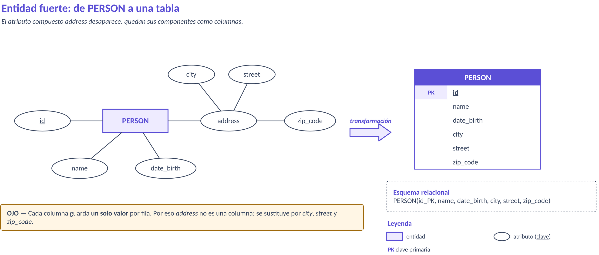

!!! ejemplo "Ejemplo"
    `PERSON` tiene el identificador `id`, los atributos `name` y `date_birth`, y el atributo compuesto `address` (formado por `city`, `street` y `zip_code`). El atributo compuesto «desaparece» y quedan sus componentes:  
    ```text
    PERSON(id_PK, name, date_birth, city, street, zip_code)
    ```

!!! ojo "Ojo"
    Una tabla no puede tener una columna «address» que contenga dentro tres valores. Cada columna guarda **un solo valor** por fila (valores atómicos). Por eso los atributos compuestos se descomponen.

!!! definicion "Definición"
    Una **clave candidata** es cualquier atributo (o grupo mínimo de atributos) que identifica cada fila sin repetirse. La **clave primaria** es la candidata que eliges; las demás quedan como **claves alternativas** y en SQL se marcan con `UNIQUE`.

## 2.2 Entidades débiles

Una **entidad débil** es la que depende de otra entidad, llamada **entidad propietaria** (o fuerte). Hay dos tipos de dependencia y cada uno se transforma de manera distinta:

| | Dependencia en **identificación** (ID) | Dependencia en **existencia** (E) |
|---|---|---|
| ¿Puede existir sin la propietaria? | No | No |
| ¿Se identifica sola? | No: necesita la clave de la propietaria | Sí: tiene su propia clave |
| En el diagrama | Rombo doble con «ID» | Rombo con «E» |
| Clave primaria de la tabla | Clave de la propietaria + clave parcial de la débil | Clave propia de la débil |
| Clave de la propietaria | Es parte de la PK **y** clave ajena | Solo clave ajena, `NOT NULL` |
| Ejemplo | Habitación de un hotel | Permiso de conducir de un empleado |

### 2.2.1 Entidad débil por identificación

Para cada entidad débil con dependencia en identificación:

1. Crea una tabla con el mismo nombre que la entidad débil, con todos sus atributos simples (o los componentes simples de sus atributos compuestos).
2. Añade la clave de la entidad propietaria como **clave ajena** (compuesta, si la clave de la propietaria lo es). Así se representa la relación de identificación.
3. La **clave primaria** de la tabla es la combinación de la clave primaria de la propietaria y la **clave parcial** (discriminador) de la entidad débil.

La clave primaria de la propietaria cumple aquí un doble papel: forma parte de la clave primaria **y** es clave ajena, lo que garantiza la integridad referencial entre las dos tablas.

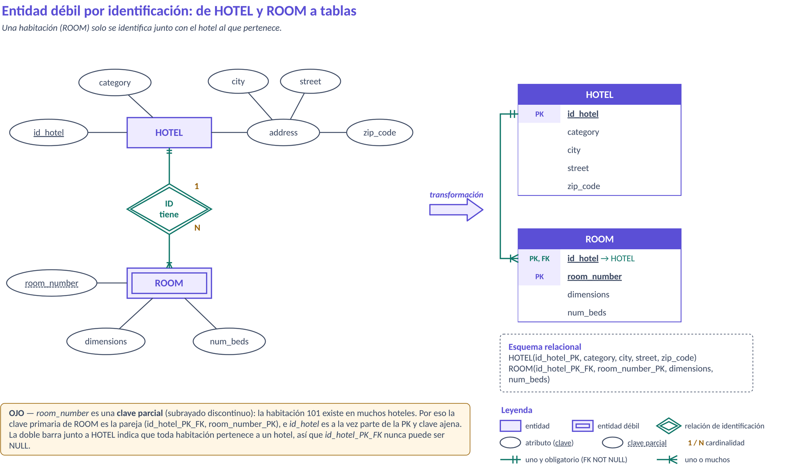

!!! ejemplo "Ejemplo"
    Un hotel tiene varias habitaciones. El número de habitación (`room_number`) se repite de un hotel a otro: la habitación 101 existe en muchos hoteles. Por eso `room_number` solo es una **clave parcial**: para identificar una habitación hace falta saber también de qué hotel es.  
    ```text
    HOTEL(id_hotel_PK, category, city, street, zip_code)
    ROOM(id_hotel_PK_FK, room_number_PK, dimensions, num_beds)   (id_hotel es parte de la clave y, además, FK a HOTEL)
    ```

| `id_hotel` | `room_number` | `dimensions` | `num_beds` |
|---|---|---|---|
| H01 | 101 | 20 m² | 2 |
| H01 | 102 | 25 m² | 3 |
| H02 | 101 | 18 m² | 1 |

La habitación 101 aparece dos veces, pero la pareja (`id_hotel`, `room_number`) no se repite nunca.

!!! definicion "Definición"
    La **clave parcial** (o discriminador) de una entidad débil es el atributo que distingue sus ocurrencias **dentro de una misma entidad propietaria**, pero no en general. En el diagrama se subraya con línea discontinua.

### 2.2.2 Entidad débil por existencia

Para cada entidad débil con dependencia en existencia:

1. Crea una tabla con el mismo nombre que la entidad débil, con todos sus atributos simples (o los componentes simples de sus atributos compuestos).
2. La **clave primaria** es el identificador propio de la entidad débil.
3. Incluye la clave primaria de la propietaria como **clave ajena**, para establecer la relación.

Las claves ajenas que apuntan a la propietaria **no pueden ser nulas**: si lo fueran, habría ocurrencias que existen sin propietaria y ya no sería una entidad débil.

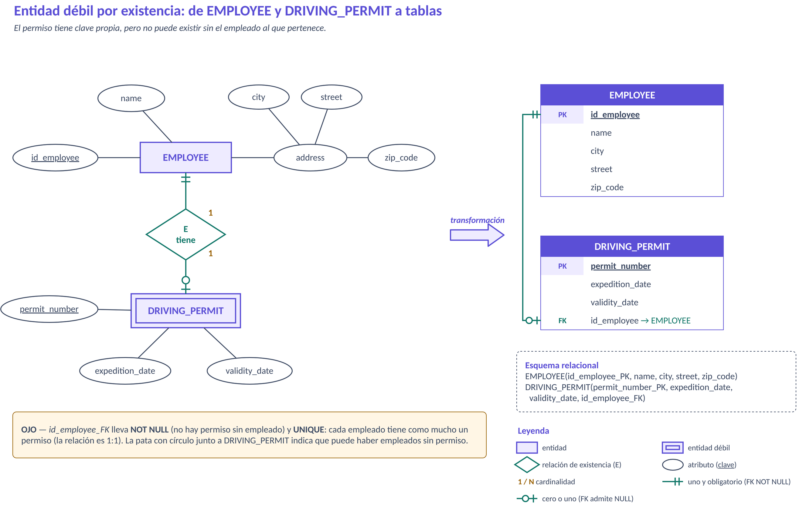

!!! ejemplo "Ejemplo"
    Un permiso de conducir tiene su propio número, que lo identifica por sí solo; pero no tiene sentido guardarlo si no es de un empleado:  
    ```text
    EMPLOYEE(id_employee_PK, name, city, street, zip_code)
    DRIVING_PERMIT(permit_number_PK, expedition_date, validity_date, id_employee_FK)   (id_employee_FK `NOT NULL`)
    ```

!!! ojo "Ojo"
    En este ejemplo la relación es **1:1**: cada empleado tiene como mucho un permiso. Además de `NOT NULL`, la clave ajena `id_employee` debe ser `UNIQUE`; si no, la base de datos dejaría guardar dos permisos para el mismo empleado.

```sql
CREATE TABLE DRIVING_PERMIT (
  permit_number   VARCHAR(20) PRIMARY KEY,
  expedition_date DATE,
  validity_date   DATE,
  id_employee     INT NOT NULL UNIQUE,
  FOREIGN KEY (id_employee) REFERENCES EMPLOYEE(id_employee)
);
```

!!! comprueba "Comprueba"
    1. ¿Qué haces con un atributo compuesto al pasar una entidad a tabla?
    2. ¿Cuál es la clave primaria de una entidad débil por identificación? ¿Y la de una débil por existencia?
    3. ¿Por qué `room_number` no puede ser, por sí solo, la clave primaria de `ROOM`?
    4. ¿Por qué la clave ajena hacia la propietaria nunca puede ser `NULL` en una entidad débil?
    5. En `DRIVING_PERMIT`, ¿qué restricción añadirías para que un empleado no tenga dos permisos?

# Bloque 3. Atributos multivaluados

## 3.1 Por qué necesitan una tabla aparte

Un **atributo multivaluado** puede tener **varios valores** para una misma ocurrencia: una persona puede tener varios correos electrónicos o varios teléfonos. En el diagrama se dibuja con un óvalo doble.

Como cada celda de una tabla solo puede guardar un valor, no puedes meter todos los correos en una columna, ni crear `email1`, `email2`, `email3`… (¿y si alguien tiene cuatro?). La solución es sacarlos a otra tabla.

## 3.2 Cómo se transforma

1. **Crea una tabla nueva** para cada atributo multivaluado, con el mismo nombre que el atributo.
2. **Define la clave primaria**: asigna un identificador único (ID) a cada valor de la nueva tabla.
3. **Añade una clave ajena** que apunte a la clave primaria de la entidad a la que pertenece el atributo (la entidad «padre»).

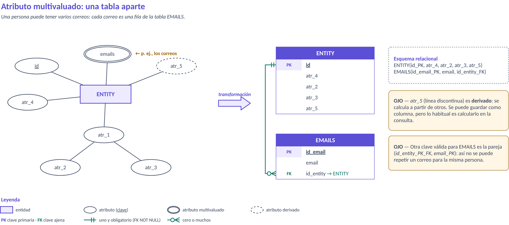

!!! ejemplo "Ejemplo"
    La entidad tiene el identificador `id`, el atributo compuesto `atr_1` (formado por `atr_2` y `atr_3`), los atributos `atr_4` y `atr_5`, y el atributo multivaluado `emails`, sus correos electrónicos:  
    ```text
    ENTITY(id_PK, atr_4, atr_2, atr_3, atr_5)
    EMAILS(id_email_PK, email, id_entity_FK)
    ```

| `id_email` | `email` | `id_Entity` |
|---|---|---|
| 1 | ana@correo.es | 7 |
| 2 | ana.lopez@trabajo.com | 7 |
| 3 | pau@correo.es | 9 |

La persona 7 tiene dos correos y la 9 uno: no importa cuántos tenga cada una.

!!! ojo "Ojo"
    Otra solución muy habitual es no añadir un ID y usar como clave primaria la pareja (clave del padre, valor): EMAILS(id_entity_PK_FK, email_PK). Así, además, la base de datos impide guardar dos veces el mismo correo para la misma persona. Las dos soluciones son correctas; con el ID, si quieres evitar duplicados, añade `UNIQUE (id_entity, email)`.

!!! ojo "Ojo"
    `atr_5` está dibujado con línea discontinua: es un **atributo derivado** (se calcula a partir de otros, como la edad a partir de la fecha de nacimiento). Se puede guardar como columna, como en el ejemplo, pero lo habitual es no guardarlo y calcularlo en la consulta, para que nunca quede desactualizado.

!!! comprueba "Comprueba"
    1. ¿Por qué un atributo multivaluado no puede ser una columna normal?
    2. ¿Qué columnas tiene la tabla que sale de un atributo multivaluado?
    3. ¿Qué inconveniente tiene crear columnas `telefono1`, `telefono2`, `telefono3`?
    4. Escribe dos claves primarias posibles para la tabla `Telefonos` de un `CLIENTE`.

# Bloque 4. Relaciones binarias: N:M, 1:N y 1:1

Una relación **binaria** une dos entidades, A y B. Siempre empiezas igual (pasos 1 a 4): una tabla para A, otra para B y una tabla de relación `R_A_B` con las dos claves y los atributos de la relación. Lo que cambia según la **cardinalidad** es la clave primaria de `R_A_B` y si se puede fusionar (paso 5).

| Cardinalidad | Clave primaria de `R_A_B` | ¿Se fusiona? | Resultado habitual |
|---|---|---|---|
| **N:M** | (id_A, id_B) | No | 3 tablas |
| **1:N** | id_B (la del lado N) | Sí, con B | 2 tablas; B lleva id_A_FK |
| **1:1** | id_A o id_B | Sí, con A o con B (o las dos en una) | 2 tablas, o 1 si las dos participaciones son obligatorias |

## 4.1 Relaciones N:M

1. **Crea una tabla de intersección.** Como un elemento de A se puede relacionar con varios de B, y al revés, se crea una tabla nueva, `R_A_B`, para representar la relación.
2. **Define la clave primaria**: es la **combinación** de las claves primarias de A y de B. Así cada pareja es única.
3. **No fusiones.** Por la naturaleza de las relaciones N:M no es posible: `R_A_B` hace de **tabla puente** entre A y B.

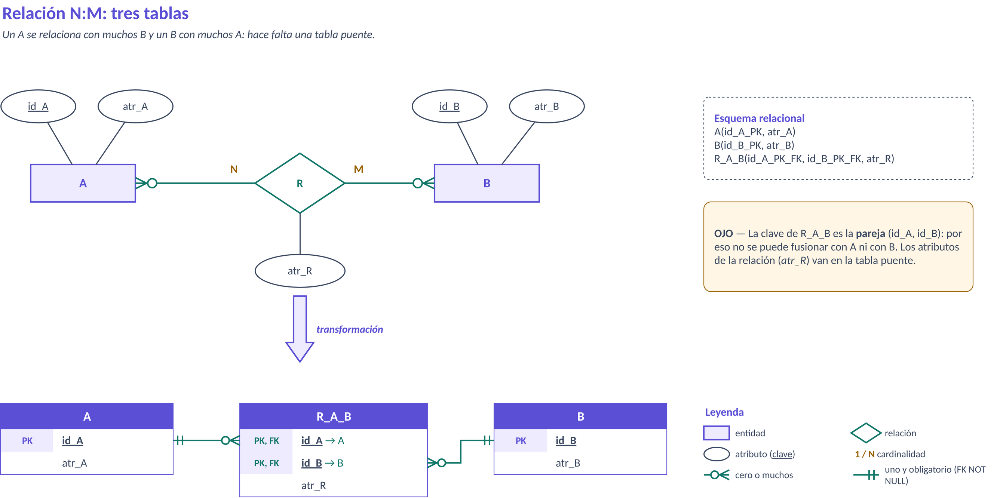

!!! ejemplo "Ejemplo"
    Un alumno se matricula de varias asignaturas y en cada asignatura hay varios alumnos. La matrícula tiene un atributo propio, la nota final:  
    ```text
    ALUMNO(DNIAl_PK, NomAl)
    ASIGNATURA(codAs_PK, NomAs)
    MATRICULA(DNIAl_PK_FK, codAs_PK_FK, notaFinal)   (DNIAl apunta a ALUMNO y codAs a ASIGNATURA)
    ```

!!! ojo "Ojo"
    Si intentas meter la relación dentro de una de las dos tablas, tendrías que repetir filas o poner varias claves en una celda. Por eso una N:M **siempre** da una tabla propia.

## 4.2 Relaciones 1:N

1. **Identifica la relación.** Cada elemento de B se relaciona con **un solo** elemento de A, así que la clave de B no se repite en `R_A_B` y la identifica.
2. **Elige la clave primaria**: la clave de B es la clave primaria de `R_A_B`.
3. **Fusiona `R_A_B` con B**: B recibe la clave de A como clave ajena y, si la relación tiene atributos, también pasan a B. Así no hace falta una tabla intermedia.

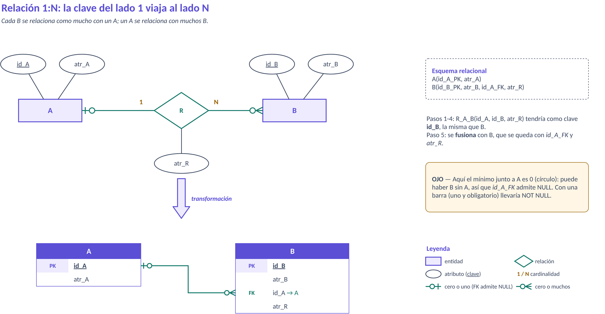

!!! definicion "Definición"
    Regla práctica de la 1:N: **la clave del lado 1 viaja, como clave ajena, a la tabla del lado N.**

!!! ejemplo "Ejemplo"
    Un departamento tiene muchos empleados y cada empleado pertenece a un único departamento:  
    ```text
    DEPARTAMENTO(codDep_PK, nombre)
    EMPLEADO(idEmp_PK, nombre, codDep_FK)
    ```

!!! ojo "Ojo"
    Fíjate en el símbolo junto a la entidad del lado 1. Si es un **círculo** (mínimo 0: puede haber empleados sin departamento), la clave ajena admite `NULL`. Si es una **barra** (mínimo 1: todo empleado tiene departamento), la clave ajena lleva `NOT NULL`.

## 4.3 Relaciones 1:1

En una relación 1:1, cada elemento de A se relaciona como mucho con uno de B, y al revés. La tabla `R_A_B` puede tener como clave primaria **cualquiera de las dos claves**, y por eso se puede fusionar con A o con B. Dónde conviene fusionarla lo deciden las **participaciones** (si cada entidad participa de forma opcional u obligatoria). En el diagrama lo ves en los extremos de las líneas: la **barra** junto a una entidad indica que es obligatoria y el **círculo**, que es opcional:

| Situación | Qué hacer |
|---|---|
| Todo A tiene siempre un B, pero no todo B tiene un A | Fusiona con **A**: A lleva id_B_FK (`NOT NULL`, `UNIQUE`) |
| Todo B tiene siempre un A, pero no todo A tiene un B | Fusiona con **B**: B lleva id_A_FK (`NOT NULL`, `UNIQUE`) |
| Las dos participaciones son opcionales | Puedes decidir: la FK va en A o en B (admitirá `NULL`) |
| Las dos participaciones son obligatorias | Une A y B en **una sola tabla** AB con todos los atributos; la clave primaria puede ser id_A o id_B |

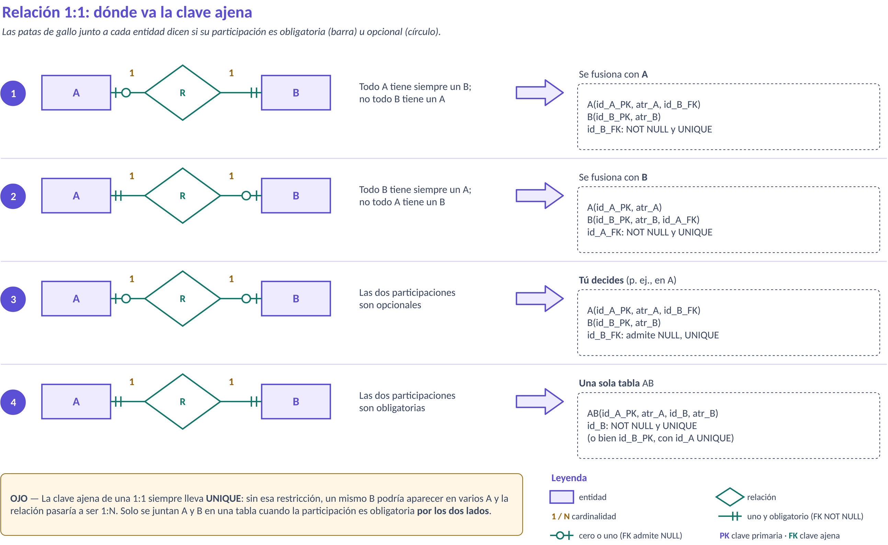

!!! ojo "Ojo"
    Solo puedes juntar A y B en una única tabla cuando la participación es obligatoria **por los dos lados**: cada A tiene exactamente un B y cada B exactamente un A. Si un solo lado es obligatorio, tendrías filas a medio rellenar llenas de `NULL`.

!!! ejemplo "Ejemplo"
    Cada centro tiene un único director y cada director dirige un único centro; puede haber profesores que no dirigen nada, pero todo centro tiene director:  
    ```text
    PROFESOR(idProf_PK, nombre)
    CENTRO(codCentro_PK, nombre, idDirector_FK)   (idDirector_FK `NOT NULL UNIQUE`)
    ```
    La FK va en `CENTRO` porque todo centro tiene director: así nunca queda vacía.

!!! ojo "Ojo"
    Una FK en una 1:1 necesita `UNIQUE`. Sin esa restricción, la base de datos permitiría que el mismo director apareciera en dos centros, y la relación se convertiría en 1:N sin que te dieras cuenta.

!!! comprueba "Comprueba"
    1. ¿Cuál es la clave primaria de la tabla que sale de una relación N:M? ¿Por qué no se puede fusionar?
    2. En una relación 1:N, ¿a qué tabla viaja la clave ajena?
    3. ¿Cuándo admite `NULL` la clave ajena de una 1:N?
    4. ¿En qué caso una relación 1:1 se convierte en una sola tabla?
    5. ¿Qué restricción tiene que llevar la FK de una relación 1:1 y por qué?

# Bloque 5. Relaciones reflexivas y ternarias

## 5.1 Relaciones reflexivas

Una relación **reflexiva** (o recursiva) relaciona una entidad **consigo misma**: un empleado supervisa a otros empleados; un alumno (el delegado) representa a los demás alumnos.

Para transformarla:

1. **Identifica la relación reflexiva**: la misma entidad aparece en los dos extremos. Suele indicar una jerarquía (por ejemplo, un empleado que es supervisor de otro).
2. **Convierte la relación en binaria**: imagina que hay dos «papeles» de la misma entidad, uno que hace de «padre» y otro de «hijo» (por ejemplo, supervisor y subordinado).
3. **Aplica el método binario que corresponda** (1:1, 1:N o N:M) a esa nueva relación.

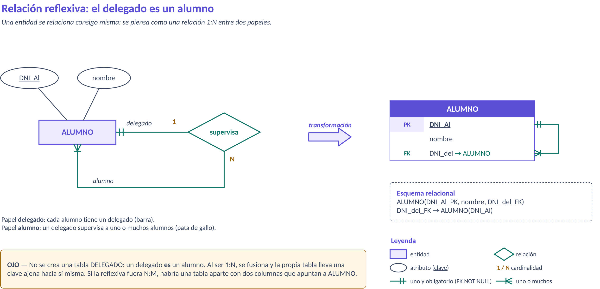

!!! ejemplo "Ejemplo"
    `Alumno` se relaciona consigo mismo mediante `Supervisa`: el delegado es un alumno que supervisa a varios alumnos. Si lo pensamos con dos papeles, **delegado** (lado 1: cada alumno tiene un delegado) y **alumno** (lado N: un delegado supervisa a uno o muchos alumnos), es una relación **1:N**.  
    Pasos 1 a 4: DELEGADO(DNI_del_PK), ALUMNO(DNI_Al_PK), R_Al_Del(DNI_Al_PK_FK, DNI_del_FK).  
    La tabla `DELEGADO` sobra: un delegado **es** un alumno, ya está en la tabla `ALUMNO`.  
    ```text
    Paso 5 (fusión 1:N): ALUMNO(DNI_Al_PK, nombre, DNI_del_FK)   (DNI_del_FK apunta a la propia tabla ALUMNO)
    ```

| `DNI_Al` | `nombre` | `DNI_del` |
|---|---|---|
| 11111111A | Marta | 11111111A |
| 22222222B | Joan | 11111111A |
| 33333333C | Laia | 11111111A |

La clave ajena apunta **a la misma tabla**: Joan y Laia tienen como delegada a Marta, que también es alumna de la tabla.

!!! ojo "Ojo"
    En una reflexiva **no se crea una tabla nueva para el segundo papel**. Los dos papeles son la misma entidad, así que es la propia tabla la que lleva una clave ajena hacia sí misma (en SQL, `FOREIGN KEY (DNI_del) REFERENCES ALUMNO(DNI_Al)`). Si la reflexiva fuera N:M, sí habría una tabla de relación con dos columnas que apuntan a la misma tabla.

## 5.2 Relaciones ternarias

Una relación **ternaria** une tres entidades a la vez: por ejemplo, un profesor imparte una asignatura en un grupo. Para transformarla:

1. **Crea una tabla nueva** para la relación ternaria, con:
   - las claves primarias de las tres entidades, como **claves ajenas**;
   - los atributos propios de la relación, si los tiene.
2. **Decide la clave primaria según la cardinalidad**:
   - **N:M:P**: la clave primaria son **las tres** claves ajenas juntas: hace falta la combinación de las tres para identificar cada fila.
   - **1:N:M**: la clave primaria son **las dos** claves de los lados N y M. La clave del lado 1 se queda en la tabla como clave ajena, pero fuera de la clave primaria.
   - **1:1:N**: la clave primaria es la clave del lado N **más una** de las dos claves de lado 1 (la que prefieras). Hay dos claves candidatas.
   - **1:1:1**: la clave primaria es **cualquier pareja** de las tres claves. Hay tres claves candidatas.

En todos los casos la tabla lleva siempre las tres claves ajenas; lo único que cambia es cuáles forman la clave primaria.

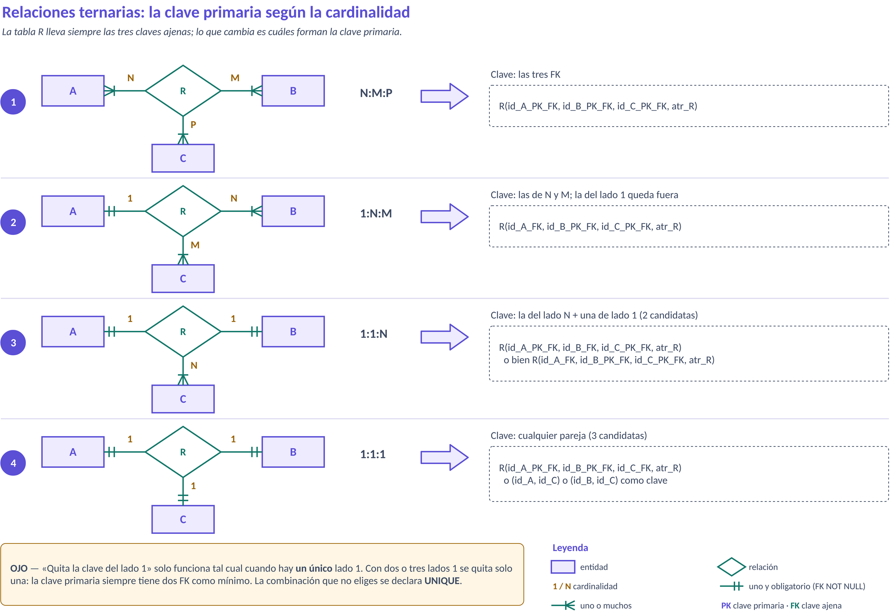

| Cardinalidad | Clave primaria de R | Claves candidatas |
|---|---|---|
| N:M:P | (id_A, id_B, id_C) | 1 |
| 1:N:M (A en el lado 1) | (id_B, id_C) | 1 |
| 1:1:N (C en el lado N) | (id_A, id_C) o (id_B, id_C) | 2 |
| 1:1:1 | (id_A, id_B), (id_A, id_C) o (id_B, id_C) | 3 |

!!! ojo "Ojo"
    La regla rápida «quita la clave del lado 1» solo funciona tal cual cuando hay **un único** lado 1 (caso 1:N:M). Si hay dos o tres lados 1, quitas **solo una** de esas claves: la clave primaria siempre tiene dos claves ajenas. La combinación que no eliges como clave primaria se puede declarar `UNIQUE`.

!!! ejemplo "Ejemplo"
    Un profesor imparte una asignatura en un grupo. En cada grupo, cada asignatura la da un solo profesor (lado 1 = PROFESOR), pero un profesor da varias asignaturas en varios grupos:  
    ```text
    IMPARTE(codAs_PK_FK, codGrupo_PK_FK, idProf_FK, horasSemana)
    ```
    Con (asignatura, grupo) ya sabes quién es el profesor: por eso `idProf` no forma parte de la clave.

!!! comprueba "Comprueba"
    1. ¿Qué es una relación reflexiva? Pon un ejemplo distinto de los del dosier.
    2. En el ejemplo del delegado, ¿por qué desaparece la tabla `Delegado`?
    3. ¿Cuántas claves ajenas tiene siempre la tabla de una relación ternaria?
    4. ¿Cuál es la clave primaria de una ternaria N:M:P? ¿Y de una 1:N:M?
    5. En una ternaria 1:1:N, ¿cuántas claves candidatas hay?

# Bloque 6. Jerarquías (herencia)

## 6.1 Supertipo y subtipos

Una **jerarquía** (generalización/especialización o relación *ISA*, «es un») tiene una entidad general, el **supertipo**, y varias entidades más concretas, los **subtipos**, que heredan sus atributos y añaden los suyos. Por ejemplo, `EMPLEADO` (supertipo) con `PROFESOR` y `ADMINISTRATIVO` (subtipos).

Las jerarquías se clasifican de dos maneras:

| Clasificación | Significado |
|---|---|
| **Total** | Todo elemento del supertipo pertenece a algún subtipo |
| **Parcial** | Puede haber elementos del supertipo que no pertenecen a ningún subtipo |
| **Exclusiva** | Un elemento solo puede pertenecer a un subtipo |
| **Solapada** | Un elemento puede pertenecer a varios subtipos a la vez |

## 6.2 Cómo se transforma

1. **Crea una tabla para cada entidad** de la jerarquía, tanto el supertipo como cada subtipo.
2. **Clave primaria de los subtipos**: cada tabla de subtipo incluye la clave primaria del supertipo, que actúa a la vez como:
   - la **clave primaria** de la tabla del subtipo;
   - una **clave ajena** que la enlaza con la tabla del supertipo.
3. **Sirve para todos los tipos de jerarquía**: este método funciona igual tanto si la jerarquía es total o parcial como si es exclusiva o solapada.

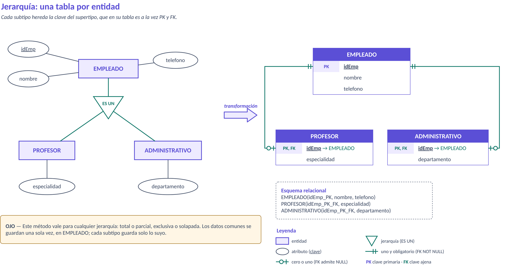

!!! ejemplo "Ejemplo"
    ```text
    EMPLEADO(idEmp_PK, nombre, telefono)
    PROFESOR(idEmp_PK_FK, especialidad)   (idEmp apunta a EMPLEADO)
    ADMINISTRATIVO(idEmp_PK_FK, departamento)   (idEmp apunta a EMPLEADO)
    ```
    Los datos comunes se guardan una sola vez, en `EMPLEADO`; cada subtipo guarda solo lo suyo.

!!! ojo "Ojo"
    En la tabla del subtipo la misma columna es **a la vez** clave primaria y clave ajena. Es el mismo doble papel que en la entidad débil por identificación, pero aquí la clave primaria es **solo** la del supertipo, sin ninguna clave parcial.

## 6.3 Otras soluciones que te encontrarás

El método de una tabla por entidad es el más general. En la práctica también verás estas alternativas, que conviene conocer:

| Solución | Cuándo encaja | Inconveniente |
|---|---|---|
| Una tabla por entidad (la del apartado anterior) | Siempre | Para ver todos los datos de un profesor hay que unir dos tablas |
| Una sola tabla con todos los atributos y una columna `tipo` | Subtipos con pocos atributos propios | Muchas columnas a `NULL` |
| Solo tablas para los subtipos, cada una con los atributos del supertipo | Jerarquías totales y exclusivas | Los datos comunes se reparten entre varias tablas |

!!! comprueba "Comprueba"
    1. ¿Qué diferencia hay entre una jerarquía total y una parcial? ¿Y entre exclusiva y solapada?
    2. ¿Cuántas tablas salen de una jerarquía con un supertipo y tres subtipos?
    3. ¿Qué doble papel tiene la clave primaria de un subtipo?
    4. ¿Qué inconveniente tiene meter toda la jerarquía en una sola tabla?

# Bloque 7. Por qué normalizar

## 7.1 Qué es la normalización

!!! definicion "Definición"
    La **normalización** es el proceso de aplicar a las tablas del modelo relacional una serie de reglas, mediante transformaciones sucesivas, para que cada tabla tenga los atributos necesarios y suficientes para describir la realidad que representa. Cuando una tabla guarda atributos que en realidad describen otra cosa, la normalización los separa en una tabla nueva.

La técnica la propuso **Edgar F. Codd** a principios de los años setenta (en 1972 describió la segunda y la tercera forma normal), junto con el propio modelo relacional. No sirve para hacer el diseño inicial: es un **refinamiento** que se aplica **después** de transformar el diagrama E/R en tablas (el paso del esquema conceptual al esquema lógico que viste en la Parte 1).

Con la normalización se consigue:

- **Reducir la redundancia**: que cada dato se guarde una sola vez.
- **Evitar problemas al insertar, modificar y borrar** datos (las anomalías de 7.2) y facilitar el acceso a ellos.
- **Aprovechar mejor el almacenamiento**, porque no se guardan copias inútiles.

En resumen, la normalización asegura una base de datos estructurada, coherente y eficiente.

!!! ojo "Ojo"
    Si el diagrama E/R está bien hecho, las tablas que salen de la transformación suelen estar ya casi normalizadas. La normalización es la **comprobación final**: detecta los fallos de diseño que se hayan colado (un atributo en la entidad equivocada, un multivaluado sin separar…).

## 7.2 Las anomalías: el problema de repetir datos

Fíjate en esta tabla de empleados. Cada empleado tiene un departamento, y cada departamento está en un edificio:

| Employee_ID | Employee_Name | Department | Department_Location |
|---|---|---|---|
| 1 | Alice | HR | Building A |
| 2 | Bob | HR | Building A |
| 3 | Charlie | IT | Building B |
| 4 | David | IT | Building B |
| 5 | Eve | Finance | Building C |

El edificio de cada departamento se repite en todas las filas de sus empleados. Esa repetición provoca tres tipos de problema, llamados **anomalías**:

| Anomalía | Qué pasa en el ejemplo |
|---|---|
| **De inserción** | Se crea el departamento Marketing en el Building D, pero todavía no tiene empleados: no hay dónde guardarlo sin inventar un empleado. |
| **De modificación** | IT se muda al Building D. Hay que cambiar **dos** filas; si se olvida una, la tabla dice a la vez que IT está en B y en D. |
| **De borrado** | Eve deja la empresa y se borra su fila. Con ella se pierde que Finance está en el Building C. |

!!! definicion "Definición"
    Una **anomalía** es un problema al insertar, modificar o borrar datos que aparece porque la misma información está repetida en varias filas o mezclada con información de otra cosa.

Normalizar consiste en partir esta tabla de forma que cada dato aparezca una sola vez. Lo resolverás en el bloque 11.

## 7.3 Las formas normales

La normalización avanza por **etapas**. Cada etapa es una **forma normal**, con unos requisitos que la tabla tiene que cumplir: primera (1FN), segunda (2FN), tercera (3FN), Boyce-Codd (FNBC), cuarta (4FN), quinta (5FN) y forma normal dominio-clave (FNDK).

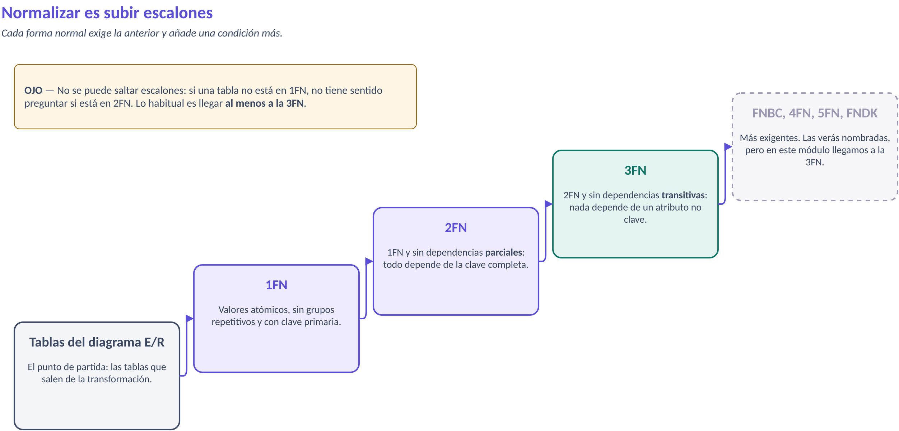

Las reglas para avanzar son:

1. **Se va en orden.** Si una tabla no cumple una forma normal, no se analiza la siguiente.
2. **Cada forma normal es más exigente** que la anterior y hace el esquema más robusto.
3. Como norma general, para que los datos se mantengan íntegros al modificarlos, se recomienda normalizar **al menos hasta la 3FN** (o hasta la FNBC). En este módulo llegamos a la 3FN.

!!! ojo "Ojo"
    En el examen, «normaliza la tabla» quiere decir llevarla hasta la 3FN y justificar cada paso: qué forma normal no cumplía, por qué, y cómo has repartido los atributos.

!!! comprueba "Comprueba"
    1. ¿En qué momento del diseño se normaliza: antes o después de pasar del E/R a tablas?
    2. Di los tres objetivos de la normalización.
    3. En la tabla de empleados, ¿qué anomalía aparece si queremos registrar un departamento sin empleados?
    4. ¿Se puede comprobar si una tabla está en 3FN sin saber si está en 2FN? ¿Por qué?

# Bloque 8. Dependencias entre atributos

Para saber en qué forma normal está una tabla hay que analizar cómo **dependen unos atributos de otros**. Hay tres conceptos clave: dependencia funcional, dependencia funcional completa y dependencia transitiva.

## 8.1 Dependencia funcional

!!! definicion "Definición"
    Dados dos atributos A y B, **B depende funcionalmente de A** si, y solo si, para cada valor de A existe un único valor de B, y siempre es el mismo. A se llama **determinante**, porque determina el valor de B. Se escribe **A → B** («A determina B»).

- Las dependencias funcionales siempre se dan **entre atributos de una misma tabla**.
- Tanto A como B pueden ser **un atributo o un conjunto de atributos**: por ejemplo, `(Título_libro, Num_ejemplar) → Precio`.

!!! ejemplo "Ejemplo"
    En una tabla de alumnado, `DNI → Nombre`: con un DNI concreto solo hay un nombre posible. En cambio, `Nombre → DNI` **no** se cumple: puede haber dos alumnas llamadas Laura con DNI distinto.

!!! ojo "Ojo"
    Una dependencia funcional habla del **significado** de los datos, no de las filas que hay ahora. Aunque hoy no haya dos clientes con el mismo nombre, `Nombre → DNI` no es una dependencia: mañana puede llegar un segundo Juan García.

## 8.2 Dependencia funcional completa y parcial

!!! definicion "Definición"
    Dados los atributos A1, A2, …, Ak y B, **B depende de forma completa** del conjunto (A1, A2, …, Ak) si depende funcionalmente del conjunto entero y **no de ningún subconjunto** suyo. Si B ya queda determinado por una parte del conjunto, la dependencia es **parcial**.

La dependencia completa garantiza que **toda la clave compuesta** es necesaria para conocer B. Una dependencia parcial indica que B describe solo a una parte de la clave, y es justo lo que prohíbe la 2FN.

!!! ojo "Ojo"
    Completa y parcial solo tienen sentido con **claves compuestas**. Si la clave es un solo atributo, no tiene partes: todas las dependencias de la clave son completas.

## 8.3 Dependencia transitiva

!!! definicion "Definición"
    Dados tres atributos A, B y C, hay una **dependencia transitiva** entre A y C si B depende funcionalmente de A y C depende funcionalmente de B. A determina C **indirectamente**, a través de B: **A → B → C**. Cada uno puede ser un atributo o un conjunto de atributos.

!!! ojo "Ojo"
    Para que se considere transitiva, B **no** puede ser clave ni determinar a A. Si B también determinara a A (B → A), B sería otra clave candidata y no habría ningún problema que arreglar.

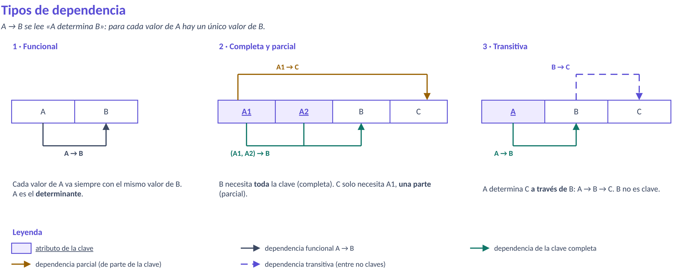

## 8.4 Ejemplo resuelto: EMPLEADO y LIBRO

Partimos de estas dos tablas:

```text
EMPLEADO(DNI_PK, Nombre, Dirección, Localidad, Cod_Localidad, Nombre_hijo, Edad_hijo)
LIBRO(Título_libro_PK, Num_ejemplar_PK, Autor, Editorial, Precio)
```

Y contestamos tres preguntas.

**1. ¿Qué atributos de EMPLEADO dependen funcionalmente de su clave primaria?**

`Nombre`, `Dirección` y `Cod_Localidad` dependen funcionalmente de `DNI`: para un DNI concreto solo hay un nombre, una dirección y un código de localidad. `Localidad` también depende de `DNI`, pero indirectamente, a través de `Cod_Localidad` (lo verás en la pregunta 3).

```text
DNI → Nombre
DNI → Dirección
DNI → Cod_Localidad
```

En cambio, `Nombre_hijo` y `Edad_hijo` **no** dependen funcionalmente de `DNI`: un empleado puede tener varios hijos, así que un mismo DNI puede ir con varios valores de esos atributos.

**2. ¿Qué atributos de LIBRO tienen dependencia funcional completa?**

La clave primaria es compuesta: `Título_libro` y `Num_ejemplar`. Suponemos que cada ejemplar puede ser de una edición distinta, con su propia editorial y su propio precio.

- `Editorial` y `Precio` dependen de **la clave completa**: hace falta saber el título y el número de ejemplar para conocerlos. Son dependencias **completas**.
- `Autor` depende solo de `Título_libro`: todos los ejemplares de un mismo título tienen el mismo autor. Es una dependencia **parcial**.

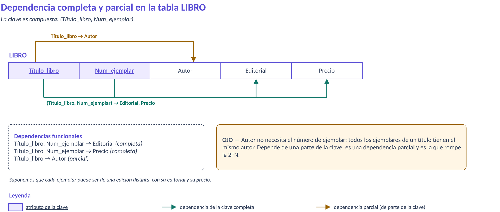

**3. ¿Hay alguna dependencia transitiva en EMPLEADO?**

Sí. `Cod_Localidad` depende funcionalmente de `DNI`, y `Localidad` depende funcionalmente de `Cod_Localidad`:

```text
DNI → Cod_Localidad → Localidad
```

Por tanto, `Localidad` depende **transitivamente** de `DNI` a través de `Cod_Localidad`.

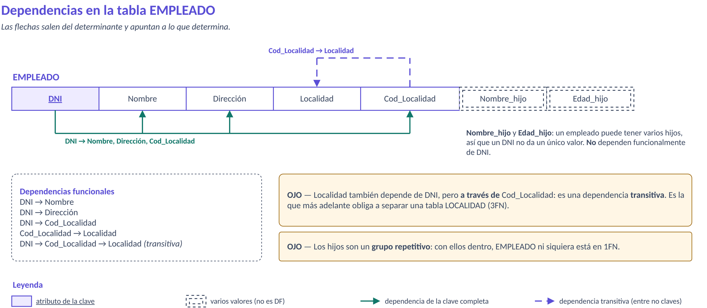

!!! comprueba "Comprueba"
    1. Explica con tus palabras qué significa `A → B`.
    2. En `PEDIDO(NumPedido_PK, CodProducto_PK, Cantidad, NombreProducto)`, ¿qué dependencia es completa y cuál es parcial?
    3. ¿Puede haber dependencias parciales en una tabla cuya clave primaria es un único atributo?
    4. En `ALUMNO(NIA_PK, Nombre, CodCiclo, NombreCiclo)`, escribe la dependencia transitiva.

# Bloque 9. Primera forma normal (1FN)

## 9.1 Definición y requisitos

!!! definicion "Definición"
    Una tabla está en **primera forma normal (1FN)** cuando todos sus atributos contienen valores **atómicos** (indivisibles) y no hay **grupos repetitivos**. Además, tiene clave primaria, de modo que todos los atributos no clave dependen funcionalmente de ella.

Para estar en 1FN, una tabla tiene que cumplir:

| Requisito | Qué significa |
|---|---|
| **Solo valores atómicos** | Cada atributo guarda un único valor por fila: no hay atributos multivaluados (`"555-1234, 555-5678"` en una celda no vale). |
| **Sin grupos repetitivos** | No hay columnas que repiten el mismo dato (`Teléfono_1`, `Teléfono_2`…). |
| **Estructura coherente** | Todos los valores de una columna son del mismo tipo y formato. |
| **Filas únicas** | Una clave primaria identifica cada fila: no puede haber dos filas iguales. |

!!! ojo "Ojo"
    «Atómico» depende del uso. Una fecha (`2026-10-27`) se trata como un solo valor aunque tenga día, mes y año. Lo que rompe la 1FN es guardar **varios valores del mismo tipo** en una celda o en columnas repetidas.

## 9.2 Cómo se consigue la 1FN

Esta tabla guarda los teléfonos de cada estudiante en una sola columna: `Teléfonos` es multivaluado.

| ID_Estudiante | Nombre | Teléfonos |
|---|---|---|
| 1 | Juan Pérez | 555-1234, 555-5678 |
| 2 | Ana Gómez | 555-4321 |
| 3 | Luis García | 555-8765, 555-3456 |

Hay tres maneras de intentar arreglarlo, y solo una es buena.

**Primer intento: una columna por teléfono.** Parece lógico, pero no es práctico: ¿cuántas columnas pones? Si alguien tiene tres teléfonos hay que cambiar la tabla, y quien tiene uno deja huecos a `NULL`.

| ID_Estudiante | Nombre | Teléfono_1 | Teléfono_2 |
|---|---|---|---|
| 1 | Juan Pérez | 555-1234 | 555-5678 |
| 2 | Ana Gómez | 555-4321 | NULL |
| 3 | Luis García | 555-8765 | 555-3456 |

**Segundo intento: una fila por teléfono, repitiendo el resto.** Ahora el nombre se copia en cada fila: es redundancia, y vuelven las anomalías del bloque 7.

| ID_Estudiante | Nombre | Teléfono |
|---|---|---|
| 1 | Juan Pérez | 555-1234 |
| 1 | Juan Pérez | 555-5678 |
| 2 | Ana Gómez | 555-4321 |
| 3 | Luis García | 555-8765 |
| 3 | Luis García | 555-3456 |

**La solución correcta: separar el atributo multivaluado en una tabla nueva.** Se identifican las columnas con valores múltiples que no pertenecen a la tabla principal, se llevan a una tabla nueva y se enlazan con la tabla de partida mediante una **clave ajena**.

:::: {.g2}
::: {.tb}
**ESTUDIANTE**

| ID_Estudiante | Nombre |
|---|---|
| 1 | Juan Pérez |
| 2 | Ana Gómez |
| 3 | Luis García |
:::

::: {.tb}
**TELEFONO**

| ID_Estudiante | Teléfono |
|---|---|
| 1 | 555-1234 |
| 1 | 555-5678 |
| 2 | 555-4321 |
| 3 | 555-8765 |
| 3 | 555-3456 |
:::
::::

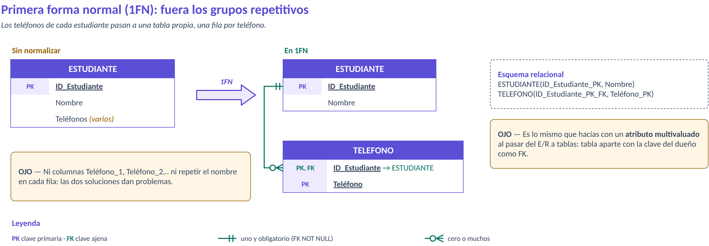

```text
ESTUDIANTE(ID_Estudiante_PK, Nombre)
TELEFONO(ID_Estudiante_PK_FK, Teléfono_PK)
```

!!! ojo "Ojo"
    La tabla del segundo intento, con clave (`ID_Estudiante`, `Teléfono`), técnicamente sí está en 1FN: cada celda tiene un solo valor. Pero `Nombre` depende solo de `ID_Estudiante`, una parte de la clave, así que **no** está en 2FN. Separar en dos tablas resuelve los dos problemas a la vez.

!!! ejemplo "Ejemplo"
    Así se crearía la tabla de teléfonos en SQL:

```sql
CREATE TABLE TELEFONO (
  ID_Estudiante INT,
  Telefono VARCHAR(15),
  PRIMARY KEY (ID_Estudiante, Telefono),
  FOREIGN KEY (ID_Estudiante) REFERENCES ESTUDIANTE(ID_Estudiante)
);
```

Es exactamente lo que hacías en la Parte 1 con los **atributos multivaluados** del diagrama E/R: si el diagrama estaba bien hecho, la tabla ya sale en 1FN.

!!! comprueba "Comprueba"
    1. ¿Qué dos cosas impiden que una tabla esté en 1FN?
    2. ¿Por qué no es buena idea crear columnas `Email_1`, `Email_2`, `Email_3`?
    3. Pasa a 1FN: `CLIENTE(DNI_PK, Nombre, Emails)`, donde un cliente puede tener varios correos.
    4. ¿Qué tiene que ver la 1FN con los atributos multivaluados del diagrama E/R?

# Bloque 10. Segunda forma normal (2FN)

## 10.1 Definición

!!! definicion "Definición"
    Una tabla está en **segunda forma normal (2FN)** si, y solo si, está en 1FN y **todos los atributos que no forman parte de la clave primaria dependen de ella de forma funcional y completa**. Es decir, no hay dependencias parciales.

De aquí sale una consecuencia muy útil: **una tabla en 1FN cuya clave primaria es un solo atributo ya está en 2FN**, porque una clave simple no tiene partes de las que depender.

!!! ojo "Ojo"
    La 2FN solo hay que mirarla con detalle cuando la clave es **compuesta**. Con clave simple, contesta «está en 2FN porque la clave tiene un solo atributo» y pasa a la 3FN.

## 10.2 Cómo se consigue la 2FN

1. Busca las **dependencias parciales**: atributos no clave que dependen solo de una parte de la clave.
2. Crea una tabla con la clave completa y los atributos que dependen de **toda** la clave. Su clave primaria es la misma que la de la tabla inicial, y ya está en 2FN.
3. Por cada parte de la clave de la que dependan atributos, crea otra tabla con esa parte como **clave primaria** y los atributos que dependen de ella.
4. En la tabla de la clave completa, cada parte de la clave pasa a ser también **clave ajena** hacia su nueva tabla (`_PK_FK`).
5. Comprueba que todas las tablas nuevas están en 2FN. Si alguna no lo está, repite el proceso con ella.

## 10.3 Ejemplo: estudiantes y cursos

Esta tabla registra en qué cursos está cada estudiante. Su clave primaria es compuesta: (`ID_Estudiante`, `ID_Curso`).

| ID_Estudiante | ID_Curso | Nombre | Instructor | Oficina_Instructor |
|---|---|---|---|---|
| 1 | 101 | Alice | Dr. Smith | Aula 101 |
| 1 | 102 | Alice | Dr. Jones | Aula 102 |
| 2 | 101 | Bob | Dr. Smith | Aula 101 |
| 2 | 103 | Bob | Dr. Brown | Aula 103 |

Está en 1FN (valores atómicos y clave primaria), pero no en 2FN, porque hay dependencias parciales:

```text
ID_Estudiante → Nombre                          (parcial)
ID_Curso      → Instructor, Oficina_Instructor  (parcial)
```

Fíjate en los datos: «Alice» aparece dos veces y «Dr. Smith, Aula 101» también. Si Alice cambia de nombre hay que tocar dos filas: anomalía de modificación.

Aplicamos los pasos:

- Ningún atributo depende de la clave **completa**, así que la tabla de la clave completa (`MATRICULA`) solo guarda la pareja de claves: indica qué estudiante está en qué curso.
- `Nombre` se va con `ID_Estudiante` a la tabla `ESTUDIANTE`.
- `Instructor` y `Oficina_Instructor` se van con `ID_Curso` a la tabla `CURSO`.

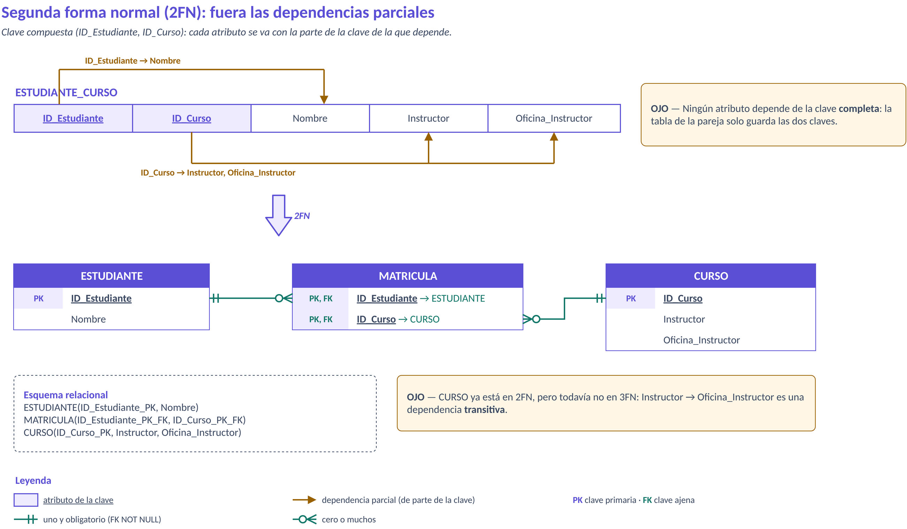

:::: {.g2}
::: {.tb}
**ESTUDIANTE**

| ID_Estudiante | Nombre |
|---|---|
| 1 | Alice |
| 2 | Bob |
:::

::: {.tb}
**MATRICULA**

| ID_Estudiante | ID_Curso |
|---|---|
| 1 | 101 |
| 1 | 102 |
| 2 | 101 |
| 2 | 103 |
:::
::::

::: {.tb}
**CURSO**

| ID_Curso | Instructor | Oficina_Instructor |
|---|---|---|
| 101 | Dr. Smith | Aula 101 |
| 102 | Dr. Jones | Aula 102 |
| 103 | Dr. Brown | Aula 103 |
:::

```text
ESTUDIANTE(ID_Estudiante_PK, Nombre)
MATRICULA(ID_Estudiante_PK_FK, ID_Curso_PK_FK)
CURSO(ID_Curso_PK, Instructor, Oficina_Instructor)
```

!!! ojo "Ojo"
    Un error típico es dejar `Nombre` en la tabla de la pareja: `(ID_Estudiante, ID_Curso, Nombre)`. Esa tabla sigue sin estar en 2FN, porque `Nombre` sigue dependiendo solo de `ID_Estudiante` y se repite en cada curso del estudiante.

Las tres tablas están en 2FN. Pero `CURSO` todavía esconde un problema: el despacho es del instructor, no del curso. Lo resolverás en el bloque 11.

!!! comprueba "Comprueba"
    1. ¿Qué tiene que cumplir una tabla para estar en 2FN?
    2. ¿Por qué una tabla en 1FN con clave simple ya está en 2FN?
    3. En `LIBRO(Título_libro_PK, Num_ejemplar_PK, Autor, Editorial, Precio)`, ¿qué atributo rompe la 2FN? Normalízala.
    4. Después de normalizar, ¿qué columnas de `MATRICULA` son clave ajena y a qué tablas apuntan?

# Bloque 11. Tercera forma normal (3FN)

## 11.1 Definición

!!! definicion "Definición"
    Una tabla está en **tercera forma normal (3FN)** si, y solo si, está en 2FN y **ningún atributo que no forma parte de la clave primaria depende transitivamente de ella**. Dicho de otro modo: ningún atributo no clave depende de otro atributo no clave.

## 11.2 Cómo se consigue la 3FN

1. Busca las **dependencias transitivas**: `clave → B → C`, donde B y C no son clave.
2. Deja en la tabla inicial los atributos que **no** dependen transitivamente de la clave. Esta tabla ya está en 3FN.
3. Con el resto, crea otra tabla con los dos atributos no clave que forman la dependencia transitiva (B y C). Elige como clave primaria el **determinante** (B), siempre que cumpla los requisitos de una clave primaria (valores únicos y nunca nulos).
4. Si el determinante no sirve como clave primaria, mete los dos atributos en la tabla nueva y añade un **identificador nuevo** (por ejemplo, un número autoincremental) como clave primaria.
5. En la tabla inicial, B se queda como **clave ajena** hacia la tabla nueva.
6. Comprueba que tanto la tabla inicial como la nueva están en 3FN.

!!! ojo "Ojo"
    En la tabla inicial **se queda** el determinante (B), ahora como clave ajena. Lo que se va es lo que dependía de él (C). Si quitas también B, pierdes la relación entre las dos tablas.

## 11.3 Ejemplo: empleados y departamentos

Volvemos a la tabla del bloque 7. Su clave es `Employee_ID`, un solo atributo, así que está en 2FN. Pero tiene una dependencia transitiva:

```text
Employee_ID → Department → Department_Location
```

`Department_Location` no describe al empleado, sino a su departamento. Por eso se repite y provoca las tres anomalías que viste en 7.2.

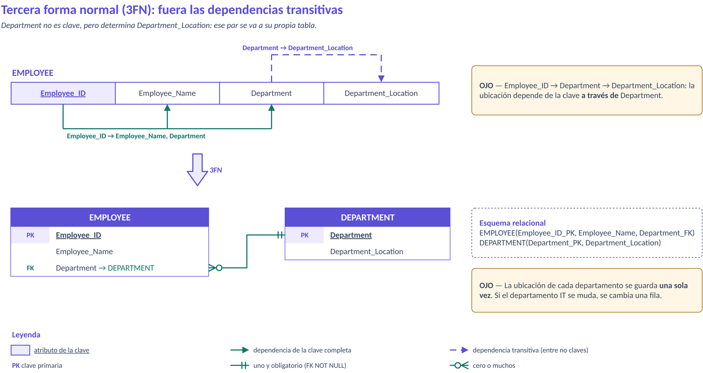

:::: {.g2}
::: {.tb}
**EMPLOYEE**

| Employee_ID | Employee_Name | Department |
|---|---|---|
| 1 | Alice | HR |
| 2 | Bob | HR |
| 3 | Charlie | IT |
| 4 | David | IT |
| 5 | Eve | Finance |
:::

::: {.tb}
**DEPARTMENT**

| Department | Department_Location |
|---|---|
| HR | Building A |
| IT | Building B |
| Finance | Building C |
:::
::::

```text
EMPLOYEE(Employee_ID_PK, Employee_Name, Department_FK)
DEPARTMENT(Department_PK, Department_Location)
```

Repasa las anomalías: Marketing ya se puede dar de alta sin empleados; si IT se muda, se cambia una sola fila; y si Eve se va, `Finance` sigue en el Building C.

!!! ejemplo "Ejemplo"
    Así quedan las dos tablas en SQL. `EMPLOYEE` se crea después de `DEPARTMENT`, porque su clave ajena apunta a ella:

```sql
CREATE TABLE DEPARTMENT (
  Department VARCHAR(30) PRIMARY KEY,
  Department_Location VARCHAR(30)
);
CREATE TABLE EMPLOYEE (
  Employee_ID INT PRIMARY KEY,
  Employee_Name VARCHAR(50),
  Department VARCHAR(30) NOT NULL,
  FOREIGN KEY (Department) REFERENCES DEPARTMENT(Department)
);
```

## 11.4 El ejemplo de la matrícula, terminado

En el bloque 10 la tabla `CURSO(ID_Curso_PK, Instructor, Oficina_Instructor)` quedaba en 2FN. Pero cada instructor tiene su despacho, sea cual sea el curso:

```text
ID_Curso → Instructor → Oficina_Instructor
```

Es una dependencia transitiva: `Oficina_Instructor` se va con `Instructor` a una tabla nueva, e `Instructor` se queda en `CURSO` como clave ajena.

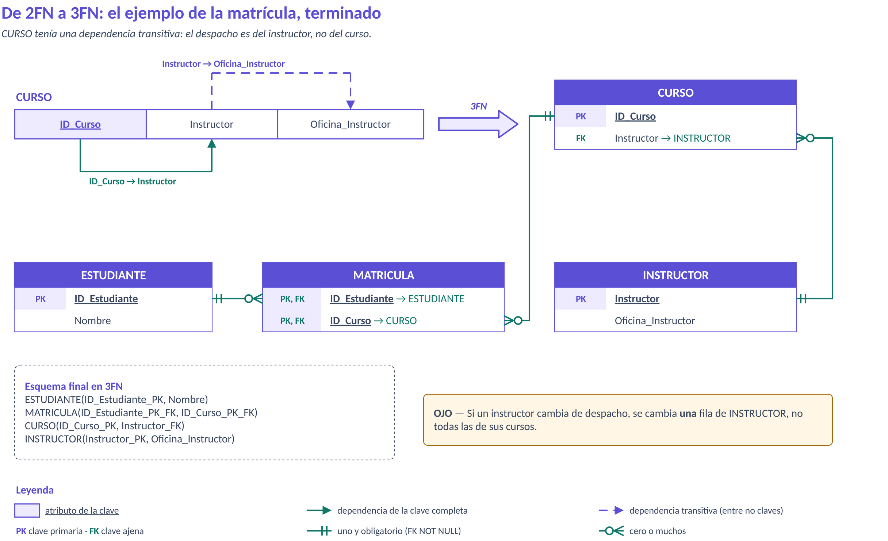

```text
ESTUDIANTE(ID_Estudiante_PK, Nombre)
MATRICULA(ID_Estudiante_PK_FK, ID_Curso_PK_FK)
CURSO(ID_Curso_PK, Instructor_FK)
INSTRUCTOR(Instructor_PK, Oficina_Instructor)
```

!!! ojo "Ojo"
    Aquí `Instructor` sirve como clave primaria porque suponemos que no hay dos instructores con el mismo nombre. En una base de datos real usarías un identificador (`ID_Instructor`), justo lo que dice el paso 4 de 11.2.

## 11.5 Las tres formas normales, de un vistazo

| Forma normal | Qué prohíbe | Pregunta que te haces | Cómo se arregla |
|---|---|---|---|
| **1FN** | Valores múltiples y grupos repetitivos | ¿Hay alguna celda con varios valores o columnas repetidas? | Tabla aparte para el atributo multivaluado, con clave ajena |
| **2FN** | Dependencias parciales | ¿Algún atributo depende solo de una parte de la clave? | Tabla para cada parte de la clave con sus atributos |
| **3FN** | Dependencias transitivas | ¿Algún atributo no clave depende de otro no clave? | Tabla para el determinante y lo que determina; el determinante queda como FK |

Más allá de la 3FN están la **forma normal de Boyce-Codd (FNBC)** y las formas cuarta, quinta y dominio-clave. La FNBC es una versión más estricta de la 3FN: exige que **todo determinante sea clave candidata**. Casi todas las tablas en 3FN ya cumplen la FNBC, y en este módulo no iremos más allá.

!!! comprueba "Comprueba"
    1. ¿Qué tiene que cumplir una tabla para estar en 3FN?
    2. En la normalización a 3FN, ¿qué atributo se queda en la tabla inicial como clave ajena?
    3. Normaliza `ALUMNO(NIA_PK, Nombre, CodCiclo, NombreCiclo)` hasta la 3FN.
    4. ¿Qué haces si el determinante de la dependencia transitiva no sirve como clave primaria?
    5. Lleva `EMPLEADO` (bloque 8) hasta la 3FN.

# Material de repaso

## Glosario

| Término | Significado |
|---|---|
| **1FN** | Valores atómicos, sin grupos repetitivos y con clave primaria. |
| **2FN** | 1FN y sin dependencias parciales. |
| **3FN** | 2FN y sin dependencias transitivas. |
| **Anomalía** | Problema al insertar, modificar o borrar datos causado por información repetida o mezclada. |
| **Atributo compuesto** | Atributo formado por otros más simples (`address` = `city` + `street` + `zip_code`). Se descompone en columnas. |
| **Atributo derivado** | Atributo que se calcula a partir de otros. Normalmente no se guarda. |
| **Atributo multivaluado** | Atributo que puede tener varios valores para la misma ocurrencia. Da una tabla aparte. |
| **Atómico** | Valor indivisible: una sola cosa por celda. |
| **Clave ajena (FK)** | Columna cuyos valores deben existir como clave primaria en otra tabla. Enlaza tablas. En el esquema lleva el sufijo `_FK`. |
| **Clave alternativa** | Clave candidata que no se ha elegido como primaria. En SQL, `UNIQUE`. |
| **Clave candidata** | Atributo o grupo mínimo de atributos que identifica cada fila. |
| **Clave parcial** | Atributo que distingue las ocurrencias de una entidad débil dentro de una misma propietaria. |
| **Clave primaria (PK)** | Clave candidata elegida para identificar cada fila. En el esquema lleva el sufijo `_PK`. |
| **Dependencia completa** | B depende de toda la clave compuesta y de ninguna parte suya. |
| **Dependencia funcional** | B depende de A si cada valor de A va siempre con un único valor de B. Se escribe `A → B`. |
| **Dependencia parcial** | B depende solo de una parte de la clave compuesta. |
| **Dependencia transitiva** | A → B → C con B no clave: C depende de A a través de B. |
| **Determinante** | Atributo (o conjunto) del que depende otro: en `A → B`, A. |
| **Diseño conceptual** | Fase del diseño en la que se dibuja el diagrama E/R. |
| **Diseño lógico** | Fase del diseño en la que se obtiene el esquema relacional. |
| **Entidad débil por existencia** | Entidad que no puede existir sin su propietaria pero tiene clave propia. |
| **Entidad débil por identificación** | Entidad que necesita la clave de su propietaria para identificarse. |
| **Entidad fuerte** | Entidad que existe y se identifica por sí misma. |
| **Entidad propietaria** | Entidad fuerte de la que depende una entidad débil. |
| **Esquema relacional** | Conjunto de tablas con sus columnas, claves primarias y claves ajenas. |
| **FNBC** | Forma normal de Boyce-Codd: todo determinante es clave candidata. |
| **Forma normal** | Conjunto de requisitos que cumple una tabla en una etapa de la normalización. |
| **Fusionar** | Meter una tabla de relación dentro de una de las tablas de entidad, añadiendo una clave ajena. |
| **Grupo repetitivo** | Columnas que repiten el mismo dato (`Teléfono_1`, `Teléfono_2`…) o celdas con varios valores. |
| **Jerarquía (ISA)** | Relación entre un supertipo y sus subtipos, que heredan sus atributos. |
| **Normalización** | Proceso que aplica reglas sucesivas a las tablas para quitar redundancia y anomalías. |
| **Redundancia** | Guardar el mismo dato en varios sitios. |
| **Relación reflexiva** | Relación de una entidad consigo misma. |
| **Relación ternaria** | Relación que une tres entidades. |
| **Tabla de intersección** | Tabla que representa una relación N:M; su clave es la combinación de las dos claves. |

## Mapa resumen

Transformación al modelo relacional:

```text
DIAGRAMA E/R  ──(transformar)──►  ESQUEMA RELACIONAL
Pasos: 1 entidad → tabla · 2 elegir PK · 3 relación → tabla
       4 elegir PK de la relación · 5 fusionar si se puede

ENTIDADES
  Fuerte ............ tabla; compuestos → sus componentes
  Débil por ID ...... PK = PK propietaria + clave parcial
  Débil por E ....... PK propia + FK a propietaria NOT NULL
ATRIBUTOS
  Multivaluado ...... tabla aparte (id, valor, FK al padre)
RELACIONES BINARIAS
  N:M ............... tabla puente, PK = (id_A, id_B)
  1:N ............... PK del lado 1 → FK en el lado N
  1:1 ............... FK UNIQUE en el lado obligatorio
                      obligatoria por los 2 lados → 1 tabla
REFLEXIVA ........... dos papeles → método binario
                      1:N → FK hacia la propia tabla
TERNARIA ............ tabla con las 3 FK
  N:M:P → PK 3 FK · 1:N:M → PK sin la del lado 1
  1:1:N / 1:1:1 → PK de 2 FK (varias candidatas)
JERARQUÍA ........... tabla por entidad;
                      PK subtipo = PK supertipo (y FK)
```

Normalización:

```text
DIAGRAMA E/R ──(transformar)──► TABLAS ──(normalizar)──► TABLAS EN 3FN

DEPENDENCIAS
  A → B ............ A determina B (un valor de A, un valor de B)
  completa ......... depende de TODA la clave compuesta
  parcial .......... depende de una PARTE de la clave   → rompe 2FN
  transitiva ....... clave → B → C (B no clave)         → rompe 3FN

1FN  valores atómicos, sin grupos repetitivos, con PK
     arreglo: multivaluado → tabla aparte con FK (_PK_FK)
2FN  1FN + sin dependencias parciales
     clave simple → ya está en 2FN
     arreglo: cada parte de la clave → su tabla; la pareja queda _PK_FK
3FN  2FN + sin dependencias transitivas
     arreglo: (B, C) → tabla nueva con B_PK; B se queda como _FK
FNBC, 4FN, 5FN, FNDK: más exigentes (fuera del módulo)
```

## Autoevaluación

### Parte 1. Transformación

**Preguntas cortas**

1. ¿Qué diferencia hay entre una relación del diagrama E/R y una relación (tabla) del modelo relacional?
2. ¿Por qué la clave primaria de una entidad débil por identificación tiene, como mínimo, dos columnas?
3. Explica con tus palabras la regla de la relación 1:N.
4. ¿Qué tiene de especial la clave ajena de una relación reflexiva?

**Tipo test** (una respuesta correcta)

5. Una relación N:M entre `LIBRO` y `AUTOR` da lugar a:
   a) dos tablas, con la clave de `AUTOR` en `LIBRO`; b) tres tablas; c) una sola tabla; d) dos tablas, con la clave de `LIBRO` en `AUTOR`.
6. El atributo compuesto `direccion` (calle, numero, cp) de `CLIENTE` se transforma en:
   a) una tabla `DIRECCION`; b) una columna `direccion`; c) tres columnas `calle`, `numero` y `cp` en `CLIENTE`; d) una clave ajena.
7. En una ternaria 1:N:M, la clave primaria está formada por:
   a) las tres claves ajenas; b) las claves de los lados N y M; c) la clave del lado 1; d) un ID nuevo.
8. En una jerarquía, la clave primaria de la tabla de un subtipo es:
   a) un ID nuevo; b) la clave del supertipo, que además es FK; c) la clave del supertipo más una clave parcial; d) no tiene clave.

**Razona**

9. Transforma este diagrama: `CLIENTE` (`dni`, `nombre`, `telefonos` multivaluado) *realiza* `PEDIDO` (`numPedido`, `fecha`), una 1:N en la que cada pedido es de exactamente un cliente y un cliente puede hacer cero o muchos pedidos; `PEDIDO` *contiene* `PRODUCTO` (`codProd`, `precio`), una N:M con el atributo `cantidad` en la que un pedido tiene uno o muchos productos y un producto puede estar en cero o muchos pedidos.
10. Un `EMPLEADO` tiene como mucho una `TAQUILLA` y cada taquilla es de como mucho un empleado; hay empleados sin taquilla y taquillas libres. ¿Dónde pones la clave ajena? ¿Qué restricciones le pones?

### Parte 2. Normalización

**Preguntas cortas**

1. ¿Qué es la normalización y cuándo se aplica?
2. Explica la diferencia entre dependencia completa y parcial.
3. ¿Qué condición tiene que cumplir B en `A → B → C` para que la dependencia sea transitiva?
4. ¿Qué tres anomalías evita la normalización? Pon un ejemplo de una.

**Tipo test** (una respuesta correcta)

5. Una tabla en 1FN con clave primaria simple…
    a) nunca está en 2FN. b) siempre está en 2FN. c) siempre está en 3FN. d) no puede tener claves ajenas.
6. En `FACTURA(NumFactura_PK, Fecha, DNI_Cliente, NombreCliente)`, la dependencia `NumFactura → DNI_Cliente → NombreCliente` es…
    a) parcial. b) completa. c) transitiva. d) multivaluada.
7. ¿Qué forma normal incumple una tabla con las columnas `Telefono1`, `Telefono2` y `Telefono3`?
    a) 1FN. b) 2FN. c) 3FN. d) Ninguna.
8. Al pasar a 3FN, el determinante de la dependencia transitiva…
    a) desaparece de la tabla inicial. b) se queda en la tabla inicial como clave ajena. c) pasa a ser la clave primaria de la tabla inicial. d) se duplica en todas las tablas.

**Razonar**

9. Normaliza hasta la 3FN la tabla `PRESTAMO(Num_socio_PK, ISBN_PK, Fecha_prestamo, Nombre_socio, Titulo, Cod_editorial, Nombre_editorial)`. Cada socio tiene un nombre; cada libro (ISBN) tiene un título y una editorial, y cada editorial tiene un nombre. Indica en cada paso qué dependencias quitas.
10. Un compañero dice: «Si mi diagrama E/R está bien, no hace falta normalizar». ¿Tiene razón? Explica qué aporta la normalización aunque el diagrama esté bien.
